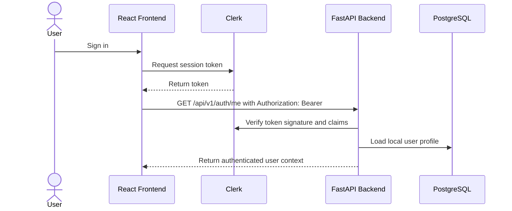
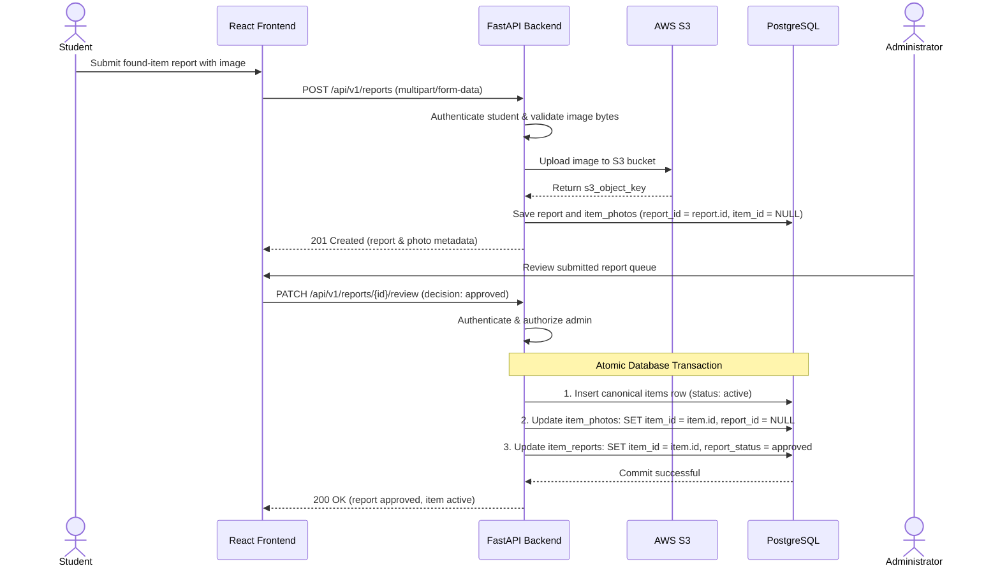
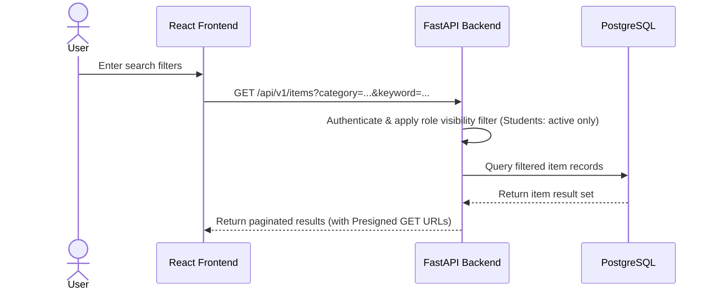
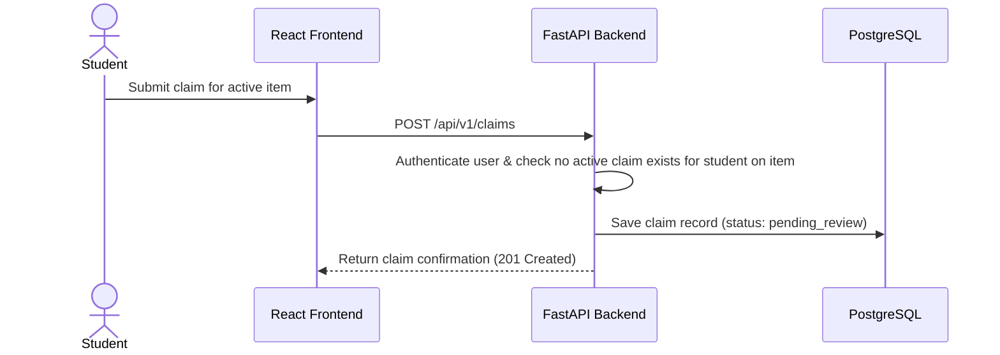
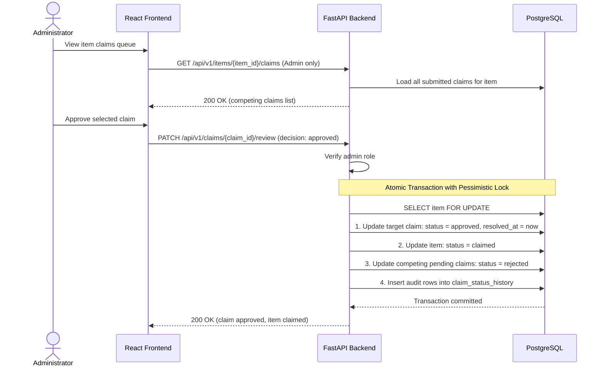
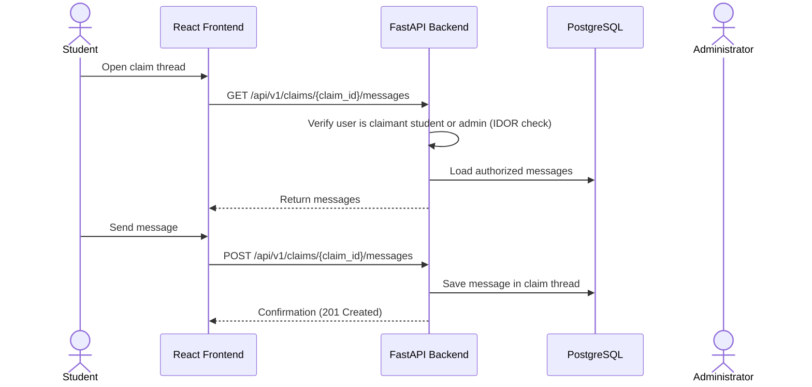
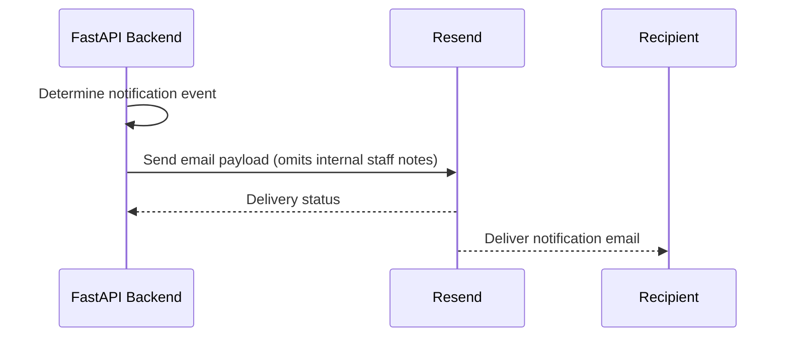
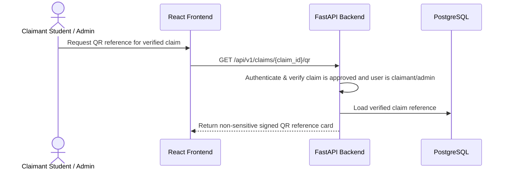

# API Design Documentation

## 1. Introduction and Purpose

The Item Finder / Campus Lost-and-Found Retrieval System uses a FastAPI backend to expose a RESTful API for the ReactJS frontend. This API design document describes the proposed API layer that supports the workflows defined in the system architecture and database design documents. It is a pre-implementation specification for an undergraduate capstone project and is intended to guide later implementation of routers, Pydantic schemas, authorization logic, and database interactions.

The API is designed around the following core responsibilities:

- authenticate users through Clerk and map them to local application profiles
- manage item records and item status transitions
- submit, review, and manage found or missing item reports
- support item search and filtering
- handle claim submission and administrative verification
- maintain private claim communication threads
- store and reference item photo metadata associated with AWS S3 objects
- trigger internal email notifications through Resend
- generate QR references for verified claim workflows

The API remains consistent with the approved technology stack:

- FastAPI
- Python
- Pydantic
- SQLAlchemy ORM
- PostgreSQL on Neon
- Clerk for identity authentication
- AWS S3 for object storage
- Resend for email delivery

The design does not claim that the API has already been implemented. It describes the proposed structure and should be treated as an implementation guide, not as existing application behavior.

---

## 2. API Architecture and Design Principles

The API follows RESTful resource-oriented design and is organized into modular router groups under a versioned base path. The system uses /api/v1 as the proposed API prefix, subject to confirmation during implementation.

The API design is guided by the following principles:

- resource-oriented endpoints using lowercase plural nouns
- correct use of HTTP methods and status codes
- backend-enforced authentication and authorization
- validation of all incoming payloads with Pydantic
- consistent JSON request and response schemas
- support for pagination, filtering, and sorting where expected
- ownership checks before mutation or retrieval of restricted resources
- clear separation between routers, schemas, service logic, and database access
- secure handling of file upload and sensitive claim conversations

The FastAPI backend acts as the central authority for application logic. It validates Clerk-issued tokens, resolves the associated local user profile, checks authorization, and applies ownership and business rules before accessing PostgreSQL or interacting with external services.

---

## 3. API Base URL and Versioning

The proposed base path is:

- /api/v1

This version prefix provides a stable foundation for future API changes while allowing separate routing for future versions if needed.

Example resource pattern:

- /api/v1/items
- /api/v1/reports
- /api/v1/claims
- /api/v1/claims/{claim_id}/messages
- /api/v1/items/{item_id}/photos

Versioning remains a proposal and may be confirmed later in implementation planning.

---

## 4. Authentication and Authorization

### 4.1 Authentication Model

The architecture separates authentication and authorization as two distinct concerns:

1. Clerk handles authentication and identity verification.
2. FastAPI verifies the Clerk session token and determines the authenticated user.
3. FastAPI retrieves the corresponding local user profile from PostgreSQL.
4. FastAPI enforces backend authorization based on role and resource ownership.

The frontend obtains a valid Clerk session token. The frontend includes this token in the HTTP Authorization header using Bearer authentication. The backend then validates the token signature and claims using the appropriate Clerk verification mechanism.

The backend must not trust user-supplied identifiers from the frontend without server-side validation. For example, a user-provided user_id or item_id is treated as untrusted input until the backend verifies the authenticated session and checks the resource access rules.

### 4.2 Authorization Model

Authorization is enforced in the backend using:

- user role checks
- resource ownership checks
- claim-participation checks
- administrator review permissions
- operation-specific authorization rules

Examples:

- Students can manage their own reports and claims.
- Administrators can review item reports, claims, and claim status transitions.
- Only authorized users can read or send private claim messages.
- Item status changes are restricted to valid administrators or authorized workflows.

### 4.3 Authentication and Authorization Failure

The API should differentiate between:

- authentication failure: invalid or missing token
- authorization failure: token valid, but operation not permitted
- validation error: malformed or incomplete request
- resource not found: entity does not exist or is not visible
- business conflict: invalid state transition or duplicate action

This distinction supports security and debugging without exposing internal details.

### 4.4 Clerk Identity and Local User Profile

Clerk is the source of identity, while the local PostgreSQL users table stores the application profile. The backend maps the verified Clerk identity to the local application user row using the external Clerk user identifier. The local user record stores the application role, status, and user-scoped metadata. This ensures that the system is not dependent on raw browser state or frontend identity claims.

> (assumed) The exact mapping logic for Clerk identity to the local user profile remains to be validated during implementation.

---

## 5. User Roles and Permission Matrix

The system defines two primary roles:

- `student`: Standard campus user authenticated through Clerk.
- `administrator`: Campus staff member authorized for moderation, claim review, and item management. Assigned exclusively through controlled backend bootstrap / database seeding (`INITIAL_ADMIN_EMAIL`), never through user-controlled client requests or public Clerk metadata.

| Resource / Action | Student | Administrator |
|---|---|---|
| View own profile (`/users/me`) | Yes | Yes |
| Update own profile (`/users/me`) | Yes, permitted fields | Yes, permitted fields |
| Submit found/missing report (`POST /reports`) | Yes | Yes |
| Cancel own pending report (`PATCH /reports/{id}/cancel`) | Yes (own report only) | No |
| Upload photo to report (`POST /reports/{id}/photos`) | Yes (own report only) | Yes |
| Browse public items (`GET /items`, `GET /items/search`) | Yes (active items only) | Yes (all item statuses) |
| Retrieve item details (`GET /items/{id}`) | Yes (active items only) | Yes (all items) |
| Manually record found item (`POST /items`) | No | Yes |
| Update item details / status (`PATCH /items/{id}`) | No | Yes |
| Submit claim (`POST /claims`) | Yes (active items only) | No |
| Withdraw own claim (`PATCH /claims/{id}/withdraw`) | Yes (own claim only) | No |
| View own claims (`GET /users/me/claims`) | Yes | Yes |
| View item claims queue (`GET /items/{id}/claims`) | **No (Forbidden / IDOR protection)** | **Yes** |
| Review / approve / reject report (`PATCH /reports/{id}/review`) | No | Yes |
| Review / approve / reject claim (`PATCH /claims/{id}/review`) | No | Yes |
| Access private claim messages (`/claims/{id}/messages`) | Yes (claimant only) | Yes (authorized staff) |
| Send private claim message (`/claims/{id}/messages`) | Yes (claimant only) | Yes (authorized staff) |
| View claim status history (`/claims/{id}/status-history`) | Yes (redacted, no staff notes) | Yes (full audit notes) |
| Generate QR reference for approved claim | Yes (own claim only) | Yes |
| Automated QR Redemption (`/claims/redeem`) | **Deferred from MVP** | **Deferred from MVP** |
| Receive email notifications via Resend | Yes | Yes |

---

## 6. API Module and Endpoint Inventory

The API is organized into modular router groups under `/api/v1`:

### 6.1 Authentication and User Profile

| Endpoint | Method | Purpose | Roles |
|---|---|---|---|
| `/api/v1/auth/me` | GET | Return authenticated user context and resolve local profile | Student, Administrator |
| `/api/v1/users/me` | GET | Return the current application profile | Student, Administrator |
| `/api/v1/users/me` | PATCH | Update permitted profile information (e.g. phone) | Student, Administrator |
| `/api/v1/users` | GET | Retrieve user directory (administrative view) | Administrator |
| `/api/v1/users/{user_id}` | GET | Retrieve specific user profile | Administrator or self |

### 6.2 Item Management

| Endpoint | Method | Purpose | Roles |
|---|---|---|---|
| `/api/v1/items` | GET | Retrieve item listings with filters and pagination (Students: active only; Admins: all) | Student, Administrator |
| `/api/v1/items` | POST | Manually create a canonical item turned in directly to staff | Administrator |
| `/api/v1/items/{item_id}` | GET | Retrieve item details (Students: active only) | Student, Administrator |
| `/api/v1/items/{item_id}` | PATCH | Update canonical item metadata | Administrator |
| `/api/v1/items/{item_id}/status` | PATCH | Update item status (`active`, `claimed`, `resolved`, `archived`) | Administrator |
| `/api/v1/items/{item_id}/photos` | GET | Retrieve item photos with short-lived S3 Presigned GET URLs | Student, Administrator |

### 6.3 Found and Missing Item Reporting

| Endpoint | Method | Purpose | Roles |
|---|---|---|---|
| `/api/v1/reports` | POST | Submit found/missing report (supports multipart photo upload) | Student, Administrator |
| `/api/v1/reports` | GET | Retrieve submitted reports queue | Administrator |
| `/api/v1/reports/{report_id}` | GET | Retrieve report details | Administrator, or submitting user |
| `/api/v1/users/me/reports` | GET | Retrieve the authenticated user’s submitted reports | Student, Administrator |
| `/api/v1/reports/{report_id}` | PATCH | Update editable report fields (while pending) | Submitting user, Administrator |
| `/api/v1/reports/{report_id}/cancel` | PATCH | Cancel user-submitted report before review | Submitting user |
| `/api/v1/reports/{report_id}/photos` | POST | Attach additional photo to submitted report | Submitting user, Administrator |
| `/api/v1/reports/{report_id}/review` | PATCH | Approve or reject report (promotes found report to item) | Administrator |

### 6.4 Search and Filtering

| Endpoint | Method | Purpose | Roles |
|---|---|---|---|
| `/api/v1/items/search` | GET | Search items by keyword, category, location (enforces active-only for students) | Student, Administrator |
| `/api/v1/items` | GET | Filter catalog listings with query parameters | Student, Administrator |

### 6.5 Claim Submission and Verification

| Endpoint | Method | Purpose | Roles |
|---|---|---|---|
| `/api/v1/claims` | POST | Submit ownership claim against an active item | Student |
| `/api/v1/users/me/claims` | GET | Retrieve authenticated student’s claims | Student |
| `/api/v1/claims/{claim_id}` | GET | Retrieve claim details (omits internal staff review notes for students) | Claimant Student, Administrator |
| `/api/v1/claims/{claim_id}/withdraw` | PATCH | Voluntarily withdraw pending claim | Claimant Student |
| `/api/v1/items/{item_id}/claims` | GET | Retrieve all competing claims for an item | **Administrator strictly** |
| `/api/v1/claims/{claim_id}/review` | PATCH | Approve or reject claim (atomic resolution of competing claims) | Administrator |
| `/api/v1/claims/{claim_id}/status-history` | GET | Retrieve claim audit history (internal notes redacted for students) | Claimant Student, Administrator |

### 6.6 Private Claim Communication

| Endpoint | Method | Purpose | Roles |
|---|---|---|---|
| `/api/v1/claims/{claim_id}/messages` | GET | Retrieve private message thread for claim | Claimant Student, Administrator |
| `/api/v1/claims/{claim_id}/messages` | POST | Send message in claim conversation | Claimant Student, Administrator |

### 6.7 Item Photo Management

| Endpoint | Method | Purpose | Roles |
|---|---|---|---|
| `/api/v1/items/{item_id}/photos` | POST | Upload a photo directly to a canonical item | Administrator |
| `/api/v1/items/{item_id}/photos/{photo_id}` | GET | Retrieve photo metadata and S3 Presigned GET URL | Student, Administrator |
| `/api/v1/items/{item_id}/photos/{photo_id}` | DELETE | Remove an item photo | Administrator |
| `/api/v1/items/{item_id}/photos/{photo_id}/primary`| PATCH | Set photo as primary catalog image | Administrator |

### 6.8 QR Code Generation (Redemption Deferred)

| Endpoint | Method | Purpose | Roles |
|---|---|---|---|
| `/api/v1/claims/{claim_id}/qr` | GET | Retrieve non-sensitive signed QR reference card for approved claim | Claimant Student, Administrator |

> **Scope Note:** Automated QR code scanning and redemption (`POST /api/v1/claims/redeem`) is explicitly **deferred** from the initial MVP release. Handover confirmation is conducted directly by administrators in the web portal via `/api/v1/items/{item_id}/status`.

### 6.9 Email Notification

The notification feature is implemented as a backend service integration rather than a public user-facing API. Resend is called by the backend after relevant events occur. No direct frontend endpoint is required for Resend communication.

---

## 7. Detailed Endpoint Specifications

### 7.1 Authentication and Current User

| Field | Description |
|---|---|
| Endpoint | /api/v1/auth/me |
| HTTP Method | GET |
| Purpose | Returns the authenticated user identity and application profile |
| Authentication | Required |
| Allowed Roles | Student, Administrator |
| Request Parameters | None |
| Request Schema | None |
| Response | Authenticated user summary |
| Success Status | 200 OK |
| Error Statuses | 401 Unauthorized, 500 Internal Server Error |

### 7.2 Item Listing and Search

| Field | Description |
|---|---|
| Endpoint | /api/v1/items |
| HTTP Method | GET |
| Purpose | Lists records with filters and pagination. Backend automatically filters `item_status = 'active'` for students; administrators may filter by any status |
| Authentication | Required |
| Allowed Roles | Student, Administrator |
| Request Parameters | Query string: category, status (admin only), location, keyword, page, page_size, sort |
| Request Schema | Query parameters only |
| Response | Paginated list of item summaries (students only see active catalog items) |
| Success Status | 200 OK |
| Error Statuses | 400 Bad Request, 401 Unauthorized, 403 Forbidden, 500 Internal Server Error |

### 7.3 Found/ Missing Item Report Submission

| Field | Description |
|---|---|
| Endpoint | /api/v1/reports |
| HTTP Method | POST |
| Purpose | Creates a missing-item or found-item report, with optional initial photograph upload |
| Authentication | Required |
| Allowed Roles | Student, Administrator |
| Request Format | `multipart/form-data` |
| Request Schema | `report_type` (`found` or `missing`), `title`, `description`, `location`, `reported_date`, optional `photo` (file, max 5 MB, JPEG/PNG/WebP) |
| Behavior | Stores report in `item_reports` (status: `pending_review`). If photo is provided, validates magic bytes, uploads to S3, and stores metadata in `item_photos` linked via `report_id = report.id, item_id = NULL` |
| Response | Created report record with attached photo metadata |
| Success Status | 201 Created |
| Error Statuses | 400 Bad Request, 401 Unauthorized, 413 Content Too Large, 415 Unsupported Media Type, 422 Unprocessable Entity, 500 Internal Server Error |

### 7.3b Direct Manual Item Creation

| Field | Description |
|---|---|
| Endpoint | /api/v1/items |
| HTTP Method | POST |
| Purpose | Allows administrators to directly record physical found items turned in to campus desks |
| Authentication | Required |
| Allowed Roles | **Administrator strictly** |
| Request Schema | `title`, `category`, `description`, `location_found_or_lost`, `found_date` |
| Behavior | Directly creates canonical `items` record with `item_status = 'active'` |
| Response | Created canonical item record |
| Success Status | 201 Created |
| Error Statuses | 400 Bad Request, 401 Unauthorized, 403 Forbidden, 422 Unprocessable Entity |

### 7.4 Claim Submission

| Field | Description |
|---|---|
| Endpoint | /api/v1/claims |
| HTTP Method | POST |
| Purpose | Submits an ownership claim against an active canonical item |
| Authentication | Required |
| Allowed Roles | Student |
| Request Schema | `item_id`, `claim_message` |
| Behavior | Validates target item is `active`. Checks that student does not already have an active/pending claim on this item. Creates claim with status `pending_review`. Multiple students may submit claims against the same item |
| Response | Created claim record |
| Success Status | 201 Created |
| Error Statuses | 400 Bad Request, 401 Unauthorized, 403 Forbidden, 404 Not Found (item not active/found), 409 Conflict (duplicate active claim), 422 Unprocessable Entity |

### 7.5 Claim Review and Competing Claims Resolution

| Field | Description |
|---|---|
| Endpoint | /api/v1/claims/{claim_id}/review |
| HTTP Method | PATCH |
| Purpose | Approves or rejects a claim. Approving a claim atomically resolves competing claims |
| Authentication | Required |
| Allowed Roles | **Administrator strictly** |
| Request Parameters | Path param: `claim_id`; body: `decision` (`approved` or `rejected`), `review_note` (internal audit rationale) |
| Behavior | In an atomic transaction with pessimistic locking (`SELECT ... FOR UPDATE` on `items`):<br>1. Updates target claim status to `approved` or `rejected`.<br>2. If approved: updates item status to `claimed`, and automatically updates all other pending claims on that item to `rejected` (with note `'Competing claim approved'`).<br>3. Records entries in `claim_status_history`.<br>If another admin approved a competing claim first, returns 409 Conflict |
| Response | Updated claim record and verification outcome |
| Success Status | 200 OK |
| Error Statuses | 400 Bad Request, 401 Unauthorized, 403 Forbidden, 404 Not Found, 409 Conflict (item already claimed), 422 Unprocessable Entity |

### 7.5b Item Claims Queue

| Field | Description |
|---|---|
| Endpoint | /api/v1/items/{item_id}/claims |
| HTTP Method | GET |
| Purpose | Lists all claims submitted against a specific item for administrative evaluation |
| Authentication | Required |
| Allowed Roles | **Administrator strictly (Students receive 403 Forbidden for IDOR protection)** |
| Response | List of all submitted claims and claimant verification messages |
| Success Status | 200 OK |
| Error Statuses | 401 Unauthorized, 403 Forbidden, 404 Not Found |

### 7.5c Claim Status History

| Field | Description |
|---|---|
| Endpoint | /api/v1/claims/{claim_id}/status-history |
| HTTP Method | GET |
| Purpose | Retrieves lifecycle status transition audit trail for a claim |
| Authentication | Required |
| Allowed Roles | Student (claimant only), Administrator |
| Field-Level Authorization | **For Students:** Returns `previous_status`, `new_status`, `changed_at` (internal staff review notes are omitted/redacted).<br>**For Administrators:** Returns full audit record including staff `note` |
| Success Status | 200 OK |
| Error Statuses | 401 Unauthorized, 403 Forbidden (not owner/admin), 404 Not Found |

### 7.6 Private Message Submission

| Field | Description |
|---|---|
| Endpoint | /api/v1/claims/{claim_id}/messages |
| HTTP Method | POST |
| Purpose | Sends a message in an authorized claim thread |
| Authentication | Required |
| Allowed Roles | Student (claimant only), Administrator |
| Request Parameters | Path param: claim_id; body: content |
| Request Schema | content |
| Response | Created message record |
| Success Status | 201 Created |
| Error Statuses | 401 Unauthorized, 403 Forbidden (not claim owner/admin), 404 Not Found, 422 Unprocessable Entity |

### 7.7 Item Photo Upload

| Field | Description |
|---|---|
| Endpoint | /api/v1/items/{item_id}/photos |
| HTTP Method | POST |
| Purpose | Uploads and stores photo metadata directly attached to a canonical item |
| Authentication | Required |
| Allowed Roles | **Administrator** |
| Request Parameters | Path param: item_id; multipart form data |
| Request Schema | file, optional is_primary |
| Response | Photo metadata record including temporary S3 Presigned GET URL |
| Success Status | 201 Created |
| Error Statuses | 400 Bad Request, 401 Unauthorized, 403 Forbidden, 413 Content Too Large, 415 Unsupported Media Type, 422 Unprocessable Entity |

---

## 8. Request and Response Schemas

The following schemas illustrate representative examples. They are not implementation code and should align with the database design and role model.

### 8.1 User Profile Response Example

```json
{
  "id": "2f4b1d8a-6f8b-449d-b0ae-fd6d2d2f8d53",
  "clerk_user_id": "user_21Hj7c7Q4p4b8f7E1d0r",
  "email": "student@campus.edu",
  "role": "student",
  "is_active": true,
  "created_at": "2026-11-05T10:00:00Z",
  "updated_at": "2026-11-05T10:00:00Z"
}
```

### 8.2 Found-Item Report Submission Request Example

```json
{
  "report_type": "found",
  "title": "Blue Water Bottle Found",
  "description": "Blue stainless steel water bottle found near the library entrance.",
  "location": "Library Entrance",
  "reported_date": "2026-11-05",
  "category": "water bottle",
  "item_metadata": {
    "color": "blue",
    "brand": "Hydro Flask"
  }
}
```

### 8.3 Missing-Item Report Submission Request Example

```json
{
  "report_type": "missing",
  "title": "Missing Smartphone",
  "description": "Black smartphone reported missing near the engineering building.",
  "location": "Engineering Building",
  "reported_date": "2026-11-05",
  "category": "phone",
  "item_metadata": {
    "color": "black",
    "model": "Model X"
  }
}
```

### 8.4 Item Search Response Example

```json
{
  "items": [
    {
      "id": "d88cfe3b-2b3d-44a2-bbe5-f7bc1be9c2c3",
      "title": "Black Smartphone",
      "category": "phone",
      "item_status": "active",
      "location_found_or_lost": "Engineering Building",
      "description": "Black smartphone reported missing.",
      "updated_at": "2026-11-05T10:10:00Z"
    }
  ],
  "page": 1,
  "page_size": 20,
  "total": 1
}
```

### 8.5 Claim Submission Request Example

```json
{
  "item_id": "d88cfe3b-2b3d-44a2-bbe5-f7bc1be9c2c3",
  "claim_message": "This phone matches the one I lost near Engineering Building. It has a black case and a cracked corner."
}
```

### 8.6 Claim Approval / Rejection Example (Admin Request)

```json
{
  "decision": "approved",
  "review_note": "Claimant accurately verified the custom lock-screen wallpaper and described the exact screen scratch."
}
```

### 8.6b Claim Status History Response Examples (Field-Level Authorization)

**Public Student View (`ClaimStatusHistoryPublicResponse`):**
```json
[
  {
    "id": "7a3f4e21-0b5c-4d8e-9f1a-6c2e8b4a9d11",
    "claim_id": "4e53f3a8-a993-4d18-a7ba-35d5d0d0f4d7",
    "previous_status": "pending_review",
    "new_status": "approved",
    "changed_at": "2026-11-05T10:18:00Z"
  }
]
```
*(Notice: `note` containing internal staff review comments is omitted from the public student response).*

**Administrator View (`ClaimStatusHistoryAdminResponse`):**
```json
[
  {
    "id": "7a3f4e21-0b5c-4d8e-9f1a-6c2e8b4a9d11",
    "claim_id": "4e53f3a8-a993-4d18-a7ba-35d5d0d0f4d7",
    "previous_status": "pending_review",
    "new_status": "approved",
    "changed_by_user_id": "2f4b1d8a-6f8b-449d-b0ae-fd6d2d2f8d53",
    "changed_at": "2026-11-05T10:18:00Z",
    "note": "Claimant accurately verified the custom lock-screen wallpaper and described the exact screen scratch."
  }
]
```

### 8.7 Claim Message Submission Example

```json
{
  "content": "Please confirm the item color and location so I can verify ownership."
}
```

### 8.8 Photo Upload Response Example (with Presigned GET URL)

```json
{
  "id": "a4cf61aa-92d2-4d74-b9b0-2a9b68d4b8c5",
  "item_id": "d88cfe3b-2b3d-44a2-bbe5-f7bc1be9c2c3",
  "report_id": null,
  "s3_object_key": "items/d88cfe3b-2b3d-44a2-bbe5-f7bc1be9c2c3/photos/a4cf61aa.jpg",
  "presigned_url": "https://campus-lost-and-found.s3.amazonaws.com/items/d88cfe3b/photos/a4cf61aa.jpg?AWSAccessKeyId=...&Signature=...&Expires=1793876400",
  "original_filename": "photo-1.jpg",
  "mime_type": "image/jpeg",
  "file_size_bytes": 184224,
  "is_primary": true,
  "uploaded_at": "2026-11-05T10:15:00Z"
}
```

### 8.9 QR Reference Response Example (Informational Only — Redemption Deferred)

```json
{
  "claim_id": "4e53f3a8-a993-4d18-a7ba-35d5d0d0f4d7",
  "item_id": "d88cfe3b-2b3d-44a2-bbe5-f7bc1be9c2c3",
  "qr_reference": "signed_ref_eyJhbGciOiJIUzI1NiIsInR5cCI6IkpXVCJ9.4e53f3a8",
  "qr_image_url": "/api/v1/claims/4e53f3a8/qr",
  "status": "informational_only",
  "notice": "Possession of this QR code does not establish ownership. Present student ID at campus lost-and-found desk.",
  "created_at": "2026-11-05T10:20:00Z"
}
```

---

## 9. HTTP Status Codes and Error Handling

The REST API should use a consistent set of HTTP status codes and a uniform error response shape.

| Status Code | Meaning |
|---|---|
| 200 OK | Successful request returning data |
| 201 Created | Resource created successfully |
| 204 No Content | Successful request with no response body |
| 400 Bad Request | Malformed or invalid request |
| 401 Unauthorized | Missing or invalid token |
| 403 Forbidden | Authenticated user lacks permission |
| 404 Not Found | Target resource not found or not visible |
| 409 Conflict | Business rule conflict or duplicate operation |
| 413 Content Too Large | Uploaded file exceeds allowed size |
| 415 Unsupported Media Type | Invalid or disallowed file type |
| 422 Unprocessable Entity | Structured validation error |
| 429 Too Many Requests | Rate limit triggered |
| 500 Internal Server Error | Unhandled server-side error |
| 503 Service Unavailable | Dependency failure or temporary outage |

### 9.1 Error Response Format

```json
{
  "error": {
    "code": "FORBIDDEN",
    "message": "You do not have permission to access this claim.",
    "details": {
      "resource": "claim",
      "resource_id": "4e53f3a8-a993-4d18-a7ba-35d5d0d0f4d7"
    }
  }
}
```

### 9.2 Error Semantics

- Authentication errors: missing or invalid token
- Authorization errors: token valid but operation not permitted
- Validation errors: malformed JSON, wrong field type, or invalid values
- Business conflicts: duplicate claim, invalid status transition, incompatible operation
- Not found errors: entity does not exist or is outside access scope

Sensitive internals such as stack traces, database errors, or AWS credentials must not be exposed to clients.

---

## 10. API Security Requirements

The API must incorporate both application-layer and transport-layer security controls.

### 10.1 Clerk Token Verification

FastAPI must verify the bearer token against Clerk using the appropriate verification mechanism. This check occurs before any business logic or database access. The backend resolves the authenticated user and then performs authorization checks.

### 10.2 Role-Based Access Control

The backend must enforce role checks for protected routes. Student and administrator roles should be mapped to the local users table and verified at runtime from the authenticated session context.

### 10.3 Resource Ownership and BOLA / IDOR Prevention

The API must validate resource ownership for all user-specific resources. Examples include:

- student claims that belong to the current user
- private claim conversations limited to authorized participants
- item review endpoints available only to administrators

Direct object references must never be treated as sufficient authorization. Ownership and role checks must be server-side and enforced before any database read or mutation.

### 10.4 Pydantic Validation

All incoming payloads should be validated using Pydantic to ensure data types, required fields, and allowed values are correct before they enter the application layer.

### 10.5 File Upload Validation

Photo uploads must be validated before S3 storage:

- allowed MIME type
- size limit
- content validation where appropriate
- authenticated request context
- authorization check for the target item

### 10.6 Network and Operational Security

- HTTPS only for production traffic
- secure environment variable management for all secrets
- CORS restricted to authorized origins
- rate limiting for repeated request patterns where appropriate
- no secret credentials exposed to the frontend

### 10.7 Private Claim Protection

Private claim conversations should be accessible only to participants or authorized administrators. Public endpoints must not reveal private message payloads to unrelated users.

### 10.8 Administrative Endpoint Protection

Administrative endpoints must require both role validation and explicit authorization checks. Route hiding in the frontend is not a security control and must not be treated as a substitute for backend enforcement.

---

## 11. API Sequence Diagrams

### 11.1 Clerk Authentication and Authenticated API Request



### 11.2 Found-Item Report Submission and Promotion Workflow



### 11.3 Item Search and Filtering



### 11.4 Student Claim Submission



### 11.5 Administrator Claim Review and Competing Claims Resolution



### 11.6 Private Claim Communication



### 11.7 Resend Email Notification



### 11.8 QR Code Generation (Redemption Deferred)



---

## 12. Backend Router Organization

The FastAPI backend should be organized into routers by domain and responsibility. This keeps the API modular and consistent with the system architecture.

| Router | Responsibility |
|---|---|
| auth | Clerk session validation, current user resolution |
| users | user profile retrieval and profile updates |
| items | item listing, detail retrieval, and item status management |
| reports | report submission, review, and retrieval |
| claims | claim creation, retrieval, status review, and status history |
| claim_messages | private claim communication |
| photos | item photo upload, metadata retrieval, and deletion |
| qr_codes | QR generation and retrieval for verified claims |

### 12.1 Router Responsibilities

- Routers handle HTTP concerns and route responsibilities.
- Schemas define request and response models used by the router.
- Service layer functions implement business logic and orchestration.
- SQLAlchemy models provide database access contracts.
- Database dependencies abstract connection and session access.
- Authentication dependencies verify Clerk tokens and authenticated user state.
- Authorization dependencies enforce role and ownership rules.

This separation supports maintainability and keeps the API consistent with the layered architecture.

---

## 13. Pagination, Search, and Filtering

The item listing and search workflows should support query parameters instead of creating a separate endpoint for every filter combination.

### 13.1 Proposed Search and Filtering Parameters

| Parameter | Type | Purpose |
|---|---|---|
| keyword | string | Free-text item description or title search |
| category | string | Filter by item category |
| status | string | Filter by item status |
| location | string | Filter by location |
| page | integer | Page index |
| page_size | integer | Number of records per page |
| sort | string | Sorting direction or field |

The API should return paginated results with metadata such as total count and page number. Request validation should reject invalid pagination values.

### 13.2 Filtering Rules

- use query parameters for common filter combinations
- keep the route base path stable across common search variants
- restrict search to authorized item visibility
- support pagination for potentially large item catalogs

---

## 14. External Service Integrations

### 14.1 Clerk

Clerk is used for authentication and identity management. The backend verifies the token and resolves the authenticated user. The local PostgreSQL users table stores the application profile. Clerk does not replace internal role-based authorization.

### 14.2 AWS S3

The backend uploads files to S3 and stores metadata in PostgreSQL. The frontend never receives AWS credentials and does not upload directly to S3 in the proposed initial architecture.

### 14.3 Resend

Resend handles outbound email delivery. The backend triggers email sending after relevant business events such as claim review and item status transitions. No direct frontend email integration is used.

---

## 15. Established API Decisions and Scope Boundaries

The following API design decisions are formally resolved:

- **Pagination Defaults:** Defaults are set to `page = 1`, `page_size = 20`, maximum `page_size = 50`.
- **Status Filter Vocabularies:**
  - Reports: `pending_review`, `approved`, `rejected`, `cancelled`.
  - Items: `active`, `claimed`, `resolved`, `archived`.
  - Claims: `pending_review`, `approved`, `rejected`, `closed`, `withdrawn`.
- **Canonical Item Creation:** Approved found reports trigger transactional item creation and photo transfer. Direct manual item recording is supported via `POST /api/v1/items` (admin only).
- **Claim Review Endpoint:** Handled by unified endpoint `PATCH /api/v1/claims/{claim_id}/review` with payload `{"decision": "approved" | "rejected", "review_note": "..."}`.
- **Claims Authorization & IDOR Protection:** `GET /api/v1/items/{item_id}/claims` is strictly restricted to administrators. Students access only their own claims.
- **Internal Notes Redaction:** `GET /api/v1/claims/{claim_id}/status-history` redacts staff review notes for student callers using `ClaimStatusHistoryPublicResponse`.
- **Search Visibility:** Students are restricted to `item_status = 'active'`. Missing reports and claimed/resolved items are excluded.
- **Photo Delivery:** Photos are served via short-lived AWS S3 Presigned GET URLs generated by the backend.
- **QR Redemption Deferred:** Automated QR scanning and redemption (`POST /api/v1/claims/redeem`) is deferred from MVP. Verification is conducted by staff in the web portal.

---

## 16. Conclusion

This API design specification provides the proposed REST interface for the Item Finder / Campus Lost-and-Found Retrieval System. It is consistent with the system architecture and the database design and supports the core workflows of item reporting, search, claim submission, private communication, photo handling, and notification delivery.

The design preserves the separation of concerns across routers, schemas, services, and data access, while emphasizing backend enforcement of authentication, authorization, and resource ownership. It also clarifies how Clerk, AWS S3, and Resend integrate into the API workflow without introducing unsupported features or technologies.

The document remains a pre-implementation architecture specification and should be used as the foundation for later FastAPI router design, Pydantic schema definition, and service-layer implementation.
