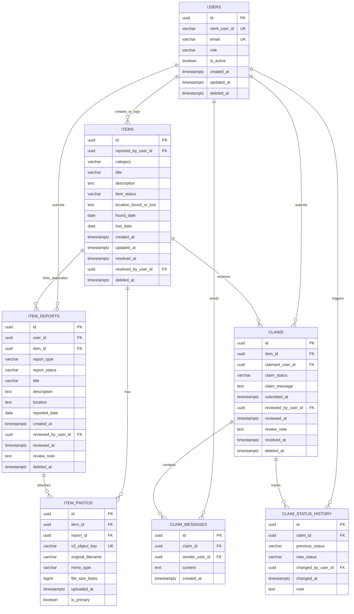

# Database Design Documentation

## 1. Introduction and Purpose

The Item Finder / Campus Lost-and-Found Retrieval System uses PostgreSQL as the primary relational data store for structured operational records. The database design described in this document follows the architectural constraints defined in the existing system architecture documentation and supports the campus item reporting, search, claim, and verification workflows described there.

This document presents a pre-implementation database specification for an undergraduate capstone project. The database has not yet been designed in final form, and the schema described here is a proposed relational model intended to guide subsequent implementation work. The design remains intentionally normalized and conservative, avoiding unnecessary complexity while maintaining sufficient detail to support integrity, authorization, and auditing requirements.

The database supports the following core functions:

- user account and role tracking
- item record creation and lifecycle management
- item report submissions for found or missing items
- claim submission and administrative review
- claim-specific private communication
- item photo metadata storage for files hosted in AWS S3
- audit tracking of claim status changes

This document distinguishes between the logical entities used in the system and the final database schema to be confirmed during implementation. In keeping with the architecture specification, the database remains a PostgreSQL-based relational design that is accessed through SQLAlchemy ORM and the FastAPI backend.

---

## 2. Database Technology and Design Principles

The database technology is limited to the existing architecture:

- PostgreSQL as the relational database management system
- Neon as the hosting provider for PostgreSQL
- SQLAlchemy ORM as the backend data access layer
- FastAPI as the application service layer

The design follows several guiding principles:

- normalized relational design with clear entity boundaries
- separation of canonical item data from historical report and claim data
- explicit auditability for claim decisions and status changes
- secure reference management for AWS S3 image objects
- consistent ownership and authorization boundaries across user, claim, and report records
- minimal use of JSONB; relational columns are preferred where a structured schema is available

The design intentionally avoids introducing additional infrastructure or database technologies. It preserves the system's existing architecture and treats the database as a relational layer that supports authentication data, item operations, and claim workflows in a controlled and auditable manner.

---

## 3. Database Architecture Overview

The database supports a relational domain model centered on four major operational areas:

1. User identity and authorization
2. Item and report lifecycle management
3. Claim submission and verification
4. Claim communication and history tracking

The database design separates the canonical item catalog from the reporting and claim workflows. This separation is important because a report is a user-submitted event, while an item is the maintained system record that represents the object and its current status.

The design also separates storage of image files from the persistence of their metadata. In the proposed architecture, AWS S3 stores image binary content, while PostgreSQL stores the metadata required to locate and reference those files. This keeps the database relational and avoids storing large binary payloads directly in PostgreSQL.

This architecture supports the following high-level operations:

- application user registration and role assignment through the Clerk identity provider
- management of item reports created by students or administrators
- item lifecycle transitions managed by administrator review or claim resolution
- claim lifecycle tracking with immutable history
- claim-specific messaging scoped to authorized participants
- audit-friendly tracking of status changes

---

## 4. Entity Definitions

The design includes the following proposed tables, each mapped to a system requirement and business process:

1. users
2. items
3. item_reports
4. claims
5. claim_messages
6. claim_status_history
7. item_photos

The design decision to keep item_reports separate from items is intentional. A report is not the same as the canonical item record; it is a user submission that may lead to item creation or item update. Likewise, claim_status_history is separate from claims because claim history must remain auditable and should not be overwritten as a simple status field.

The following entities are considered essential to the architecture and are therefore included in the proposed model:

- users: stores application users and role data
- items: stores the canonical item record and current status
- item_reports: stores report submissions for found or missing items
- claims: stores claim submissions and verification outcomes
- claim_messages: stores private claim conversations
- claim_status_history: stores the status change timeline for claims
- item_photos: stores S3 object metadata for item images

> (assumed) The exact table names and relationships may evolve during implementation, but the proposed entities remain aligned with the current architecture.

---

## 5. Table and Attribute Specifications

All tables use lowercase snake_case naming, consistent with PostgreSQL conventions and SQLAlchemy ORM expectations. The following specifications describe the proposed baseline schema and should be treated as design guidance rather than final implementation requirements.

### 5.1 users

| Column | PostgreSQL Type | Key / Constraint | Notes |
|---|---|---|---|
| id | UUID | PRIMARY KEY | Application user identifier (UUIDv4) |
| clerk_user_id | VARCHAR(255) | NOT NULL, UNIQUE | External Clerk identity identifier |
| email | VARCHAR(320) | NOT NULL, UNIQUE | User email address |
| role | VARCHAR(32) | NOT NULL | Allowed values: `student`, `administrator`. Initial admin accounts are assigned via backend bootstrap / database seeding (`INITIAL_ADMIN_EMAIL`), never from client metadata |
| is_active | BOOLEAN | NOT NULL, DEFAULT true | Account active flag |
| created_at | TIMESTAMP WITH TIME ZONE | NOT NULL, DEFAULT CURRENT_TIMESTAMP | Audit timestamp |
| updated_at | TIMESTAMP WITH TIME ZONE | NOT NULL, DEFAULT CURRENT_TIMESTAMP | Modification timestamp |
| deleted_at | TIMESTAMP WITH TIME ZONE | NULL | Soft-deletion timestamp |

Purpose: Stores application user profiles representing authenticated Clerk users. Authentication is delegated to Clerk, while authorization and role enforcement are managed locally.

Relationships:
- One user may submit many item reports.
- One user may create or log many items (as finder reporter or staff).
- One user may submit many claims.
- One user may send many claim messages.
- One user may trigger many claim status history records.

### 5.2 items

| Column | PostgreSQL Type | Key / Constraint | Notes |
|---|---|---|---|
| id | UUID | PRIMARY KEY | Canonical item identifier |
| reported_by_user_id | UUID | NOT NULL, FOREIGN KEY -> users(id) ON DELETE RESTRICT | User who initially found/reported the item (or staff creator) |
| category | VARCHAR(100) | NOT NULL | Item category (e.g., electronics, bottles, keys) |
| title | VARCHAR(255) | NOT NULL | Canonical item name/title |
| description | TEXT | NULL | Public description of the item |
| item_status | VARCHAR(32) | NOT NULL | Allowed values: `active`, `claimed`, `resolved`, `archived` |
| location_found_or_lost | TEXT | NULL | Campus location where item was found |
| found_date | DATE | NULL | Date when the item was recovered |
| lost_date | DATE | NULL | Informational lost date (if applicable) |
| created_at | TIMESTAMP WITH TIME ZONE | NOT NULL, DEFAULT CURRENT_TIMESTAMP | Item registration timestamp |
| updated_at | TIMESTAMP WITH TIME ZONE | NOT NULL, DEFAULT CURRENT_TIMESTAMP | Item record update timestamp |
| resolved_at | TIMESTAMP WITH TIME ZONE | NULL | Final handover/archive timestamp |
| resolved_by_user_id | UUID | NULL, FOREIGN KEY -> users(id) ON DELETE SET NULL | Administrator confirming handover/resolution |
| deleted_at | TIMESTAMP WITH TIME ZONE | NULL | Soft-deletion timestamp |

Purpose: Stores canonical records for physical belongings recovered on campus. Items are created either through administrator approval of a found-item report, or directly by staff via `POST /api/v1/items`. Items represent claimable physical property.

Relationships:
- Many item reports may reference one item (backlink for initial approved report or linked duplicates).
- One item may have many item photos (`item_photos.item_id`).
- One item may receive many claims (`claims.item_id`).

### 5.3 item_reports

| Column | PostgreSQL Type | Key / Constraint | Notes |
|---|---|---|---|
| id | UUID | PRIMARY KEY | Unique report identifier |
| user_id | UUID | NOT NULL, FOREIGN KEY -> users(id) ON DELETE RESTRICT | Submitting student or administrator |
| item_id | UUID | NULL, FOREIGN KEY -> items(id) ON DELETE SET NULL | Backlink to canonical item (set when approved, or linked to existing duplicate) |
| report_type | VARCHAR(32) | NOT NULL | Allowed values: `found`, `missing` |
| report_status | VARCHAR(32) | NOT NULL | Allowed values: `pending_review`, `approved`, `rejected`, `cancelled` |
| title | VARCHAR(255) | NOT NULL | Report title |
| description | TEXT | NOT NULL | Detailed user report description |
| location | TEXT | NOT NULL | Location where item was found or lost |
| reported_date | DATE | NOT NULL | Date of loss or discovery |
| created_at | TIMESTAMP WITH TIME ZONE | NOT NULL, DEFAULT CURRENT_TIMESTAMP | Submission timestamp |
| reviewed_by_user_id | UUID | NULL, FOREIGN KEY -> users(id) ON DELETE SET NULL | Administrator reviewer |
| reviewed_at | TIMESTAMP WITH TIME ZONE | NULL | Administrative review timestamp |
| review_note | TEXT | NULL | Internal admin moderation note (hidden from students) |
| deleted_at | TIMESTAMP WITH TIME ZONE | NULL | Soft-deletion timestamp |

Purpose: Stores user-submitted missing or found item reports. A found-item report that is approved by an administrator creates a canonical `items` record and transfers attached photos. A missing-item report remains in `item_reports` as an active inquiry record and does not generate a claimable item in `items`.

Relationships:
- Many item reports belong to one user.
- One item report may reference one canonical item once reviewed.
- One item report may have many uploaded photos (`item_photos.report_id`) prior to item promotion.

### 5.4 claims

| Column | PostgreSQL Type | Key / Constraint | Notes |
|---|---|---|---|
| id | UUID | PRIMARY KEY | Unique claim identifier |
| item_id | UUID | NOT NULL, FOREIGN KEY -> items(id) ON DELETE RESTRICT | Active item being claimed |
| claimant_user_id | UUID | NOT NULL, FOREIGN KEY -> users(id) ON DELETE RESTRICT | Student submitting ownership claim |
| claim_status | VARCHAR(32) | NOT NULL | Allowed values: `pending_review`, `approved`, `rejected`, `closed`, `withdrawn` |
| claim_message | TEXT | NOT NULL | Ownership justification/evidence provided by claimant |
| submitted_at | TIMESTAMP WITH TIME ZONE | NOT NULL, DEFAULT CURRENT_TIMESTAMP | Claim submission timestamp |
| reviewed_by_user_id | UUID | NULL, FOREIGN KEY -> users(id) ON DELETE SET NULL | Administrator reviewer |
| reviewed_at | TIMESTAMP WITH TIME ZONE | NULL | Review decision timestamp |
| review_note | TEXT | NULL | Internal administrator evaluation note (hidden from students) |
| resolved_at | TIMESTAMP WITH TIME ZONE | NULL | Resolution timestamp |
| deleted_at | TIMESTAMP WITH TIME ZONE | NULL | Soft-deletion timestamp |

Purpose: Stores student ownership claims against active canonical items. Multiple simultaneous pending claims are permitted per item. Approving one claim sets it to `approved`, updates the item to `claimed`, and automatically marks remaining pending claims as `rejected`.

Relationships:
- One item may receive multiple claims.
- One student may submit claims against items (restricted to at most one active claim per item).
- One claim may have many claim messages (`claim_messages.claim_id`).
- One claim has an immutable status history audit trail (`claim_status_history.claim_id`).

### 5.5 claim_messages

| Column | PostgreSQL Type | Key / Constraint | Notes |
|---|---|---|---|
| id | UUID | PRIMARY KEY | Unique message identifier |
| claim_id | UUID | NOT NULL, FOREIGN KEY -> claims(id) ON DELETE CASCADE | Parent claim |
| sender_user_id | UUID | NOT NULL, FOREIGN KEY -> users(id) ON DELETE RESTRICT | Message sender (claimant or admin) |
| content | TEXT | NOT NULL | Private conversation text |
| created_at | TIMESTAMP WITH TIME ZONE | NOT NULL, DEFAULT CURRENT_TIMESTAMP | Timestamp |

Purpose: Stores private, two-way communication between the claimant student and administrators regarding ownership verification. Access is strictly limited to authorized claim participants.

### 5.6 claim_status_history

| Column | PostgreSQL Type | Key / Constraint | Notes |
|---|---|---|---|
| id | UUID | PRIMARY KEY | Unique audit record identifier |
| claim_id | UUID | NOT NULL, FOREIGN KEY -> claims(id) ON DELETE CASCADE | Parent claim |
| previous_status | VARCHAR(32) | NULL | State prior to update |
| new_status | VARCHAR(32) | NOT NULL | Updated claim state |
| changed_by_user_id | UUID | NOT NULL, FOREIGN KEY -> users(id) ON DELETE RESTRICT | User or admin who triggered change |
| changed_at | TIMESTAMP WITH TIME ZONE | NOT NULL, DEFAULT CURRENT_TIMESTAMP | Audit timestamp |
| note | TEXT | NULL | Staff audit rationale. Protected by field-level serialization: visible to admins, redacted for students |

Purpose: Maintains an append-only audit trail for claim lifecycle transitions. Internal staff notes are captured here and protected against student exposure.

### 5.7 item_photos

| Column | PostgreSQL Type | Key / Constraint | Notes |
|---|---|---|---|
| id | UUID | PRIMARY KEY | Unique photo metadata identifier |
| item_id | UUID | NULL, FOREIGN KEY -> items(id) ON DELETE CASCADE | Canonical item parent (set when approved or logged directly) |
| report_id | UUID | NULL, FOREIGN KEY -> item_reports(id) ON DELETE CASCADE | Report parent (set upon report submission) |
| s3_object_key | VARCHAR(512) | NOT NULL, UNIQUE | Storage key in AWS S3 (e.g. `reports/{id}/{uuid}.jpg`) |
| original_filename | VARCHAR(255) | NULL | Client-submitted filename (sanitized) |
| mime_type | VARCHAR(128) | NOT NULL | Validated MIME type (`image/jpeg`, `image/png`, `image/webp`) |
| file_size_bytes | BIGINT | NOT NULL | File size in bytes (max 5 MB) |
| uploaded_at | TIMESTAMP WITH TIME ZONE | NOT NULL, DEFAULT CURRENT_TIMESTAMP | Upload timestamp |
| is_primary | BOOLEAN | NOT NULL, DEFAULT false | Designates primary catalog display image |

Purpose: Stores metadata for photographs stored in AWS S3. Supports photo ingestion during initial report submission (`report_id`) and seamless transfer to canonical item records (`item_id`) upon approval without re-uploading S3 objects.

Parentage Constraint:
A photo must belong to exactly one parent entity at any time, enforced by a database CHECK constraint:
`CHECK ((item_id IS NOT NULL AND report_id IS NULL) OR (item_id IS NULL AND report_id IS NOT NULL))`

---

## 6. Entity Relationship Diagram



This ER diagram reflects the normalized relational structure:
- `ITEM_PHOTOS` supports dual parentage (`report_id` during initial submission, transferred to `item_id` upon approval).
- Canonical items and user reports remain strictly separated.
- `CLAIM_STATUS_HISTORY` preserves an immutable audit timeline for claim review decisions.

---

## 7. Relationships and Cardinality

The relational model enforces normalized cardinality aligned with system operations:

- One user may submit many item reports (`users(id) -> item_reports(user_id)`).
- One user may create or log many canonical items (`users(id) -> items(reported_by_user_id)`).
- One item report may attach many photos during initial reporting (`item_reports(id) -> item_photos(report_id)`).
- One approved found report creates exactly one canonical item; the report backlinks to the item via `item_reports.item_id`.
- Duplicate reports referencing an already cataloged item are linked to the existing `items(id)`.
- One canonical item may have many photos (`items(id) -> item_photos(item_id)`).
- A photo belongs to exactly one parent at a time: either `item_reports(id)` or `items(id)`.
- One active canonical item may receive multiple claims from different students (`items(id) -> claims(item_id)`).
- A student may submit at most one active claim per item (`UNIQUE (item_id, claimant_user_id) WHERE claim_status IN ('pending_review', 'approved')`).
- One claim may have many claim messages (`claims(id) -> claim_messages(claim_id)`).
- One claim has many status history rows (`claims(id) -> claim_status_history(claim_id)`).

Deletion Behavior:
- Critical records use `ON DELETE RESTRICT` for user foreign keys on items, reports, and claims to preserve historical accountability.
- Deletions are managed via soft-deletion (`deleted_at TIMESTAMP WITH TIME ZONE NULL`) on `users`, `items`, `item_reports`, and `claims`.
- Dependent message and photo records use `ON DELETE CASCADE` only when their parent claim or item/report is definitively purged.

---

## 8. Item, Report, and Claim Status Lifecycle

Status vocabularies and valid state transitions are established to eliminate ambiguous operational states.

### 8.1 Item Status Lifecycle

Canonical items in `items` represent physical belongings logged in the catalog:

- `active`: Item is verified and published in the catalog. Eligible for search and claiming by students.
- `claimed`: An ownership claim has been approved by an administrator. Item is locked against new claims and hidden from student search.
- `resolved`: Physical handover has been completed (or item was returned to owner). Final state.
- `archived`: Item remained unclaimed beyond retention limits or was disposed of according to campus policy. Final state.

Canonical items start directly in `active` status upon creation (either via approved found-item report promotion or via direct staff entry `POST /api/v1/items`).

### 8.2 Report Status Lifecycle

User reports in `item_reports` represent missing or found submissions:

- `pending_review`: Initial state upon user submission. Awaiting administrative moderation.
- `approved`: Administrator verified the report. For `found` reports, this triggers atomic creation of a canonical `items` record and photo transfer. For `missing` reports, this registers the report as an active inquiry alert (no canonical item created).
- `rejected`: Administrator determined the report is invalid, spam, or duplicate.
- `cancelled`: Submitting student cancelled the report before administrative review.

### 8.3 Claim Status Lifecycle

Claims in `claims` represent ownership claims against active canonical items:

- `pending_review`: Initial state upon student claim submission. Awaiting administrative review.
- `approved`: Administrator verified ownership evidence and approved the claim. (Triggers item transition to `claimed` and auto-rejection of competing pending claims).
- `rejected`: Administrator rejected the claim, or the claim was auto-rejected due to approval of a competing claim.
- `closed`: Item was handed over or claim process was concluded.
- `withdrawn`: Claimant student voluntarily withdrew their claim.

### 8.4 Status Transition and Concurrency Rules

1. **Found Report Approval & Item Promotion:**
   - When an administrator approves a found report (`pending_review` -> `approved`), an atomic transaction creates an `items` record (`item_status = 'active'`), updates `item_photos` (`item_id = item.id, report_id = NULL`), and backlinks `item_reports.item_id = item.id`.
2. **Missing Report Handling:**
   - Approved missing reports do NOT create `items` rows. Missing reports remain inquiry records, ensuring users cannot claim missing belongings.
3. **Competing Claim Concurrency Control:**
   - Multiple pending claims can coexist on an active item.
   - When an administrator approves a claim, the backend acquires a pessimistic lock (`SELECT ... FOR UPDATE` on `items`).
   - In a single atomic transaction:
     - The selected claim transitions to `approved`.
     - The item transitions to `claimed`.
     - All other pending claims for that item automatically transition to `rejected` with an audit note: `"Competing claim approved"`.
     - Rows are inserted into `claim_status_history` for each updated claim.
   - If another administrator concurrently attempts to approve a claim on the same item, the lock forces serialized execution; the second attempt detects `item_status = 'claimed'` and is rejected with HTTP 409 Conflict.

---

## 9. Database Constraints and Integrity Rules

The database design should enforce integrity at both the database and application layers. The database is responsible for enforcing structural consistency, while the backend remains responsible for business-rule validation.

### 9.1 Core Integrity Rules

- All foreign keys must reference valid rows in parent tables with appropriate `ON DELETE` semantics (`RESTRICT` for auditing, `CASCADE` for dependent media/messages).
- User email addresses and Clerk user IDs must be unique.
- A photo must reference exactly one parent entity: either an `item_reports` row or an `items` row.
- Claim statuses, report statuses, and item statuses must be restricted to approved enumerated values.
- A claim must reference a valid canonical item and active student claimant.
- A message must reference a valid claim and an authorized sender user.

### 9.2 Necessary CHECK Constraints

The schema enforces the following CHECK constraints:

- `role IN ('student', 'administrator')`
- `report_type IN ('found', 'missing')`
- `report_status IN ('pending_review', 'approved', 'rejected', 'cancelled')`
- `item_status IN ('active', 'claimed', 'resolved', 'archived')`
- `claim_status IN ('pending_review', 'approved', 'rejected', 'closed', 'withdrawn')`
- Photo Parentage Constraint: `CHECK ((item_id IS NOT NULL AND report_id IS NULL) OR (item_id IS NULL AND report_id IS NOT NULL))`
- `file_size_bytes > 0 AND file_size_bytes <= 5242880` (5 MB upload ceiling)
- `mime_type IN ('image/jpeg', 'image/png', 'image/webp')`

### 9.3 Partial Unique Indexes and Duplicate Prevention

The schema prevents invalid duplicates using PostgreSQL partial unique indexes:

1. **Active Claim Uniqueness:**
   A student may not submit multiple active claims against the same item:
   ```sql
   CREATE UNIQUE INDEX uq_active_claim_per_user 
   ON claims(item_id, claimant_user_id) 
   WHERE claim_status IN ('pending_review', 'approved');
   ```
2. **Primary Photo Uniqueness:**
   An item may have at most one primary display photo:
   ```sql
   CREATE UNIQUE INDEX uq_item_primary_photo 
   ON item_photos(item_id) 
   WHERE is_primary = true AND item_id IS NOT NULL;
   ```
3. **Clerk Identity Mapping:**
   One Clerk identity maps to exactly one application user record:
   ```sql
   CREATE UNIQUE INDEX uq_users_clerk_id ON users(clerk_user_id);
   ```

### 9.4 Transactional Integrity

Database transactions are required for multi-step state changes:

1. **Found Report Approval & Item Promotion Transaction:**
   When an administrator approves a found report:
   - Insert new row into `items` (`item_status = 'active'`).
   - Transfer photos: `UPDATE item_photos SET item_id = :item_id, report_id = NULL WHERE report_id = :report_id;`.
   - Update report: `UPDATE item_reports SET item_id = :item_id, report_status = 'approved', reviewed_at = NOW(), reviewed_by_user_id = :admin_id WHERE id = :report_id;`.
2. **Claim Approval & Competing Claims Resolution Transaction:**
   When an administrator approves a claim:
   - Acquire pessimistic lock: `SELECT * FROM items WHERE id = :item_id FOR UPDATE;`.
   - Update target claim: `UPDATE claims SET claim_status = 'approved', resolved_at = NOW(), reviewed_at = NOW(), reviewed_by_user_id = :admin_id WHERE id = :claim_id;`.
   - Update item status: `UPDATE items SET item_status = 'claimed', updated_at = NOW() WHERE id = :item_id;`.
   - Auto-reject competing pending claims: `UPDATE claims SET claim_status = 'rejected', reviewed_at = NOW(), review_note = 'Competing claim approved' WHERE item_id = :item_id AND id != :claim_id AND claim_status = 'pending_review';`.
   - Insert audit records into `claim_status_history` for each modified claim.

---

## 10. Indexing and Query Optimization

Indexes are targeted to high-frequency query patterns:

| Query Pattern | Recommended Index | Rationale |
|---|---|---|
| Search active items by category | INDEX on items(category, item_status, created_at) | Supports student catalog search & category filtering |
| Filter items by status | INDEX on items(item_status, created_at) | Optimizes admin item listings and student visibility filters |
| Search items by location | INDEX on items(location_found_or_lost) | Supports campus location queries |
| Retrieve reports by user | INDEX on item_reports(user_id, created_at) | Supports student report history lookups |
| Retrieve claims by item | INDEX on claims(item_id, claim_status, submitted_at) | Optimizes administrative claim queue per item |
| Retrieve claims by student | INDEX on claims(claimant_user_id, submitted_at) | Supports student `/users/me/claims` queries |
| Single active claim check | UNIQUE INDEX on claims(item_id, claimant_user_id) WHERE claim_status IN ('pending_review', 'approved') | Prevents duplicate active claims by same claimant |
| Load messages by claim | INDEX on claim_messages(claim_id, created_at) | Supports chronological message thread retrieval |
| Retrieve photos by item | INDEX on item_photos(item_id, is_primary) | Supports item detail photo galleries |
| Retrieve photos by report | INDEX on item_photos(report_id) | Supports report detail rendering before item approval |
| Single primary photo check | UNIQUE INDEX on item_photos(item_id) WHERE is_primary = true AND item_id IS NOT NULL | Enforces single primary image per item |
| Lookup user by Clerk ID | UNIQUE INDEX on users(clerk_user_id) | Fast authentication token mapping |
| Lookup user by email | UNIQUE INDEX on users(email) | Supports account resolution and bootstrap checks |

The design should be constrained by actual workload requirements. Excessive indexes increase write cost, particularly for frequently updated item and claim records. The recommended set above balances common query access with acceptable write overhead.

---

## 11. Data Ownership and Access Control

The database design supports policies that define who may view, update, or manage each record. This is essential for preventing unauthorized access and for supporting BOLA/IDOR prevention.

### 11.1 Ownership Rules

- Students can manage their own item reports.
- Students can submit and view claims they own or are authorized to access.
- Students can view item records within their permitted search scope.
- Administrators can review item reports, manage item records, and verify claims.
- Administrators can read claim messages in the scope of a verified claim review process.

### 11.2 Authorization and Backend Enforcement

The database provides referential integrity and supports ownership through foreign keys, but it does not replace backend authorization logic. The FastAPI application must enforce access rules at the endpoint level, because database foreign keys alone do not determine whether a user is allowed to access a specific claim or message.

This requirement directly supports BOLA / IDOR mitigation. Even when a malicious user knows a valid identifier, the backend must confirm both authentication and authorization before returning or modifying the resource.

---

## 12. AWS S3 Photo Metadata Integration

The architecture stores item photos in AWS S3, not in PostgreSQL. The relational database stores metadata that references those files. This design preserves the relational database while handling media files more efficiently and scalably.

The proposed item_photos table stores:

- item_photo identifier
- associated item identifier
- S3 object key
- original filename, if needed
- MIME type
- file size in bytes
- upload timestamp
- primary image flag

The database must not store AWS access keys, secret keys, or long-lived credentials. Those values remain outside the database and are managed through environment variables or a secure secret-management solution. The item_photos table is only the metadata layer; the binary object remains in S3.

---

## 13. Data Retention and Privacy

The system stores user, claim, and item-related records that may contain sensitive information. The database design should support privacy-aware retention and secure records handling.

### 13.1 Retention Considerations

- user account deactivation should not immediately delete all related history if the records are needed for administrative accountability
- item reports may need retention to support investigation, reporting, and auditability
- claim conversations may need retention during claim resolution and possible dispute review
- item photos should be retained only as long as the item record is active or required for operational review

### 13.2 Privacy and Minimization

The system should avoid storing unnecessary personal information. For example, private claim conversations should remain tied to the claim and should not be exposed through public item records. Email notification content should contain only the information needed to prompt action.

> To be determined: formal retention schedules, document deletion policies, and archival requirements must be approved before production deployment.

---

## 14. Transaction Management

The database should use transactions for multi-step workflows that must remain consistent. This is especially important for claim decisions and item lifecycle changes.

### 14.1 Transaction-Critical Processes and Concurrency

The system uses standard PostgreSQL `READ COMMITTED` transaction isolation augmented with explicit pessimistic row-level locking (`SELECT ... FOR UPDATE`) for concurrent state transitions:

1. **Found Report Approval & Promotion:**
   - Evaluates report validity.
   - Inserts row into `items`.
   - Transfers attached photo metadata in `item_photos` (`SET item_id = :item_id, report_id = NULL`).
   - Updates `item_reports` (`SET item_id = :item_id, report_status = 'approved'`).
   - If any step fails, the entire transaction rolls back; the S3 object remains intact in object storage.
2. **Claim Approval & Competing Claims Resolution:**
   - Locks the canonical item row via `SELECT * FROM items WHERE id = :item_id FOR UPDATE`.
   - Checks that `item_status == 'active'` and the target claim is `pending_review`.
   - Updates target claim to `approved`.
   - Updates item status to `claimed`.
   - Automatically transitions all other pending claims on that item to `rejected` with note `'Competing claim approved'`.
   - Writes immutable status history entries for each transitioned claim into `claim_status_history`.
   - Concurrently executing approval transactions on the same item are blocked by the row lock; once unblocked, they observe `item_status = 'claimed'` and fail safely with a business conflict exception.

---

## 15. Established Design Decisions and Scope Boundaries

The following design decisions are formally established:

- **Photo Entity Relationship (AUD-CRIT-001):** Established. `item_photos` supports dual parentage (`report_id` during initial submission, transferred atomically to `item_id` upon approval) enforced by a CHECK constraint ensuring exactly one parent at a time. S3 objects are preserved without re-upload.
- **Report Promotion and Canonical Items (AUD-CRIT-002):** Established. Approved found reports create canonical items (`items`). Approved missing reports remain inquiry records in `item_reports` and do not generate claimable items.
- **Competing Claims Policy (AUD-CRIT-003):** Established. Multiple simultaneous pending claims are permitted on an active item. Approving one claim auto-rejects all other competing pending claims via a locked database transaction.
- **Internal Staff Notes Protection (AUD-CRIT-004):** Established. Notes in `claims.review_note` and `claim_status_history.note` represent internal staff review rationale and are redacted in student-facing response models.
- **Administrator Provisioning:** Established. Initial administrators are provisioned via controlled backend bootstrap / database seeding using an environment configuration whitelist (`INITIAL_ADMIN_EMAIL`), never from client-controlled claims.
- **Search Visibility:** Established. Public and student queries filter strictly for `item_status = 'active'`. Non-active items and missing reports are excluded.
- **QR Code Workflow (AUD-CRIT-005):** Scope Decision. QR redemption (`POST /api/v1/claims/redeem`) is deferred from the initial MVP release. Physical item handover is managed directly by staff in the admin portal.
- **Operational Policies Deferred to Deployment:** Automated data retention schedules (purging resolved items and historical claim messages after N semesters) and database backup rotation policies are operational tasks deferred to production deployment configuration.

---

## 16. Conclusion

The proposed PostgreSQL database design for the Item Finder / Campus Lost-and-Found Retrieval System is a normalized relational model that supports item reporting, search, claim processing, communication, and photo management. The design preserves the separation between user identity, canonical item records, report submissions, claim records, and audit history, which is critical for both system clarity and operational integrity.

The architecture consistently separates storage of relational records from storage of item image files, with AWS S3 handling media objects and PostgreSQL storing metadata and references. The design also treats claim and report status management separately from item lifecycle management, which prevents ambiguous operational states and supports a stronger audit trail.

This document provides the database specification needed to guide the subsequent implementation of PostgreSQL tables, SQLAlchemy models, and migration planning. The design remains intentionally conservative and pre-implementation, and unresolved business rules are explicitly marked as such for later validation.
