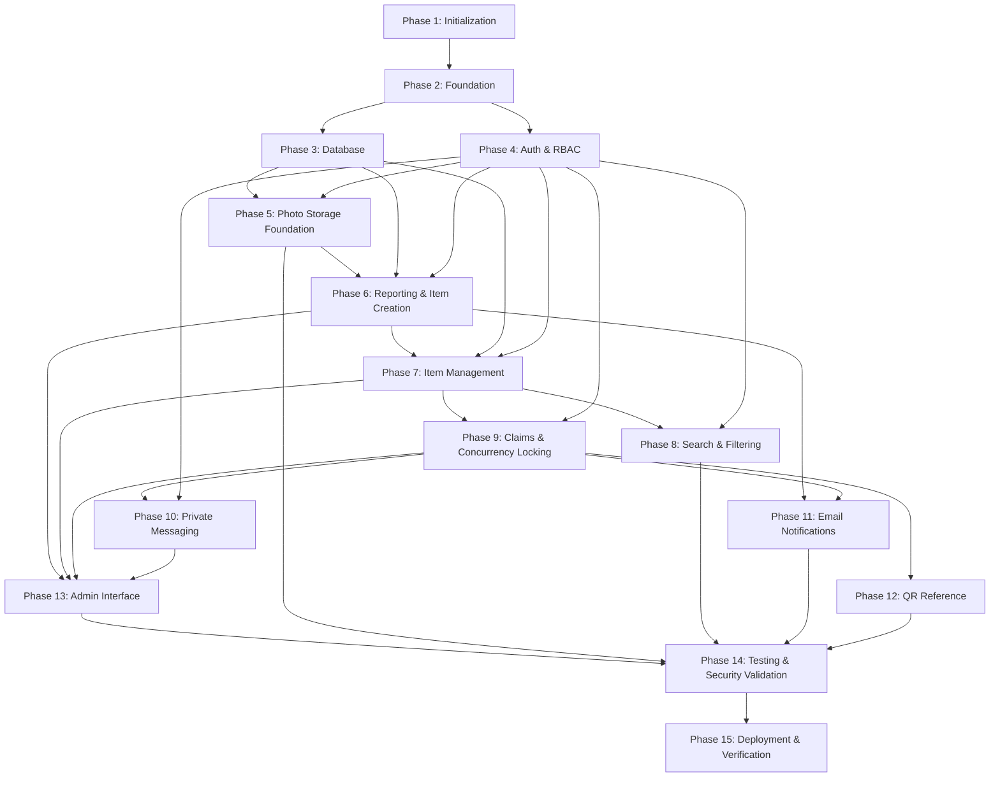

# Implementation Plan Documentation

## 1. Introduction

This document presents the implementation plan for the Item Finder / Campus Lost-and-Found Retrieval System. It translates the approved system architecture, database design, API design, module design, and security design into a structured, dependency-driven development roadmap for a pre-implementation undergraduate capstone project.

The project has not yet been implemented. This plan is a roadmap for future engineering work and must be treated as a planned development sequence rather than a description of completed work. All implementation tasks remain subject to validation, review, and approval.

The implementation strategy follows a phased, dependency-oriented delivery model. The project is organized so that foundational services—including persistence, authentication, and photo ingestion storage infrastructure—are completed before dependent domain features are implemented and before end-to-end security and user validation are performed. This eliminates the risk of building dependent features (such as photo-bearing report submissions) on an incomplete storage or authorization foundation.

This plan remains consistent with the documented system requirements and incorporates all architectural decisions established during technical documentation remediation (including report-to-item promotion, dual-parent photo storage, claim concurrency locking, IDOR protection, and deferred QR redemption).

---

## 2. Implementation Objectives and Scope

The overall objective is to deliver a working campus-based lost-and-found platform that supports the following core workflows:

- student and administrator authentication through Clerk with backend RBAC and admin bootstrap
- photo ingestion infrastructure through backend-mediated AWS S3 upload with magic-byte validation and private Presigned GET URLs
- item report submission for missing and found items (with multipart photo attachment)
- report review, approval, rejection, and atomic canonical item creation for found items
- canonical item lifecycle management (`active`, `claimed`, `resolved`, `archived`) and manual item recording
- item search and filtering with student visibility restricted to active items
- claim submission, review, and concurrency-safe approval with pessimistic locking and auto-rejection of competing claims
- private claim communication restricted strictly to claim participants and administrators
- internal administrator notes isolated from student-facing responses
- email notifications via Resend for key lifecycle events
- informational QR code generation for verified claim pickup (automated QR redemption deferred from MVP)
- administrative review and moderation dashboard

The implementation must be aligned with the authoritative project documents:

- `system-architecture.md`
- `database-design.md`
- `api-design.md`
- `module-design.md`
- `security-design.md`

The development scope includes backend APIs, persistence layer setup, frontend screens for student and admin flows, integration with external services, and validation against the documented security requirements.

---

## 3. Development Strategy

The system is implemented in phases according to strict architectural dependency order. Crucially, storage and photo ingestion infrastructure (Phase 5) precedes reporting (Phase 6), because found and missing item reporting requires image uploads and persistence of photo metadata.

The approved delivery sequence is:

1. Project initialization and environment setup
2. Backend and frontend foundation
3. Database implementation (with dual-parent photo schema, soft deletion, and partial unique indexes)
4. Authentication and authorization (Clerk token verification, RBAC, and admin bootstrap)
5. Storage and photo ingestion foundation (AWS S3 client, file validation, presigned URLs)
6. Found and missing item reporting (multipart submissions, report lifecycle, report-to-item promotion)
7. Canonical item management (catalog CRUD, status lifecycles, manual entry)
8. Search and filtering (visibility enforcement, pagination, multi-criteria filtering)
9. Claim submission and verification (concurrency-safe review, pessimistic locking, IDOR enforcement)
10. Private claim communication (claim-scoped messaging, participant authorization)
11. Email notifications (Resend integration, event triggers, privacy filtering)
12. QR code reference generation (pickup card generation; automated redemption deferred)
13. Administrative interface and integration (moderation dashboard, staff review)
14. Testing and security validation (comprehensive security test suite, IDOR checks, race condition validation)
15. Deployment and final verification

---

## 4. Technology Stack

### 4.1 Frontend

- ReactJS
- React Router DOM
- TanStack Query

### 4.2 Backend

- Python
- FastAPI
- Pydantic v2
- SQLAlchemy ORM

### 4.3 Database and Storage

- PostgreSQL hosted on Neon
- AWS S3 for item photographs (private bucket, backend-mediated presigned URLs)

### 4.4 External Services

- Clerk for user identity and authentication
- Resend for transactional email notifications

### 4.5 Scope Boundaries

This plan does not introduce additional frameworks, languages, or infrastructure beyond the established stack.

---

## 5. Project Phases and Tasks

### Phase 1: Project Initialization and Environment Setup

#### 5.1 Objective
Set up the repository, define the project structure, and establish the working environment for both frontend and backend development.

#### 5.2 Scope
- repository structure for frontend and backend code
- environment configuration templates (`.env.example`)
- dependency management and version pinning
- Git workflow and branch strategy
- local development setup documentation

#### 5.3 Tasks and Subtasks
- Create the project repository structure separating `/frontend` and `/backend`.
- Initialize the frontend React application with React Router DOM and TanStack Query.
- Initialize the backend FastAPI application structure with virtual environment and Poetry/pip-tools.
- Define environment variable conventions for PostgreSQL (Neon), Clerk, AWS S3, and Resend.
- Configure code formatters and linters (ESLint/Prettier for frontend, Ruff/Black for backend).
- Create a developer onboarding guide for local setup and testing.

#### 5.4 Dependencies
- None.

#### 5.5 Expected Deliverables
- Project directory structure with frontend and backend bases.
- Environment template files with documented variables.
- Developer setup instructions.

#### 5.6 Testing Requirements
- Verify backend and frontend install and bootstrap cleanly in local environments.

#### 5.7 Completion Criteria
- Local environment setup is repeatable and verified.
- Repository structure matches documented conventions.

---

### Phase 2: Backend and Frontend Foundation

#### 5.8 Objective
Establish core routing, API clients, application skeletons, and central error handling.

#### 5.9 Scope
- FastAPI application factory and modular router layout
- React routing skeleton and base page layout
- API client configuration using TanStack Query
- Standardized HTTP response wrappers and error handlers

#### 5.10 Tasks and Subtasks
- Create FastAPI application skeleton with CORS configuration and standard exception handlers.
- Establish modular router layout: `/auth`, `/users`, `/reports`, `/items`, `/claims`, `/messages`, `/photos`, `/admin`.
- Set up React Router DOM routes for public, student, and administrator flows.
- Create TanStack Query API client with central Axios/Fetch wrapper and Bearer token injection.
- Implement standardized API error response schemas (`detail`, `code`, `timestamp`).

#### 5.11 Dependencies
- Phase 1: Project initialization.

#### 5.12 Expected Deliverables
- Functional backend skeleton with health-check and router modules.
- Frontend application shell with route boundaries and API client.

#### 5.13 Testing Requirements
- Confirm backend starts and returns healthy response.
- Confirm frontend compiles and communicates with backend through `/api/v1`.

#### 5.14 Completion Criteria
- Baseline runtime is stable.
- Central error handling catches unhandled exceptions and formats standard JSON errors.

---

### Phase 3: Database Implementation

#### 5.15 Objective
Implement the PostgreSQL relational data model on Neon using SQLAlchemy ORM, including all constraints, partial unique indexes, soft deletion, and relationship mappings.

#### 5.16 Scope
- PostgreSQL configuration for Neon with SSL connection pooling
- SQLAlchemy ORM models for all documented entities
- Dual-parent photo schema (`item_photos`) with XOR constraint
- Partial unique indexes (`uq_active_claim_per_user`, `uq_item_primary_photo`)
- Soft deletion columns (`deleted_at`) for GDPR/retention compliance
- Migration management via Alembic

#### 5.17 Tasks and Subtasks
- Configure SQLAlchemy database session management with Neon PostgreSQL connection pooling.
- Implement SQLAlchemy ORM models:
  - `users` (`clerk_user_id`, `role`, `status`)
  - `item_reports` (`report_type`, `report_status`, `user_id`, `item_id`)
  - `items` (`item_status`, `category`, `location`, `storage_location`, `created_by_admin_id`)
  - `item_photos` (`file_path`, `report_id`, `item_id`, `is_primary`, `deleted_at`)
  - `claims` (`item_id`, `claimant_id`, `claim_status`, `review_note`)
  - `claim_status_history` (`claim_id`, `changed_by_user_id`, `old_status`, `new_status`, `note`)
  - `claim_messages` (`claim_id`, `sender_id`, `message_text`)
- Implement constraints:
  - `chk_photo_single_parent`: `CHECK ((item_id IS NOT NULL AND report_id IS NULL) OR (item_id IS NULL AND report_id IS NOT NULL))`
  - `chk_claim_status`: enum validation
  - `chk_report_status`: enum validation
  - `chk_item_status`: enum validation
- Implement partial unique indexes:
  - `uq_active_claim_per_user` on `claims(item_id, claimant_id)` where `claim_status IN ('pending', 'under_review')`
  - `uq_item_primary_photo` on `item_photos(item_id)` where `is_primary = TRUE`
  - `uq_report_primary_photo` on `item_photos(report_id)` where `is_primary = TRUE`
- Initialize Alembic migration environment and generate baseline migration script.

#### 5.18 Dependencies
- Phase 2: Backend foundation.
- Authoritative document: `database-design.md`.

#### 5.19 Expected Deliverables
- Alembic migration scripts creating all tables, indexes, and constraints.
- Verified SQLAlchemy ORM models matching database design.

#### 5.20 Testing Requirements
- Run migrations up and down against a test Neon PostgreSQL instance.
- Validate that inserting an `item_photo` with both `report_id` and `item_id` set (or neither set) fails with a check constraint violation.
- Validate that creating two active claims for the same user on the same item fails unique constraint.

#### 5.21 Completion Criteria
- Database schema matches `database-design.md` exactly.
- All relationships, cascades, and partial indexes are functional.

---

### Phase 4: Authentication and Authorization

#### 5.22 Objective
Implement secure authentication via Clerk token verification, local user record synchronization, backend RBAC enforcement, and administrator bootstrapping.

#### 5.23 Scope
- Frontend Clerk React SDK integration
- Backend Clerk JWT verification using JWKS
- Local user auto-provisioning and role lookup
- Initial administrator bootstrap via `INITIAL_ADMIN_EMAIL`
- FastAPI authorization dependencies (`require_auth`, `require_role`, `require_admin`)
- BOLA/IDOR prevention foundation

#### 5.24 Tasks and Subtasks
- Configure Clerk React SDK on the frontend for login, logout, and token acquisition.
- Configure Axios/Fetch interceptor to attach `Authorization: Bearer <token>` to all API requests.
- Implement backend `get_current_user` dependency validating JWT signatures against Clerk JWKS endpoints.
- Synchronize Clerk user profile to local `users` table on first authenticated request.
- Implement bootstrap mechanism: if `user.email == settings.INITIAL_ADMIN_EMAIL`, assign `role = 'administrator'`.
- Implement RBAC dependencies: `require_student`, `require_admin`.
- Ensure role checks are evaluated strictly against the verified database record, not untrusted JWT claims.
- Implement automated tests for token validation: missing token, expired token, signature tampering, unauthorized role access.

#### 5.25 Dependencies
- Phase 2: Backend and frontend foundation.
- Phase 3: Database implementation (`users` table).
- Authoritative document: `security-design.md`.

#### 5.26 Expected Deliverables
- Working frontend Clerk login/logout flows.
- Backend JWT validation and local user resolution pipeline.
- Reusable FastAPI security dependencies.

#### 5.27 Testing Requirements
- Unauthenticated requests return HTTP 401 Unauthorized.
- Student token requesting admin endpoint returns HTTP 403 Forbidden.
- Initial admin user is correctly bootstrapped.

#### 5.28 Completion Criteria
- Backend independently enforces authentication and RBAC.
- No public client can tamper with role assignment.

---

### Phase 5: Storage and Photo Ingestion Foundation

#### 5.29 Objective
Implement backend-mediated AWS S3 storage infrastructure, strict file validation (magic bytes, size, MIME type), and presigned GET URL generation prior to reporting implementation.

#### 5.30 Scope
- AWS S3 client integration (boto3) with IAM least privilege
- Server-side file validation service (size <= 5MB, magic bytes inspection, JPEG/PNG/WebP allowlist)
- Backend-mediated multipart upload processing
- Secure S3 object key naming conventions (`reports/{report_id}/{uuid}.{ext}`, `items/{item_id}/{uuid}.{ext}`)
- Presigned GET URL generator (15-minute expiration)
- `item_photos` metadata persistence logic for preliminary uploads

#### 5.31 Tasks and Subtasks
- Configure backend AWS SDK (boto3) with server-side environment credentials (never exposed to frontend).
- Implement file validation utility checking:
  - File size does not exceed 5MB.
  - File content header inspection via `python-magic` to confirm true image payload.
  - Allowed MIME types strictly limited to `image/jpeg`, `image/png`, and `image/webp`.
- Implement S3 upload utility writing files with private ACLs and server-side encryption (SSE-S3).
- Implement presigned GET URL generator utility generating temporary (15-minute) signed access URLs.
- Implement photo repository layer supporting creation, soft deletion, and association transfer in `item_photos`.
- Implement cleanup routines for orphaned S3 objects if database transaction fails.

#### 5.32 Dependencies
- Phase 3: Database implementation (`item_photos` table).
- Phase 4: Authentication and authorization.
- Authoritative document: `security-design.md` Section 5.

#### 5.33 Expected Deliverables
- Storage service module providing upload, validation, and presigned URL capabilities.
- Test suite validating file inspection and upload failure handling.

#### 5.34 Testing Requirements
- Uploading an executable renamed to `.jpg` must fail magic-byte validation with HTTP 422.
- Uploading a file > 5MB must fail with HTTP 413.
- Presigned GET URLs must expire after 15 minutes.

#### 5.35 Completion Criteria
- Photo validation and S3 upload infrastructure are fully operational and tested before report submission is built.

---

### Phase 6: Found and Missing Item Reporting

#### 5.36 Objective
Implement found and missing item reporting workflows, multipart report submission with attached photos, report lifecycle management, and atomic report-to-item promotion for approved found reports.

#### 5.37 Scope
- Report submission APIs (`POST /api/v1/reports` multipart)
- Report retrieval and personal report list (`GET /api/v1/reports`, `GET /api/v1/reports/{id}`)
- Report cancellation (`POST /api/v1/reports/{id}/cancel`)
- Admin report review queue and decision endpoint (`PATCH /api/v1/reports/{id}/review`)
- Atomic canonical item creation on found-report approval with photo association transfer
- Handling missing reports (approved missing reports remain inquiry records and do NOT create catalog items)

#### 5.38 Tasks and Subtasks
- Implement Pydantic request and response schemas for reports.
- Implement `POST /api/v1/reports` endpoint supporting `multipart/form-data` with optional photo upload.
- Persist report record in `item_reports` with `report_status = 'pending_review'`.
- If photos are uploaded, validate via storage service (Phase 5), upload to S3, and insert into `item_photos` with `report_id = report.id, item_id = NULL`.
- Implement `GET /api/v1/reports` with role filtering (students see own reports; admins see all reports).
- Implement `POST /api/v1/reports/{id}/cancel` allowing report owner to cancel pending reports.
- Implement `PATCH /api/v1/reports/{id}/review` (admin only):
  - If decision is `rejected`, update `report_status = 'rejected'` with `review_notes`.
  - If decision is `approved` and `report_type == 'found'`:
    - In a single database transaction, insert canonical `items` record (`item_status = 'active'`).
    - Update `item_photos` records setting `item_id = new_item.id, report_id = NULL`.
    - Update `item_reports` setting `report_status = 'approved', item_id = new_item.id`.
  - If decision is `approved` and `report_type == 'missing'`:
    - Update `item_reports` setting `report_status = 'approved'`.
    - Do NOT create canonical item; missing reports serve as internal inquiries.

#### 5.39 Dependencies
- Phase 3: Database implementation.
- Phase 4: Authentication and authorization.
- Phase 5: Storage and photo ingestion foundation.
- Authoritative documents: `api-design.md`, `module-design.md`.

#### 5.40 Expected Deliverables
- Working report submission with photo attachment.
- Working admin review and approval transaction.
- Photo association transfer verified in PostgreSQL.

#### 5.41 Testing Requirements
- Submitting a found report with photos correctly links photos to `report_id`.
- Approving a found report transfers photo association to `item_id` and leaves `report_id` NULL.
- Approving a missing report does not create an item in `items`.
- Non-admin calling review endpoint receives HTTP 403.

#### 5.42 Completion Criteria
- Reporting lifecycle functions with atomic database consistency.
- Photos transfer seamlessly without S3 re-uploading.

---

### Phase 7: Canonical Item Management

#### 5.43 Objective
Implement canonical item catalog management, status lifecycles, admin direct item entry, and photo associations.

#### 5.44 Scope
- Direct manual item recording by administrators (`POST /api/v1/items`)
- Item detail retrieval (`GET /api/v1/items/{id}`)
- Item metadata updates (`PATCH /api/v1/items/{id}`)
- Item status transitions (`active`, `claimed`, `resolved`, `archived`)
- Item photo management (primary photo assignment, photo addition/deletion)

#### 5.45 Tasks and Subtasks
- Implement `POST /api/v1/items` endpoint restricted to `Administrator` role for physical drop-offs at campus lost-and-found desk.
- Implement item detail endpoint generating presigned GET URLs for all associated active photos.
- Implement `PATCH /api/v1/items/{id}` for updating item metadata and storage locations.
- Enforce valid state machine transitions:
  - `active` -> `claimed` (via claim approval)
  - `claimed` -> `resolved` (via physical handover confirmation)
  - `active` -> `archived` (via admin timeout/disposal)
- Ensure unauthorized role attempts to mutate items return HTTP 403.

#### 5.46 Dependencies
- Phase 3: Database implementation.
- Phase 4: Authentication and authorization.
- Phase 5: Storage foundation.
- Phase 6: Reporting and promotion foundation.

#### 5.47 Expected Deliverables
- Item catalog CRUD endpoints and admin management interface.
- Presigned photo URL delivery in item responses.

#### 5.48 Testing Requirements
- Admin can manually create item with photos.
- Student cannot create items directly via `POST /api/v1/items`.
- Invalid item status transitions are rejected with HTTP 422.

#### 5.49 Completion Criteria
- Item catalog operations are fully operational and protected by admin RBAC.

---

### Phase 8: Search and Filtering

#### 5.50 Objective
Implement item catalog search and filtering with strict authorization-level visibility rules.

#### 5.51 Scope
- Catalog listing and search (`GET /api/v1/items`)
- Keyword matching across title, description, and brand
- Category and location filtering
- Date range filtering
- Student visibility enforcement: only `item_status = 'active'` items are visible to students
- Admin visibility: ability to filter across all item statuses
- Pagination and sorting

#### 5.52 Tasks and Subtasks
- Implement query validation using Pydantic query models.
- Apply database query filters: ILIKE/full-text search for keywords, exact match for category and location.
- Enforce visibility rule in backend query builder: if authenticated user is not Administrator, automatically inject `item_status = 'active'` filter.
- Exclude missing reports from search catalog (missing reports remain in `item_reports`).
- Attach primary photo presigned GET URLs to returned items.
- Implement pagination (`page`, `page_size`, max limit 50).

#### 5.53 Dependencies
- Phase 3: Database implementation.
- Phase 4: Authentication and authorization.
- Phase 7: Canonical item management.

#### 5.54 Expected Deliverables
- High-performance, secure search endpoint.
- Frontend search and filter UI with debounced query inputs.

#### 5.55 Testing Requirements
- Student queries do not return items with status `claimed`, `resolved`, or `archived`.
- Keyword searches return relevant matching items.
- Pagination parameters are enforced.

#### 5.56 Completion Criteria
- Search is fast, paginated, and strictly enforces active-item visibility for students.

---

### Phase 9: Claim Submission and Verification

#### 5.57 Objective
Implement claim submission, review, and concurrency-safe approval with pessimistic locking and BOLA/IDOR protection.

#### 5.58 Scope
- Student claim submission (`POST /api/v1/items/{item_id}/claims`)
- Student personal claims list (`GET /api/v1/users/me/claims`)
- Claim detail access with ownership check (`GET /api/v1/claims/{id}`)
- Claim withdrawal (`POST /api/v1/claims/{id}/withdraw`)
- Administrator item claims queue (`GET /api/v1/items/{item_id}/claims` - STRICTLY ADMIN ONLY)
- Concurrency-safe claim approval (`PATCH /api/v1/claims/{id}/review`) using pessimistic locking (`SELECT ... FOR UPDATE`)
- Auto-rejection of competing pending claims upon approval
- Separation of internal staff notes from student responses

#### 5.59 Tasks and Subtasks
- Implement `POST /api/v1/items/{item_id}/claims`:
  - Validate target item has `item_status = 'active'`.
  - Validate student does not already have an active claim on this item (enforced by DB partial unique index `uq_active_claim_per_user`).
  - Persist claim with `claim_status = 'pending'`.
- Implement `GET /api/v1/items/{item_id}/claims`:
  - Enforce `require_admin` dependency. Reject student requests with HTTP 403 Forbidden to prevent student-to-student claim inspection.
- Implement `GET /api/v1/claims/{id}`:
  - Verify caller is either claim owner or Administrator. Return HTTP 403/404 on IDOR attempts.
- Implement `GET /api/v1/claims/{id}/status-history`:
  - Return `ClaimStatusHistoryPublicResponse` to students (redacting `note` field).
  - Return `ClaimStatusHistoryAdminResponse` to administrators (including internal `note` field).
- Implement `PATCH /api/v1/claims/{id}/review` (admin only):
  - Execute within a serializable/pessimistic lock transaction:
    - Acquire pessimistic row lock on target item: `SELECT * FROM items WHERE id = :item_id FOR UPDATE`.
    - If item status is no longer `active`, abort and raise HTTP 409 Conflict.
    - If decision is `approved`:
      - Update target claim `claim_status = 'approved'`.
      - Update item `item_status = 'claimed'`.
      - Atomically update all other pending/under_review claims on this item to `rejected` with automated audit note: `"Automatically rejected due to competing claim approval"`.
      - Record entries in `claim_status_history`.

#### 5.60 Dependencies
- Phase 3: Database implementation.
- Phase 4: Authentication and authorization.
- Phase 7: Canonical item management.
- Authoritative documents: `api-design.md`, `security-design.md`.

#### 5.61 Expected Deliverables
- Secure claim submission and verification endpoints.
- Race-condition safe claim approval transaction.
- Strict BOLA/IDOR protection on claims queue.

#### 5.62 Testing Requirements
- Student calling `GET /api/v1/items/{id}/claims` receives HTTP 403 Forbidden.
- Student inspecting another student's claim receives HTTP 403/404.
- Concurrent claim approval race condition test confirms only one claim is approved and competing claims are rejected without duplicate approvals.
- Student inspecting status history does not see staff review notes.

#### 5.63 Completion Criteria
- Claims lifecycle is completely secure against IDOR and concurrency race conditions.

---

### Phase 10: Private Claim Communication

#### 5.64 Objective
Implement private message threads between the claimant and staff within verified claim contexts.

#### 5.65 Scope
- Message submission (`POST /api/v1/claims/{claim_id}/messages`)
- Message list retrieval (`GET /api/v1/claims/{claim_id}/messages`)
- Participant-scoped authorization enforcement
- Audit logging of communications

#### 5.66 Tasks and Subtasks
- Implement message schemas and endpoints.
- Enforce strict authorization dependency: caller must be the student who submitted the claim or an Administrator.
- Reject attempts by unrelated students with HTTP 403 Forbidden.
- Validate message text length (1 to 2000 characters, sanitized against XSS).
- Store messages in `claim_messages` table.

#### 5.67 Dependencies
- Phase 4: Authentication and authorization.
- Phase 9: Claim submission and verification.

#### 5.68 Expected Deliverables
- Private claim chat API endpoints.
- Frontend claim communication component.

#### 5.69 Testing Requirements
- Unrelated student attempting to read or post messages receives HTTP 403 Forbidden.
- Admin and claimant can communicate bi-directionally.

#### 5.70 Completion Criteria
- Communication is strictly isolated to authorized claim participants.

---

### Phase 11: Email Notification

#### 5.71 Objective
Implement transactional email notifications using Resend for key report and claim lifecycle milestones.

#### 5.72 Scope
- Resend API client integration
- Asynchronous background event triggers
- Privacy-aware email templates (no internal notes, minimal PII)
- Resilient failure handling (email failures do not roll back database transactions)

#### 5.73 Tasks and Subtasks
- Configure Resend SDK in backend services with verified sender domain.
- Implement email dispatch background tasks for key events:
  - Report submitted confirmation.
  - Found report approved / canonical item published.
  - Claim submitted confirmation.
  - Claim approved / ready for pickup.
  - Claim rejected notification (generic reason only; internal staff notes excluded).
- Ensure email delivery exceptions are caught, logged, and do not disrupt API transaction responses.

#### 5.74 Dependencies
- Phase 4: Authentication and authorization.
- Phase 6: Reporting.
- Phase 9: Claim verification.

#### 5.75 Expected Deliverables
- Resend notification client service.
- Privacy-conscious HTML/text email templates.

#### 5.76 Testing Requirements
- Event triggers successfully initiate email dispatch.
- Mocked email service outage does not cause API endpoint to return HTTP 500.
- Outgoing emails do not contain internal administrator notes.

#### 5.77 Completion Criteria
- Transactional notifications are operational and privacy-compliant.

---

### Phase 12: QR Code Reference Generation

#### 5.78 Objective
Implement informational pickup reference QR code generation for verified claims. (Automated QR redemption is deferred from the initial MVP).

#### 5.79 Scope
- Pickup reference generation for approved claims (`GET /api/v1/claims/{id}/qr`)
- Cryptographic reference payload (signed reference token, claim ID, expiry)
- Student-facing digital pickup card in frontend
- Explicit exclusion of automated redemption endpoints from MVP

#### 5.80 Tasks and Subtasks
- Implement QR code generation utility generating PNG image encoding a non-sensitive claim reference.
- Restrict endpoint `GET /api/v1/claims/{id}/qr` to approved claims and authorized claimant/admin only.
- Include explicit architectural disclaimer: QR code is an informational reference card; physical verification and item handover must be confirmed manually by staff in the admin portal.
- Document deferred QR redemption requirements for future milestone.

#### 5.81 Dependencies
- Phase 4: Authentication and authorization.
- Phase 9: Claim verification.

#### 5.82 Expected Deliverables
- QR reference generation endpoint.
- Student pickup card component.

#### 5.83 Testing Requirements
- Claims not in `approved` status cannot generate QR codes (HTTP 400/403).
- Unrelated users cannot fetch QR code.

#### 5.84 Completion Criteria
- Informational QR generation works securely without introducing premature redemption logic.

---

### Phase 13: Administrative Interface and Integration

#### 5.85 Objective
Build frontend administrative moderation interfaces and connect them to backend moderation endpoints.

#### 5.86 Scope
- Admin moderation dashboard
- Report review queue and found-report approval flow
- Item catalog management and manual entry form
- Claim review queue with competing claim indicator
- Handover confirmation workflow (`claimed` -> `resolved`)

#### 5.87 Tasks and Subtasks
- Build admin dashboard routes protected by frontend role guards.
- Implement report review screen displaying submitted photos and approval controls.
- Implement claim management screen displaying competing claims and review history.
- Implement item creation screen for direct desk drop-offs.
- Integrate all admin actions with corresponding `/api/v1/admin/*` endpoints.

#### 5.88 Dependencies
- Phase 4: Authentication and authorization.
- Phase 6: Reporting.
- Phase 7: Item management.
- Phase 9: Claim verification.

#### 5.89 Expected Deliverables
- Comprehensive administrative web interface.

#### 5.90 Testing Requirements
- Non-admin users are redirected away from `/admin/*` routes.
- Admin actions update backend state and refresh UI caches via TanStack Query.

#### 5.91 Completion Criteria
- Administrative staff can execute all moderation workflows through the web UI.

---

### Phase 14: Testing and Security Validation

#### 5.92 Objective
Execute comprehensive test suites including unit, integration, functional, and security penetration test scenarios.

#### 5.93 Scope
- Unit test suite (Pydantic validation, business logic, state machines)
- Integration test suite (database transactions, S3 uploads, Resend dispatch)
- Security test suite targeting:
  - IDOR/BOLA on `/api/v1/items/{item_id}/claims` and `/api/v1/claims/{id}`
  - File upload bypass (magic bytes, oversize, MIME spoofing)
  - Concurrency race conditions on competing claim approvals
  - Staff note leakage in student responses
  - Cross-user message thread isolation
- User acceptance testing (end-to-end student and admin journeys)

#### 5.94 Tasks and Subtasks
- Run automated security test suite covering all scenarios in `security-design.md` Section 9.
- Verify that simultaneous claim approval requests are serialized and only one succeeds.
- Verify that S3 upload validation blocks polyglot files and scripts.
- Perform end-to-end smoke tests across all student and admin workflows.

#### 5.95 Dependencies
- Phases 1 through 13.

#### 5.96 Expected Deliverables
- Automated test suite with passing status.
- Security verification report confirming zero high/critical vulnerabilities.

#### 5.97 Testing Requirements
- 100% pass rate on security test scenarios.

#### 5.98 Completion Criteria
- All quality gates pass and the system is verified secure for staging deployment.

---

### Phase 15: Deployment and Final Verification

#### 5.99 Objective
Deploy application components to target environments, verify production environment variables, and perform smoke testing.

#### 5.100 Scope
- Neon PostgreSQL production database configuration
- AWS S3 bucket configuration (CORS, private bucket policy, encryption)
- Frontend and backend production hosting configuration
- Production Clerk and Resend API key configuration
- Post-deployment smoke testing

#### 5.101 Tasks and Subtasks
- Verify all production secrets in secure environment managers.
- Run Alembic migrations against production Neon database.
- Verify AWS S3 bucket permissions block public object access.
- Deploy backend FastAPI application and frontend React build.
- Perform smoke test verifying authentication, reporting, item search, and claim workflows.
- Document deployment verification checklist and runbook.

#### 5.102 Dependencies
- Phase 14: Testing and security validation.

#### 5.103 Expected Deliverables
- Deployed and functional application.
- Deployment operational guide.

#### 5.104 Testing Requirements
- Production smoke test passes end-to-end.
- S3 bucket objects cannot be accessed via direct unsigned HTTP requests.

#### 5.105 Completion Criteria
- System is live, secure, and ready for campus operational use.

---

## 6. Task Prioritization

Implementation tasks are classified by priority to ensure the team delivers mandatory security controls and core functional workflows first.

| Task | Phase | Priority | Dependency | Completion Criteria |
|---|---|---|---|---|
| Project setup and environment structure | 1 | Must Have | None | Local setup repeatable for all developers |
| Backend and frontend foundation | 2 | Must Have | 1 | App layers start and communicate via `/api/v1` |
| PostgreSQL and SQLAlchemy setup | 3 | Must Have | 2 | Models, XOR constraints, and partial indexes pass |
| Clerk auth and backend RBAC | 4 | Must Have | 2, 3 | Token validation and admin bootstrap work |
| Storage and photo ingestion foundation | 5 | Must Have | 3, 4 | S3 upload, magic-byte check, and presigned URLs work |
| Found & missing item reporting | 6 | Must Have | 3, 4, 5 | Reports with photos submit; found reports promote to items |
| Canonical item management | 7 | Must Have | 3, 4, 5, 6 | Catalog CRUD, manual entry, and status transitions work |
| Search and filtering | 8 | Must Have | 3, 4, 7 | Active-only visibility enforced for students |
| Claim submission and verification | 9 | Must Have | 3, 4, 7 | Pessimistic locking works; IDOR blocked on claims queue |
| Private claim messaging | 10 | Must Have | 4, 9 | Messages strictly claim-scoped and private |
| Email notifications via Resend | 11 | Should Have | 4, 6, 9 | Event notifications fire without leaking staff notes |
| QR reference generation | 12 | Should Have | 4, 9 | Informational QR generated (redemption deferred) |
| Admin moderation interface | 13 | Must Have | 4, 6, 7, 9, 10 | Staff review workflows operational via UI |
| Security and integration testing | 14 | Must Have | 1-13 | All security scenarios pass (IDOR, race conditions) |
| Deployment and final verification | 15 | Must Have | 14 | Production environment smoke-tested and operational |

---

## 7. Phase Dependencies

### 7.1 Dependency Matrix

| Phase | Depends On | Architectural Justification |
|---|---|---|
| 1. Initialization | None | Establishes codebase and developer environments |
| 2. Foundation | 1 | Router skeletons and API client needed before domain logic |
| 3. Database | 2 | Persistence layer and relational schema required for all services |
| 4. Auth & RBAC | 2, 3 | All protected operations require verified identity and local user mapping |
| 5. Photo Storage Foundation | 3, 4 | Reporting requires photo ingestion and validation infrastructure |
| 6. Reporting | 3, 4, 5 | Report submissions include photos; approved found reports promote to items |
| 7. Item Management | 3, 4, 5, 6 | Catalog lifecycle depends on report promotion and manual admin entry |
| 8. Search & Filtering | 3, 4, 7 | Item discovery requires stable item catalog and visibility enforcement |
| 9. Claims | 3, 4, 7 | Claims require active items, pessimistic locking, and IDOR protection |
| 10. Private Messaging | 4, 9 | Messaging requires verified claim context and participant checks |
| 11. Email Notifications | 4, 6, 9 | Notification logic depends on valid report and claim events |
| 12. QR Reference | 4, 9 | QR pickup card is generated only for approved claims |
| 13. Admin Interface | 4, 6, 7, 9, 10 | Admin portal unifies review across reports, items, and claims |
| 14. Testing & Validation | 1-13 | End-to-end security and integration tests require complete system |
| 15. Deployment | 14 | Production launch follows rigorous security and functional sign-off |

### 7.2 Mermaid Dependency Diagram

---

## 8. Testing Strategy and Quality Gates

### 8.1 Quality Gate Requirements

| Quality Gate | Phase Gate | Requirement | Verification Method |
|---|---|---|---|
| QG-1: Foundation | Phase 2 | Backend starts and frontend communicates | Automated ping / health check |
| QG-2: Schema Integrity | Phase 3 | XOR photo constraint & partial unique indexes hold | Alembic migration test & constraint violation unit tests |
| QG-3: Identity Security | Phase 4 | Clerk JWT verification and admin bootstrap verified | Invalid token, expired token, and RBAC denial tests |
| QG-4: Photo Ingestion | Phase 5 | Magic-byte validation blocks disguised binaries | File upload test with oversized and disguised files |
| QG-5: Report Promotion | Phase 6 | Found approval transfers photos to item atomically | DB state inspection following report approval |
| QG-6: Search Isolation | Phase 8 | Students cannot see claimed or archived items | Query validation test with student auth context |
| QG-7: Concurrency & IDOR | Phase 9 | Competing claim approvals serialized; student IDOR blocked | Race condition simulation test & BOLA permission test |
| QG-8: Note Redaction | Phase 9 | Internal staff notes omitted from student responses | Response schema assertion on student claim history |
| QG-9: Security Sign-off | Phase 14 | 100% pass on security design testing matrix | Automated pytest security test suite |
| QG-10: Production Readiness | Phase 15 | Live environment smoke-tested and verified | Production smoke test checklist |

---

## 9. Project Milestones

| Milestone | Deliverable | Success Criteria | Status |
|---|---|---|---|
| M1. Environment Ready | Repositories, packages, and `.env` templates | Clean local setup for frontend and backend | Planned |
| M2. Foundation Ready | Application shells and routing skeletons | Frontend calls backend `/api/v1` successfully | Planned |
| M3. Database Ready | PostgreSQL schema on Neon with migrations | Models, XOR constraints, and indexes verified | Planned |
| M4. Auth Ready | Clerk auth and backend RBAC | Secure token validation and admin bootstrap | Planned |
| M5. Storage Ready | AWS S3 client, validation, presigned URLs | Magic-byte checks and upload tests pass | Planned |
| M6. Reporting Ready | Report submission and found-item promotion | Reports persist with photos; promotion works | Planned |
| M7. Catalog Ready | Item management and manual entry | Admin can record and update items | Planned |
| M8. Search Ready | Filtered search with active-only visibility | Fast, paginated, student-filtered search | Planned |
| M9. Claims Ready | Concurrency-safe claims and IDOR protection | Pessimistic locking and note redaction pass | Planned |
| M10. Messaging Ready | Participant-isolated claim communication | Cross-user messaging blocked | Planned |
| M11. Email Ready | Resend transactional event notifications | Email sent without exposing staff notes | Planned |
| M12. QR Reference Ready | Informational claim pickup reference card | QR generated for approved claims | Planned |
| M13. Admin Portal Ready | Comprehensive moderation frontend | Review queues and actions operational | Planned |
| M14. Security QA Ready | Complete automated test suite | Zero high/critical security findings | Planned |
| M15. Deployment Ready | Production launch on Neon, S3, and hosting | End-to-end smoke tests pass in production | Planned |

---

## 10. Implementation Risks and Mitigations

| Risk | Impact | Architectural Mitigation |
|---|---|---|
| Concurrent claim approvals cause double handovers | Inconsistent item ownership | Database pessimistic locking (`SELECT ... FOR UPDATE`) in `PATCH /claims/{id}/review`; auto-rejection of competing claims |
| Photo upload precedes item creation | Broken foreign keys or lost images | Dual-parent `item_photos` schema (`report_id` XOR `item_id`) and S3 foundation established before reporting |
| Student inspects competing claims (BOLA/IDOR) | Privacy violation and claim fraud | `GET /items/{id}/claims` restricted to Administrator strictly; students only access `/users/me/claims` |
| Internal staff review notes leaked to students | Exposure of confidential moderation rationale | Strict schema separation: `ClaimStatusHistoryPublicResponse` redacts `note` field; private notes visible only to admins |
| Malicious file upload to S3 | Malware distribution or code execution | Magic-byte content inspection via `python-magic`, 5MB cap, allowlist MIME types, private bucket ACL |
| Unresolved QR redemption complexity blocks MVP | Schedule delays and security vulnerabilities | Automated QR redemption explicitly deferred from MVP; QR serves as informational pickup reference card |

---

## 11. Established Architectural Decisions

All architectural decisions identified during the technical documentation audit have been formally resolved and integrated into the project documentation:

1. **Photo Association (AUD-CRIT-001):** Established. `item_photos` uses dual parentage (`report_id UUID NULL`, `item_id UUID NULL`) enforced by constraint `chk_photo_single_parent`. Photos upload during reporting and atomically transfer to canonical items upon approval without S3 re-uploading.
2. **Canonical Item Creation (AUD-CRIT-002):** Established. Approved `found` reports create canonical items (`item_status = 'active'`) and transfer photos. Approved `missing` reports remain inquiry records in `item_reports` and do not create catalog items. Direct desk drop-offs are handled via `POST /api/v1/items` (Admin only).
3. **Claims Authorization (AUD-CRIT-003):** Established. `GET /api/v1/items/{item_id}/claims` is strictly restricted to `Administrator`. Students access only their own claims via `/users/me/claims` or `/claims/{id}`.
4. **Internal Staff Notes (AUD-CRIT-004):** Established. Internal staff notes in `claims.review_note` and `claim_status_history.note` are redacted from student responses via separate Pydantic response models (`ClaimStatusHistoryPublicResponse` vs `ClaimStatusHistoryAdminResponse`).
5. **QR Code Workflow (AUD-CRIT-005):** Established. Automated QR redemption (`POST /api/v1/claims/redeem`) is deferred from the initial MVP. QR codes serve as informational reference cards for pickup; physical handover is confirmed manually by staff in the admin portal.
6. **Implementation Dependencies (AUD-CRIT-006):** Established. Storage and photo ingestion foundation is scheduled in Phase 5, before Reporting in Phase 6.
7. **Administrator Provisioning:** Established. Controlled backend bootstrap via `INITIAL_ADMIN_EMAIL` during initial user synchronization.
8. **Catalog Visibility:** Established. Students query `item_status = 'active'` only; missing reports and non-active items are excluded.
9. **Claim Concurrency:** Established. Multiple pending claims allowed (`uq_active_claim_per_user` permits one active claim per student per item); claim approval acquires a pessimistic lock (`SELECT ... FOR UPDATE`) and atomically rejects competing pending claims.
10. **Retention Policies:** Established. Soft deletion via `deleted_at` is implemented in the schema. Automated purge cron jobs are deferred to post-MVP production maintenance.

---

## 12. Conclusion

This implementation plan provides an authoritative, dependency-driven roadmap for developing the Campus Lost-and-Found Retrieval System. By establishing the storage and photo ingestion foundation prior to reporting, enforcing database-level integrity, locking down authorization boundaries, and deferring non-essential redemption workflows, this roadmap ensures a secure, robust, and orderly engineering process.

The project is now fully prepared to begin Phase 1 (Project Initialization and Environment Setup) upon formal approval by the project owner.