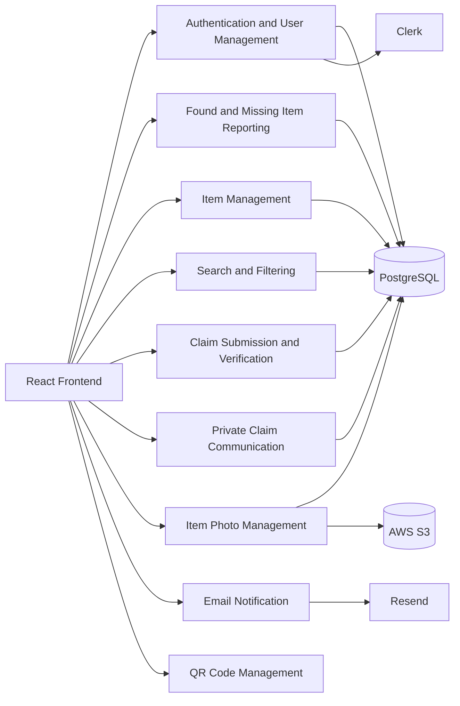
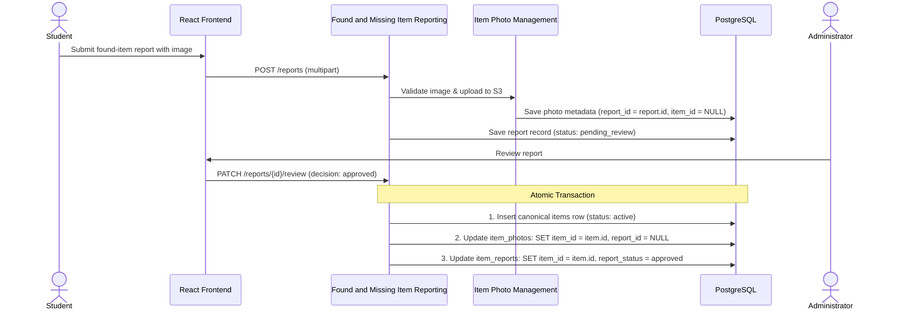
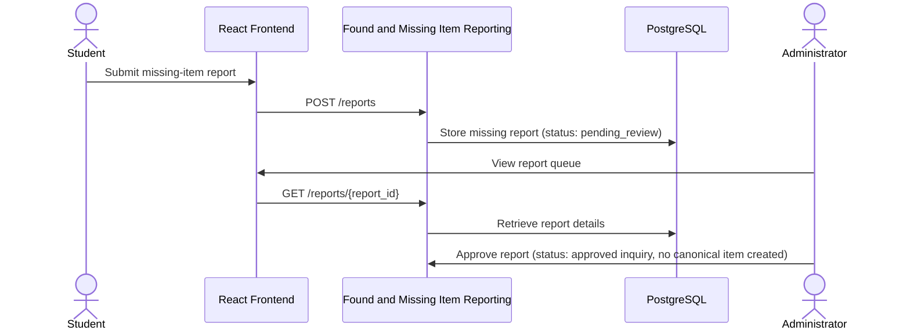
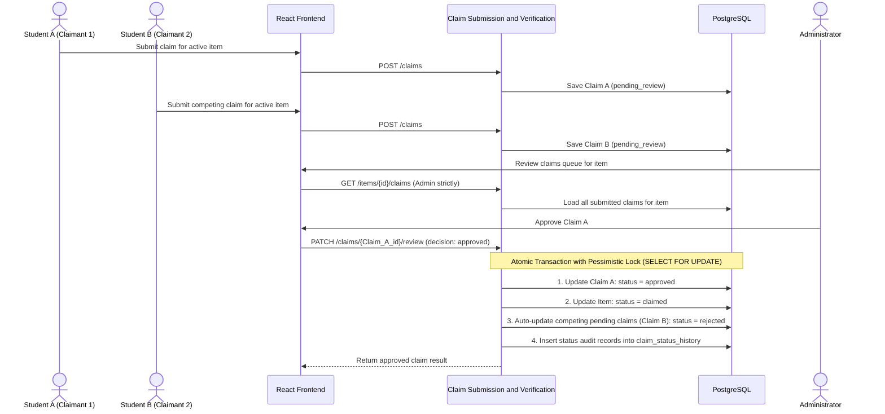
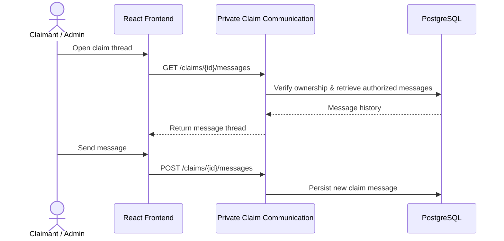
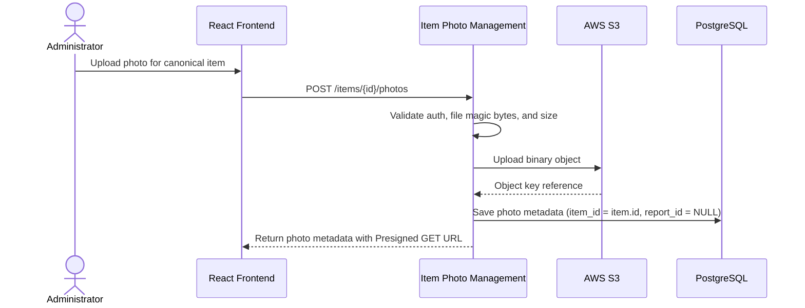
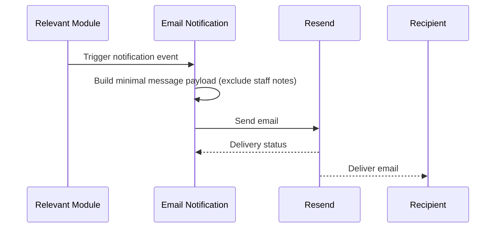
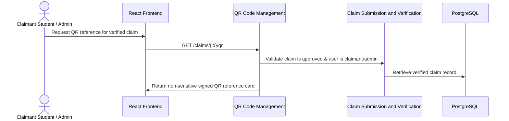

# Module Design Documentation

## 1. Introduction

The Item Finder / Campus Lost-and-Found Retrieval System is a campus-oriented item recovery platform designed to support reporting, search, claim review, and item verification workflows. The proposed system architecture, database design, and API design already define the intended system boundary, user roles, data entities, and external service interactions. This document describes the logical module decomposition of the system and explains how the modules collaborate to support the operational lifecycle of item reports, item records, claims, and private communication.

This document is a pre-implementation design specification. It describes the intended modular structure rather than a completed implementation. The module design remains consistent with the existing architecture documents and does not introduce unsupported technologies or features.

---

## 2. Purpose and Scope

The purpose of the module design is to define the system as a set of logically distinct, cooperating modules. Each module has a clear responsibility and a defined relationship to the backend services, database entities, external integrations, and API routes already described in the architecture and API specifications.

This module design covers the following functions:

- user authentication and profile management
- submission and review of found and missing item reports
- canonical item lifecycle management
- item search and filtering
- claim creation, review, and status tracking
- private claim communication
- item photo upload and metadata handling
- internal email notification through Resend
- QR code generation for verified claim workflows
- administrative functions across the preceding modules

The design intentionally avoids overlapping responsibilities. Each module owns a specific business domain, and cross-module interaction occurs only through clearly defined interfaces and workflows.

---

## 3. System Module Overview

The system is decomposed into the following modules:

| Module | Primary Responsibility | Main Users |
|---|---|---|
| Authentication and User Management | Clerk-based identity verification and local user profile handling | Students, Administrators |
| Found and Missing Item Reporting | Creation and review of user-submitted reports | Students, Administrators |
| Item Management | Canonical item lifecycle and item record maintenance | Students, Administrators |
| Search and Filtering | Item discovery through search and filter operations | Students, Administrators |
| Claim Submission and Verification | Claim lifecycle processing and decision workflow | Students, Administrators |
| Private Claim Communication | Private claim conversation support | Students, Administrators |
| Item Photo Management | Image validation, upload, metadata, and retrieval | Students, Administrators |
| Email Notification | Email generation and delivery coordination | Students, Administrators |
| QR Code Management | QR generation and retrieval for verified claims | Students, Administrators |
| Administrative Management | Review and moderation across item and claim workflows | Administrators |

These modules interact through the FastAPI backend and are supported by PostgreSQL, AWS S3, Clerk, and Resend. The frontend consumes the module services via API endpoints and presents the results to the user interface.

---

## 4. Detailed Module Specifications

### 4.1 Authentication and User Management

#### Purpose
This module manages the identity lifecycle of the application, including authentication through Clerk and local application user profile management. It defines the mapping between Clerk-issued identity tokens and PostgreSQL user records, while keeping authentication separate from application authorization.

#### Responsibilities
- validate Clerk session tokens
- resolve the authenticated user from the verified Clerk identity
- load or initialize the local application user profile
- assign or read the user role (administrators are provisioned via backend bootstrap / database seeding using an environment configuration whitelist `INITIAL_ADMIN_EMAIL`, never via client-supplied role parameters)
- support profile retrieval and permitted updates
- enforce backend authorization for protected routes

#### Main Functionalities
- current-user retrieval via authenticated session
- local user profile lookup
- profile update for permitted fields
- student and administrator role resolution
- backend enforcement for protected operations
- protection against unauthorized administrative privilege escalation

#### Primary Users
- Students
- Administrators

#### Inputs
- Clerk session token
- authenticated request context
- local user query or profile update request

#### Outputs
- authenticated user context
- local user profile payload
- role metadata
- authorization decisions

#### Database Entities Involved
- users

#### API Endpoints Involved
- /api/v1/auth/me
- /api/v1/users/me
- /api/v1/users/{user_id}
- /api/v1/users

#### Dependencies on Other Modules
- none directly; it is foundational to all protected modules
- used by all modules that require authenticated access and authorization checks

#### Processing Workflow
1. Frontend receives a Clerk session token.
2. Frontend sends the token in the Authorization header.
3. FastAPI verifies the token with Clerk.
4. FastAPI resolves the matching local user profile.
5. The backend applies role and ownership checks before allowing access.

#### Validation and Authorization Requirements
- token signature and claims must be verified by the backend
- role must be validated against the local user record
- frontend identity values must not be treated as trusted identifiers

#### Failure Scenarios
- invalid or expired Clerk token
- missing local user profile
- role mismatch or account deactivation
- authorization denial for protected actions

---

### 4.2 Found and Missing Item Reporting

#### Purpose
This module handles the submission and moderation of user reports for missing or found items. It manages initial user-reported information and supports later review before a report can be promoted into canonical item management or other workflow states.

#### Responsibilities
- accept found-item and missing-item submissions with optional multipart image upload
- validate report data, file type, file size, and magic bytes before uploading to AWS S3
- persist report entries in `item_reports` and photo metadata in `item_photos` linked via `report_id`
- support report review by administrators
- distinguish report records from canonical item records:
  - when an administrator approves a `found` report, execute an atomic transaction that inserts a canonical `items` record, updates `item_photos` to point to the new `item_id` (setting `report_id = NULL`), and backlinks `item_reports.item_id = item.id`
  - when an administrator approves a `missing` report, set `report_status = 'approved'` (active inquiry); do NOT create an item in `items`, preventing users from submitting claims on missing items
- handle duplicate reports by allowing administrators to link a report to an existing canonical item record

#### Main Functionalities
- submit found-item report with initial photo
- submit missing-item report
- cancel own submitted report (`PATCH /api/v1/reports/{id}/cancel`)
- attach additional photos to a pending report (`POST /api/v1/reports/{id}/photos`)
- retrieve report details
- retrieve the current user’s reports
- review and approve or reject a report (triggering atomic item creation and photo transfer)

#### Primary Users
- Students submit and cancel reports
- Administrators review, approve, or reject reports

#### Inputs
- report type (`found` or `missing`)
- title
- description
- location
- reported date
- optional image file (multipart/form-data)

#### Outputs
- created report record
- photo metadata record (linked via `report_id`)
- report review result
- canonical item creation and photo transfer (on found report approval)

#### Database Entities Involved
- item_reports
- items
- users
- item_photos

#### API Endpoints Involved
- /api/v1/reports
- /api/v1/reports/{report_id}
- /api/v1/users/me/reports
- /api/v1/reports/{report_id}/cancel
- /api/v1/reports/{report_id}/photos
- /api/v1/reports/{report_id}/review

#### Dependencies on Other Modules
- Authentication and User Management
- Item Management
- Item Photo Management

#### Processing Workflow
1. Student submits a report (with optional image file via multipart form data).
2. Backend authenticates user, validates data, inspects image magic bytes, and uploads to S3.
3. Report is stored in `item_reports` (status: `pending_review`), and photo is saved in `item_photos` (`report_id = report.id, item_id = NULL`).
4. Administrator reviews the report via `/api/v1/reports/{id}/review`.
5. If report is `found` and approved:
   - Backend executes atomic transaction:
     - Creates `items` record (`item_status = 'active'`).
     - Updates `item_photos`: `item_id = item.id, report_id = NULL`.
     - Updates `item_reports`: `item_id = item.id, report_status = 'approved'`.
6. If report is `missing` and approved:
   - Sets `report_status = 'approved'` (active inquiry). No row is added to `items`.
7. Notifications are dispatched via Resend.

#### Validation and Authorization Requirements
- only authenticated users may submit reports
- submitting students can only view or cancel their own reports
- only administrators can review, approve, or reject reports
- image validation (magic bytes, size <= 5 MB, allowed MIME types) must succeed before persisting photo metadata

#### Failure Scenarios
- invalid report payload
- unsupported or malformed image file
- unauthorized review attempt
- duplicate report submission conflict
- atomic transaction failure during report approval (rolls back item creation and photo update cleanly)

---

### 4.3 Item Management

#### Purpose
This module manages canonical item records (`items`) representing verified physical belongings in the catalog. It stores current item states, coordinates status transitions, supports direct manual staff entry, and manages photo associations.

#### Responsibilities
- maintain canonical item records
- track visible item status (`active`, `claimed`, `resolved`, `archived`)
- support direct administrative logging of items turned in to campus desks (`POST /api/v1/items`)
- manage item status update workflows
- associate item photos with a valid canonical item
- support retrieval of item details and listing data
- coordinate item lifecycle changes after report approval or claim resolution

#### Main Functionalities
- retrieve item details
- retrieve item listings (enforcing role-based visibility)
- manually record found items (`POST /api/v1/items`, admin only)
- maintain item state and lifecycle
- update item status (`PATCH /api/v1/items/{id}/status`)
- manage item metadata and photo associations

#### Primary Users
- Students browse active item listings
- Administrators manage all item states, records, and manual entries

#### Inputs
- item identifier
- item metadata
- status transition request
- photo references

#### Outputs
- item detail payload (with S3 Presigned GET URLs)
- item list payload
- updated item status and metadata

#### Database Entities Involved
- items
- item_photos
- users
- claims

#### API Endpoints Involved
- /api/v1/items (GET, POST)
- /api/v1/items/{item_id}
- /api/v1/items/{item_id}/status
- /api/v1/items/{item_id}/photos

#### Dependencies on Other Modules
- Authentication and User Management
- Found and Missing Item Reporting
- Search and Filtering
- Claim Submission and Verification
- Item Photo Management

#### Processing Workflow
1. Item listing or detail endpoint is requested.
2. Backend authenticates the caller and validates access.
3. The backend loads the item record and associated metadata.
4. If the request is admin-driven, status or metadata updates are applied.
5. Item state changes are persisted and may trigger notifications or claim review actions.

#### Validation and Authorization Requirements
- item updates require admin authorization unless explicitly allowed by business rule
- item status values must be validated against an approved lifecycle model
- item status changes must not contradict claim state or report review state

#### Failure Scenarios
- invalid item status transition
- item not found or access blocked
- stale record conflict during item update
- conflicting item state when review actions are in progress

---

### 4.4 Search and Filtering

#### Purpose
This module supports item discovery and browsing. It allows students and administrators to retrieve matching canonical item records using search keywords, categories, location fields, and pagination controls, while strictly enforcing role-based catalog visibility.

#### Responsibilities
- parse and validate search criteria
- enforce catalog visibility rules:
  - for students: filter strictly `item_status = 'active'`. Non-active items (`claimed`, `resolved`, `archived`) and private missing-item reports are completely excluded
  - for administrators: permit queries across all item statuses
- return list results with pagination and optional sorting
- generate short-lived AWS S3 Presigned GET URLs for item photos

#### Main Functionalities
- keyword search over item title and description
- category and location filters
- pagination and sorting
- role-based query enforcement

#### Primary Users
- Students (browse active items only)
- Administrators (search all items)

#### Inputs
- query parameters: `keyword`, `category`, `status` (admin only), `location`, `page`, `page_size`, `sort`

#### Outputs
- paginated item list with photo presigned URLs
- total matching count and pagination metadata

#### Database Entities Involved
- items
- item_photos
- users

#### API Endpoints Involved
- /api/v1/items
- /api/v1/items/search

#### Dependencies on Other Modules
- Authentication and User Management
- Item Management

#### Processing Workflow
1. User submits a search request.
2. Backend authenticates caller and inspects user role.
3. If user is a student, backend injects `WHERE item_status = 'active'` into the SQL query.
4. Backend executes query against `items` and joins primary `item_photos`.
5. Presigned GET URLs are generated for attached photo keys.
6. Paginated result set is returned to the frontend.

#### Validation and Authorization Requirements
- search results must never expose non-active items, missing reports, or competing claim data to students
- invalid query parameters must be rejected with 422 Unprocessable Entity
- search must not mutate item records

---

### 4.5 Claim Submission and Verification

#### Purpose
This module manages the lifecycle of student claims against canonical item records. It supports claim creation, retrieval, review, and resolution, while ensuring competing claims are resolved consistently through locked database transactions.

#### Responsibilities
- process student claim submission against active canonical items
- enforce single active claim rule per student per item
- permit multiple simultaneous pending claims by different students on the same active item
- support administrative claim review queue (`GET /api/v1/items/{item_id}/claims`, restricted to administrators)
- enforce atomic claim approval with pessimistic locking (`SELECT ... FOR UPDATE`):
  - transitions approved claim to `approved`
  - transitions canonical item to `claimed`
  - automatically transitions competing pending claims on that item to `rejected` with an audit note
- maintain append-only claim status history
- protect internal staff review notes against student exposure

#### Main Functionalities
- submit a claim (`POST /api/v1/claims`)
- withdraw a claim (`PATCH /api/v1/claims/{claim_id}/withdraw`)
- retrieve user claims (`GET /api/v1/users/me/claims`)
- retrieve claims for an item (`GET /api/v1/items/{item_id}/claims`, Admin strictly)
- review and approve/reject a claim (`PATCH /api/v1/claims/{claim_id}/review`, Admin strictly)
- retrieve claim status history with field-level redaction of internal notes

#### Primary Users
- Students submit, view, and withdraw own claims
- Administrators evaluate all claims and make binding approval decisions

#### Inputs
- `item_id`
- claimant identity from authenticated session
- `claim_message`
- review decision (`approved` or `rejected`) and `review_note`

#### Outputs
- claim record
- updated claim status, item state, and competing claim records
- status history audit entries

#### Database Entities Involved
- claims
- claim_status_history
- items
- users

#### API Endpoints Involved
- /api/v1/claims
- /api/v1/users/me/claims
- /api/v1/claims/{claim_id}
- /api/v1/claims/{claim_id}/withdraw
- /api/v1/items/{item_id}/claims (Admin only)
- /api/v1/claims/{claim_id}/review (Admin only)
- /api/v1/claims/{claim_id}/status-history

#### Dependencies on Other Modules
- Authentication and User Management
- Item Management
- Administrative Management
- Email Notification

#### Processing Workflow
1. Student submits a claim against an active item.
2. Backend verifies item is `active` and student has no active claim on it.
3. Claim is saved in `claims` (status: `pending_review`).
4. Administrator evaluates claims queue via `GET /api/v1/items/{item_id}/claims`.
5. Administrator approves a claim:
   - Backend acquires pessimistic lock on the item row (`SELECT * FROM items WHERE id = :id FOR UPDATE`).
   - Updates target claim to `approved`.
   - Updates item status to `claimed`.
   - Auto-rejects remaining pending claims on that item.
   - Appends audit entries to `claim_status_history`.
6. Email notifications are dispatched via Resend (without internal staff notes).

#### Validation and Authorization Requirements
- `GET /api/v1/items/{item_id}/claims` must be restricted strictly to Administrators to prevent IDOR and competitive claimant enumeration
- students may only access claims where `claimant_user_id == current_user.id`
- claim status history must redact internal staff notes when requested by students
- concurrent approval attempts on the same item must result in 409 Conflict for the second request

#### Failure Scenarios
- target item not found or not active
- duplicate active claim submission by the same student
- unauthorized access to another student's claim
- concurrent approval conflict (handled gracefully via database row locking)

---

### 4.6 Private Claim Communication

#### Purpose
This module supports private claim-thread communication between authorized claim participants and administrators. It keeps claim communication private and prevents unrelated users from viewing conversations.

#### Responsibilities
- retrieve message history for an authorized claim
- allow sending of messages within a valid claim conversation
- restrict conversation access to authorized parties
- preserve the conversation in claim-specific records

#### Main Functionalities
- message retrieval by claim
- message submission by claim participants
- claim conversation access authorization

#### Primary Users
- Students within claim scope
- Administrators with valid claim oversight permissions

#### Inputs
- claim_id
- sender identity
- message content

#### Outputs
- message records
- conversation history
- status of submitted message

#### Database Entities Involved
- claim_messages
- claims
- users

#### API Endpoints Involved
- /api/v1/claims/{claim_id}/messages

#### Dependencies on Other Modules
- Authentication and User Management
- Claim Submission and Verification
- Administrative Management

#### Processing Workflow
1. User requests claim messages.
2. Backend verifies claim authorization.
3. Backend retrieves associated messages from claim_messages.
4. User sends a message.
5. Backend validates sender permission and claim scope.
6. Message is persisted to claim_messages.

#### Validation and Authorization Requirements
- only authorized claim participants can access the thread
- administrators may access claim threads only within appropriate review scope
- messages must be bound to a valid claim object

#### Failure Scenarios
- unauthorized access to a claim conversation
- invalid message content or missing payload
- deletion or update attempts outside permitted scope
- claim closed or invalid state preventing message creation

---

### 4.7 Item Photo Management

#### Purpose
This module manages item photo upload, validation, metadata persistence, S3 Presigned URL generation, and authorized deletion. It maintains the separation between binary objects in AWS S3 and metadata in PostgreSQL, and supports dual-parent association (`report_id` during report submission and `item_id` for canonical items).

#### Responsibilities
- validate uploaded file size (<= 5 MB), allowed MIME types (`image/jpeg`, `image/png`, `image/webp`), and file magic bytes
- authenticate and authorize the upload request
- upload image to AWS S3 using unpredictable object keys
- persist metadata in `item_photos` with parentage validation (ensuring exactly one parent: `report_id` OR `item_id`)
- generate secure, short-lived AWS S3 Presigned GET URLs for authorized image rendering
- coordinate atomic transfer of photo association from `report_id` to `item_id` upon report approval without re-uploading S3 objects
- support photo deletion by authorized administrators

#### Main Functionalities
- upload item photo (attached to report or canonical item)
- generate presigned view URLs for authorized users
- set primary photo for an item (`PATCH /api/v1/items/{item_id}/photos/{photo_id}/primary`)
- delete item photo

#### Primary Users
- Students when uploading photos during report submission
- Administrators when managing item photos or uploading directly to items

#### Inputs
- `report_id` or `item_id`
- multipart file payload
- optional `is_primary` flag

#### Outputs
- uploaded photo metadata record with temporary S3 Presigned GET URL
- object reference and metadata stored in PostgreSQL

#### Database Entities Involved
- item_photos
- item_reports
- items
- users

#### API Endpoints Involved
- /api/v1/reports/{report_id}/photos
- /api/v1/items/{item_id}/photos
- /api/v1/items/{item_id}/photos/{photo_id}
- /api/v1/items/{item_id}/photos/{photo_id}/primary

#### Dependencies on Other Modules
- Authentication and User Management
- Found and Missing Item Reporting
- Item Management

#### Processing Workflow
1. User submits photo upload for a report or canonical item.
2. Backend authenticates user and verifies authorization.
3. File magic bytes, MIME type, and size are validated.
4. Backend uploads binary object to AWS S3.
5. Metadata is saved in `item_photos` (linked via `report_id` or `item_id`).
6. Presigned GET URL is generated and returned with metadata to frontend.

#### Validation and Authorization Requirements
- binary magic bytes must match declared MIME type
- photo must belong to exactly one parent (`report_id` OR `item_id`)
- S3 bucket remains private; direct public URLs are strictly forbidden

#### Failure Scenarios
- invalid file type, spoofed extension, or file > 5 MB
- S3 network timeout or storage failure
- orphaned metadata (prevented via rollback on DB error)

---

### 4.8 Email Notification

#### Purpose
This module coordinates outgoing email notifications via Resend in response to validated system events.

#### Responsibilities
- construct minimal, privacy-conscious notification payloads
- call Resend from the backend asynchronously without blocking request handling
- ensure internal staff review notes are never included in outgoing emails
- track delivery status metadata

#### Main Functionalities
- trigger notifications on report approval/rejection
- trigger notifications on claim decision (approved/rejected)
- trigger notifications on new private claim message

#### Primary Users
- Students
- Administrators

#### Inputs
- event type
- recipient email address
- notification message content

#### Outputs
- email delivery request to Resend
- delivery status metadata

#### Database Entities Involved
- users
- claims
- item_reports

#### API Endpoints Involved
- Internal backend integration; no direct public API endpoint

#### Dependencies on Other Modules
- Claim Submission and Verification
- Found and Missing Item Reporting
- Authentication and User Management

---

### 4.9 QR Code Management (Redemption Deferred)

#### Purpose
This module generates non-sensitive, signed QR references for students with approved claims to facilitate in-person identification at campus lost-and-found desks.

#### Responsibilities
- validate that claim status is `approved` before generating QR references
- generate signed, non-sensitive reference payloads (excluding raw DB keys and personal info)
- clearly communicate that QR possession alone does not constitute proof of ownership
- **Scope Boundary:** Automated QR code scanning and redemption (`POST /api/v1/claims/redeem`) is explicitly **deferred** from the initial MVP release. Handover confirmation is conducted directly by administrators in the web portal via `/api/v1/items/{item_id}/status`.

#### Main Functionalities
- generate/retrieve QR reference card for verified claims

#### Primary Users
- Students (claimant only)
- Administrators

#### Inputs
- claim identifier
- verified claim state

#### Outputs
- non-sensitive QR payload or QR image

#### Database Entities Involved
- claims
- users

#### API Endpoints Involved
- /api/v1/claims/{claim_id}/qr

#### Dependencies on Other Modules
- Claim Submission and Verification
- Authentication and User Management

---

### 4.10 Administrative Management

#### Purpose
This module summarizes administrative authorities spanning operational and moderation workflows across reports, items, claims, and users.

#### Responsibilities
- review submitted found and missing item reports
- approve found reports (triggering atomic item creation and photo transfer) or missing reports (active inquiries)
- manage canonical item records and item lifecycle transitions
- review student claims and execute atomic claim approvals resolving competing claims
- provision and oversee administrative access

#### Primary Users
- Administrators

#### API Endpoints Involved
- /api/v1/reports/{report_id}/review
- /api/v1/items (POST)
- /api/v1/items/{item_id}
- /api/v1/items/{item_id}/status
- /api/v1/items/{item_id}/claims
- /api/v1/claims/{claim_id}/review

---

## 5. Module Responsibilities and Data Ownership

| Entity | Responsible Modules | Creation | Retrieval | Update / Management |
|---|---|---|---|---|
| `users` | Authentication and User Management | Auth & User Mgmt (Clerk sync & bootstrap) | Auth & User Mgmt | Auth & User Mgmt |
| `items` | Item Management, Found and Missing Item Reporting, Search and Filtering, Claim Submission and Verification | Item Management (direct entry), Found & Missing Reporting (approval promotion) | Item Management, Search and Filtering | Item Management, Administrative Management |
| `item_reports` | Found and Missing Item Reporting, Administrative Management | Found and Missing Item Reporting | Found & Missing Reporting, Admin Mgmt | Found & Missing Reporting (cancel), Admin Mgmt (review) |
| `claims` | Claim Submission and Verification, Administrative Management, Private Claim Communication | Claim Submission and Verification | Claim Submission & Verification, Admin Mgmt | Admin Mgmt (review), Claim Sub & Verif (withdraw) |
| `claim_messages` | Private Claim Communication | Private Claim Communication | Private Claim Communication | Private Claim Communication |
| `claim_status_history` | Claim Submission and Verification, Administrative Management | Claim Submission and Verification, Administrative Management | Claim Submission & Verification (field-level redacted for students) | Admin Mgmt (append-only) |
| `item_photos` | Item Photo Management, Found and Missing Item Reporting, Item Management | Item Photo Management (via report submit or item upload) | Item Photo Management, Search & Filtering | Item Photo Management (transfer, primary toggle, delete) |

This ownership model preserves strict relational consistency and separates report submissions from maintained canonical item records.

---

## 6. Module Dependencies

| Module | Depends On | Purpose of Dependency |
|---|---|---|
| Authentication and User Management | None | Provides identity and local profile context for all authenticated workflows |
| Item Photo Management (Foundation) | Authentication and User Management | Provides file validation, S3 upload, and photo metadata persistence |
| Found and Missing Item Reporting | Authentication and User Management, Item Photo Management, Item Management | Validates identity, stores reports with photos, coordinates item creation on approval |
| Item Management | Authentication and User Management, Item Photo Management | Maintains canonical items, direct staff logging, and status transitions |
| Search and Filtering | Authentication and User Management, Item Management, Item Photo Management | Retrieves active items with Presigned photo URLs |
| Claim Submission and Verification | Authentication and User Management, Item Management, Administrative Management | Submits claims, executes locked concurrency transitions, auto-rejects competing claims |
| Private Claim Communication | Authentication and User Management, Claim Submission and Verification | Restricts communication to authorized claim contexts |
| Email Notification | Claim Submission and Verification, Found and Missing Item Reporting, Administrative Management | Sends event-driven emails without internal staff notes |
| QR Code Management | Authentication and User Management, Claim Submission and Verification | Generates informational QR reference cards for verified claims (redemption deferred) |
| Administrative Management | All operational modules | Moderates reports, manages catalog items, resolves competing claims |

---

## 7. Module Interaction Workflows

### 7.1 Student Registration / Authentication and Profile Retrieval

1. Student signs in through Clerk.
2. Frontend receives a valid Clerk session token.
3. The token is sent to the FastAPI backend.
4. Authentication and User Management verifies the token.
5. Backend resolves the local user profile.
6. Profile information is returned to the frontend.

### 7.2 Found-Item Report Submission and Administrative Review

1. Student submits a found-item report.
2. Found and Missing Item Reporting validates the payload.
3. Optional image is handled by Item Photo Management.
4. Report is saved in item_reports.
5. Administrator reviews the report.
6. Administrative Management approves or rejects the report.
7. Item Management may create or update the canonical item record after approval.

### 7.3 Missing-Item Report Submission

1. Student submits a missing-item report.
2. Backend validates the report payload and user identity.
3. The report is stored in item_reports.
4. The report remains separate from items until review or item creation occurs.
5. Authorized administrators review and confirm the report outcome.

### 7.4 Item Browsing and Search

1. User performs search and filter operations.
2. Search and Filtering validates query parameters.
3. Item Management provides access to eligible item records.
4. PostgreSQL returns matching item records.
5. The frontend renders the result list.

### 7.5 Student Claim Submission

1. Student authenticates and retrieves an item listing.
2. Student submits a claim against an item.
3. Claim Submission and Verification validates the item and user context.
4. Claim record is created in the claims table.
5. Claim status is set to an initial workflow state.

### 7.6 Administrator Claim Approval or Rejection

1. Administrator accesses the claim review queue.
2. Claim Submission and Verification retrieves the claim and related item context.
3. Administrative Management approves or rejects the claim.
4. Backend validates the transition and updates item status as required.
5. Claim history is written and notification events may be triggered.

### 7.7 Private Claim Communication

1. Student or administrator opens a claim thread.
2. Private Claim Communication validates the claim and user access scope.
3. Message history is retrieved.
4. A new message is submitted and stored in claim_messages.
5. Backend ensures only authorized participants access the thread.

### 7.8 Photo Upload and Retrieval

1. User submits a photo associated with an item.
2. Item Photo Management validates file metadata and permissions.
3. File is uploaded to AWS S3.
4. PostgreSQL stores the metadata in item_photos.
5. Item details later display the stored photo references.

### 7.9 Email Notification

1. A relevant event is triggered in a module such as claim review or report approval.
2. Email Notification composes the system message.
3. The backend calls Resend.
4. Delivery status is returned to the application.
5. User receives the email.

### 7.10 QR Generation After Claim Verification

1. Claim is approved.
2. QR Code Management validates the claim state and user authorization.
3. System generates a non-sensitive QR reference.
4. QR information is returned to the frontend or display layer.
5. QR is not treated as proof of ownership.

---

## 8. Module Workflow Diagrams

### 8.1 Overall Module Interaction



### 8.2 Found-Item Reporting, Photo Ingestion, and Approval Transfer



### 8.3 Missing-Item Reporting



### 8.4 Item Search

```mermaid
sequenceDiagram
    actor User
    participant FE as React Frontend
    participant SEARCH as Search and Filtering
    participant ITEMS as Item Management
    participant DB as PostgreSQL

    User->>FE: Enter keyword and filters
    FE->>SEARCH: GET /items?keyword=...
    SEARCH->>ITEMS: Enforce visibility (Students: active only; Admins: all)
    ITEMS->>DB: Query item records
    DB-->>ITEMS: Matching records
    ITEMS-->>SEARCH: Filtered result set with Presigned photo URLs
    SEARCH-->>FE: Paginated result list
```

### 8.5 Claim Submission and Competing Claims Resolution



### 8.6 Private Claim Communication



### 8.7 Photo Upload



### 8.8 Email Notification



### 8.9 QR Reference Generation (Redemption Deferred)



---

## 9. Cross-Module Security Requirements

All modules share a common security model that is enforced in the FastAPI backend. Frontend route hiding or interface restrictions are not sufficient security controls.

### 9.1 Shared Security Responsibilities

- authentication and token verification are handled by Authentication and User Management
- role enforcement is handled by Authentication and User Management and validated in each protected module
- ownership checks are enforced when a user accesses records such as claims, messages, or reports
- BOLA / IDOR prevention is required across all modules that operate on records identified by resource IDs:
  - `GET /api/v1/items/{item_id}/claims` is strictly restricted to administrators
  - students may only access their own claims and claim threads
  - claim status history redacts internal staff review notes for student callers
- request validation is required for all incoming payloads
- file upload validation (size <= 5 MB, magic bytes inspection) is required for photo-related operations
- private claim communication is restricted to authorized claim participants and permitted administrators
- administrative endpoints are protected by explicit role checks

### 9.2 Input Validation and Module Interactions

Each module must validate input before performing operation-level logic:

- user and role data must be validated by Authentication and User Management
- report submissions must be validated by Found and Missing Item Reporting
- item updates must be validated by Item Management
- claim creation and review must be validated by Claim Submission and Verification
- message payloads must be validated by Private Claim Communication
- photo files must be validated by Item Photo Management

### 9.3 External Service Security

- Clerk is responsible for authentication identity checks
- Resend receives only minimal, authorized email content (internal notes excluded)
- AWS S3 accepts uploads only through validated backend-mediated requests; objects are private and delivered via short-lived Presigned GET URLs
- no secret credentials are exposed to the frontend

---

## 10. Error Handling and Data Consistency

The module design preserves consistency in error handling and state transitions across the system. Each module uses standard HTTP status codes:

### 10.1 Common Failure Patterns

- invalid input: 400 Bad Request or 422 Unprocessable Entity
- missing resource: 404 Not Found
- unauthorized access: 401 Unauthorized or 403 Forbidden (BOLA/IDOR protection)
- duplicate or conflicting action: 409 Conflict (e.g., competing claim concurrent approval or duplicate active claim)
- unsupported file type or file too large: 415 Unsupported Media Type or 413 Content Too Large
- backend or dependency failure: 500 Internal Server Error or 503 Service Unavailable

### 10.2 Transaction-Sensitive Operations

The following workflows require consistent transaction handling:

- claim approval together with item status update and competing claims auto-rejection (pessimistic lock via `SELECT ... FOR UPDATE`)
- found report approval leading to canonical item creation and photo parent transfer
- item status change after successful physical handover
- photo metadata persistence after S3 upload succeeds

### 10.3 Workflow Validation

Modules must check valid workflow transitions:

- report approval and rejection
- item lifecycle transitions (`active` -> `claimed` -> `resolved` / `archived`)
- claim approval and rejection
- claim status history insertion
- private message access under claim participation rules

Invalid transitions must be rejected and logged as business-rule violations rather than silently accepted.

---

## 11. Established Module Decisions and Scope Boundaries

The following design decisions are formally resolved:

- **Dual-Parent Photo Lifecycle:** Found reports ingest photos with `report_id`. On approval, photo metadata transfers atomically to `item_id`. S3 objects are preserved without re-upload.
- **Canonical Item Ingestion:** Approved found reports create canonical items. Missing reports remain active inquiry alerts. Direct staff logging is supported via `POST /api/v1/items`.
- **Competing Claim Concurrency:** Multiple pending claims are permitted per item. Approving one claim acquires a row lock, sets item to `claimed`, and auto-rejects competing claims with audit logging.
- **IDOR Protection on Claims:** `GET /items/{item_id}/claims` is restricted to administrators. Students can only query `/users/me/claims` or `/claims/{claim_id}` where they are the owner.
- **Internal Staff Notes Redaction:** Status history notes are visible to admins and redacted for students.
- **Search Visibility:** Students query `item_status = 'active'` only.
- **Deferred QR Redemption:** Automated QR redemption is deferred from MVP. Verification is conducted in-person by staff.
- **Operational Policies Deferred to Deployment:** Long-term archival of resolved items and log purging are operational tasks deferred to production setup.

---

## 12. Conclusion

The Item Finder / Campus Lost-and-Found Retrieval System is organized into a set of logically separated backend modules that collectively support user authentication, item reporting, item management, claim review, communication, and notification workflows. Each module has a defined responsibility, specific data ownership, and clear API interaction patterns that align with the architecture, database design, and API design already documented.

The module design preserves modularity and supports maintainability by separating concerns such as identity, reporting, item lifecycle, claim review, communication, and external integrations. It also supports data integrity, security, and operational clarity by emphasizing backend authorization, resource ownership checks, and transaction-aware workflow design.

This document provides a practical framework for the subsequent design and implementation of FastAPI routers, service functions, database access logic, and frontend integration, while remaining explicitly pre-implementation and consistent with the established project architecture.
