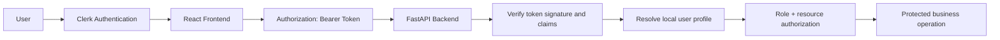

# Security Design Documentation

## 1. Introduction

This document defines the proposed security design for the Item Finder / Campus Lost-and-Found Retrieval System. It is a pre-implementation security specification for an undergraduate capstone project and is intended to guide the design, review, and future implementation of the system without claiming that the security controls described here are already deployed.

The security design is based on the authoritative project documentation for the system architecture, database design, API design, and module design. It remains consistent with the established technology stack and workflows:

- Frontend: ReactJS, React Router DOM, TanStack Query
- Backend: Python, FastAPI, Pydantic, SQLAlchemy ORM
- Database and storage: PostgreSQL on Neon, AWS S3 for item photographs
- External services: Clerk for authentication, Resend for email notifications

This document identifies the primary security objectives, sensitive assets, threats, required controls, and testing strategy for the system. It also distinguishes between mandatory requirements and optional recommendations that require project approval before implementation.

> (assumed) The system is designed as a single backend service with external identity and email providers. This document does not assume a broader security infrastructure beyond the existing project architecture.

---

## 2. Security Objectives

The security design supports the following objectives in the context of a campus lost-and-found application:

### 2.1 Confidentiality
Confidentiality ensures that only authorized users can access private information such as claim records, private messages, user profiles, and photo metadata. In this system, confidentiality is essential for claim discussions, administrative review, and access to item records that may reveal location, ownership, or contact context.

### 2.2 Integrity
Integrity ensures that records are not modified in unauthorized or unintended ways. The system must protect item status, claim status, report decisions, and photo metadata from tampering. The backend must validate all state transitions and prevent unauthorized changes to claim, report, and item records.

### 2.3 Availability
Availability ensures that the service remains usable during routine and abnormal conditions. Threats include spam submissions, excessive API requests, repeated claim attempts, oversized uploads, and dependency outages. Controls are needed to preserve service stability for students and administrators, though the project does not define production-level SLAs.

### 2.4 Authentication
Authentication ensures that a user is who they claim to be. In this project, authentication is handled by Clerk. The frontend receives a valid session token, and the backend validates that token before resolving the local application user profile.

### 2.5 Authorization
Authorization ensures that an authenticated user is allowed to access, edit, or review only the resources permitted by role and business rules. Authorization is not the same as authentication. A valid session does not grant access to all resources.

### 2.6 Accountability
Accountability ensures that actions such as report decisions, claim approvals, and item status updates can be traced to a specific actor or review context. This is supported by the claim status history and related audit-oriented records already described in the database design.

### 2.7 Privacy
Privacy protects sensitive information such as claim activity, private communications, and item images from exposure beyond the authorized workflow. Privacy is especially important because the system handles student records and claim-related interactions in a campus environment.

### 2.8 Data Protection
Data protection covers user-related data, item records, claim content, and stored photo metadata. This includes secure storage, proper handling of S3 metadata, minimizing unnecessary disclosure in email notifications, and protecting secrets such as credentials and API keys.

---

## 3. System Assets and Data Classification

The following assets are relevant to the system. The classification reflects the sensitivity and protection requirements expected for a campus item recovery platform.

| Asset | Description | Sensitivity | Security Requirement |
|---|---|---|---|
| User identity and profile information | Local application user records, role assignment, and identity mapping | High | Protect from unauthorized access and enforce role-based authorization |
| Clerk identity references and authentication tokens | Clerk-issued identifiers and session tokens used for backend validation | High | Validate signatures and claims on every request; do not trust client-supplied identity values |
| Item records | Canonical item metadata such as title, category, status, description, and location | Medium | Restrict modification to authorized roles and validate status transitions |
| Found and missing reports | User-submitted reports for item discovery or loss | Medium | Protect report content, enforce review rules, and prevent false or malicious reports |
| Claim records | Student claims against items and related review outcomes | High | Enforce ownership checks, role restrictions, and audit history |
| Private claim messages | Claim-specific communication between students and administrators | High | Restrict to authorized claim participants and require claim-level authorization |
| Claim status history | Timeline of claim state transitions | High | Maintain immutability or controlled write access for audit integrity |
| Item photographs | Image file metadata and S3 object references | Medium to High | Validate file content, restrict access, and protect S3 object metadata |
| QR references | QR payloads or encoded references for claim or item workflows | Medium | Do not expose sensitive data and validate server-side if used for redemption |
| Administrative operations | Moderation, approval, item status updates, and claim review actions | High | Require explicit admin authorization and log relevant events |
| Database credentials | Credentials used to connect to PostgreSQL | High | Keep in environment variables or secure secret storage; never expose to frontend |
| AWS S3 credentials | Credentials used to access object storage | High | Keep server-side only; do not expose to frontend or public clients |
| Resend API credentials | Email service credentials | High | Keep server-side only; restrict blast radius and protect secret handling |
| Application configuration and secrets | Internal settings, environment values, and tokens | High | Store securely; avoid logging; protect against accidental disclosure |

> (assumed) The project does not currently define a formal data retention or classification policy beyond the information in the architecture and database design documents.

---

## 4. Threat Modeling

The threat assessment below uses the STRIDE model to identify realistic threats against this system. The design treats these as security requirements, not as claims that the system already implements them.

| Threat | Affected Component | Attack Scenario | Potential Impact | Proposed Mitigation |
|---|---|---|---|---|
| Spoofing | Authentication and User Management | An attacker impersonates another user by submitting a valid-looking client token or manipulated identity field | Unauthorized account access and false claim/report submission | Require Clerk token validation on the backend; use the verified session identity, never client-supplied identity values; enforce backend role and resource checks |
| Tampering | Item records, claim records, report records, item status transitions | A user modifies item or claim identifiers in requests to access or alter another record | Unauthorized modification of item or claim state | Enforce authorization on every resource access; validate status transitions; use server-side business rules and database integrity constraints |
| Repudiation | Administrative actions and claim decisions | A user or administrator denies approving or rejecting a claim or report | Weak accountability and disputed decisions | Maintain auditable claim status history, capture actor and timestamp references, and protect logs from tampering |
| Information Disclosure | Private claim messages, item metadata, user profiles | A student accesses another student’s claim or private messages through manipulated IDs | Exposure of sensitive information | Enforce claim-participation and ownership checks; avoid returning unrelated records; provide minimal data in responses |
| Denial of Service | APIs, search endpoints, photo upload endpoints | An attacker bombards search, claim submission, or upload endpoints with invalid or excessive requests | Service degradation and resource exhaustion | Rate limiting, request-size validation, pagination caps, graceful error handling, and dependency timeouts |
| Elevation of Privilege | Admin-only routes, claim review, item management | A student attempts to access administrator-only endpoints or status update routes | Unauthorized moderation and system control | Enforce role-based authorization on each protected endpoint; verify admin role against local profile and check resource context |

### 4.1 Relevant Attack Scenarios

The following scenarios are directly relevant to the system requirements described in the architecture and API design documents:

- An attacker impersonates another user.
- A student accesses another student’s claim.
- A student accesses private messages outside their claim.
- A user changes an item, report, claim, or message identifier to access another resource.
- An unauthorized user modifies item status.
- An attacker submits false found-item or missing-item reports.
- A malicious or oversized photo upload is accepted.
- AWS S3 or Resend credentials are exposed.
- Unauthorized administrative operations are attempted.
- Search or submission endpoints are abused for spam.
- QR references are manipulated or accessed without authorization.
- Email notifications leak private information or are sent for unverified events.

> (assumed) The threat model does not assume full production security monitoring, but it establishes the minimum required defensive controls for a capstone-level system design.

---

## 5. Authentication Security

The authentication flow follows the design already documented in the architecture and API specification:

1. Clerk authenticates the user.
2. The frontend obtains a valid session token.
3. The frontend sends the token through the Authorization Bearer header.
4. FastAPI verifies the token signature and relevant claims.
5. The backend identifies the authenticated user.
6. The backend retrieves the corresponding local user profile.
7. The backend applies role and resource authorization.

### 5.1 Token Verification
The backend must validate the Clerk token before accepting any authenticated request. Verification should include checking the expected issuer, signing algorithm, audience or token audience claims, expiration claims, and user identity claims. The token must be validated on the server side; the frontend must not be trusted to establish identity.

### 5.2 Token Expiration and Invalid Tokens
The system must reject expired, malformed, or otherwise invalid tokens. Requests that lack an Authorization header or include a malformed Authorization value must fail with the appropriate error response and should not create application-side trust state.

### 5.3 Secure Token Handling
The project must treat tokens as sensitive security material. They must:

- be transmitted only over HTTPS
- be stored in a secure client-side mechanism as required by the frontend implementation
- not be logged by the application or browser console code
- not be exposed in URLs, query strings, or error messages
- not be trusted if they are not validated by the backend

### 5.4 Authentication Versus Authorization
Authentication answers the question: “Who is this user?” Authorization answers: “What is this user allowed to do?” The system must maintain this distinction. A user who is authenticated may still be denied access to another user’s claim, another user’s private message, or admin-only endpoints.

### 5.5 Why the Frontend Must Not Establish Identity
The frontend is not a trusted security boundary. A client can manipulate browser state, request payloads, and resource identifiers. Therefore, the backend must treat all request parameters as untrusted and verify resource ownership and roles from the authenticated server context.

### 5.6 Local User Profile Mapping
After Clerk token verification, the backend retrieves or creates the corresponding local application user profile. This local record stores role and application-specific state such as activity status. The local user profile must be used to evaluate permissions rather than trusting client-provided role values.

---

## 6. Authorization and Access Control

The system defines the following primary roles:

- Students
- Administrators

These roles are established in the architecture and API design documents and must be enforced on the backend.

### 6.1 Role-Based Access Control (RBAC) and Administrator Provisioning
The following role model is required:

- Students may submit reports, view own reports, search active items, submit claims on active items, view own claims, and participate in authorized claim threads.
- Administrators review reports, create and moderate canonical items, review all claims, manage item status, and perform moderation operations.
- A user may only access protected resources if both authentication and resource-level authorization succeed.

**Administrator Provisioning Control:**
To prevent unauthorized privilege escalation, administrator accounts are provisioned exclusively through a controlled backend bootstrap or database seeding procedure using a secure server-side environment configuration whitelist (`INITIAL_ADMIN_EMAIL`), or direct database administration in PostgreSQL. The backend must reject and ignore any user-supplied role parameters in registration/profile payloads, and must never trust user-editable Clerk public metadata for administrative authorization.

### 6.2 Resource-Level Authorization
Role checks alone are insufficient. Resource-level authorization must validate whether the authenticated user is allowed to access the specific object instance:

- a student can view only their own reports and claims (`user_id == current_user.id`)
- `GET /api/v1/items/{item_id}/claims` is strictly restricted to administrators; students cannot query claims submitted by other users
- a private claim message thread is visible only to the verified claimant student and authorized administrators
- status history responses must redact internal staff review notes when requested by students

### 6.3 Permission Matrix

| Resource / Operation | Student | Administrator |
|---|---|---|
| Retrieve own profile (`/users/me`) | Yes | Yes |
| Retrieve another user profile | No | Yes, if permitted by admin workflow |
| Submit found/missing report (`POST /reports`) | Yes | Yes |
| Cancel own pending report (`PATCH /reports/{id}/cancel`) | Yes (own report only) | No |
| View item listings (`GET /items`, `/items/search`) | Yes (active items only) | Yes (all items) |
| Search items | Yes (active items only) | Yes (all items) |
| Manually record found item (`POST /items`) | No | Yes |
| Create claim (`POST /claims`) | Yes (active items only) | No |
| Withdraw own claim (`PATCH /claims/{id}/withdraw`) | Yes (own claim only) | No |
| View own claims (`GET /users/me/claims`) | Yes | Yes |
| View item claims queue (`GET /items/{id}/claims`) | **No (Forbidden / IDOR Protection)** | **Yes** |
| Approve or reject report (`PATCH /reports/{id}/review`) | No | Yes |
| Approve or reject claim (`PATCH /claims/{id}/review`) | No | Yes |
| Update item status (`PATCH /items/{id}/status`) | No | Yes |
| Access private claim conversation (`/claims/{id}/messages`) | Yes (claimant only) | Yes (authorized staff) |
| Send private claim message (`/claims/{id}/messages`) | Yes (claimant only) | Yes (authorized staff) |
| View claim status history (`/claims/{id}/status-history`) | Yes (redacted, no staff notes) | Yes (full audit notes) |
| Upload item photo (`POST /items/{id}/photos`) | No | Yes |
| Upload report photo (`POST /reports/{id}/photos`) | Yes (own report only) | Yes |
| Generate QR reference for verified claim | Yes (own claim only) | Yes |
| Automated QR Redemption (`/claims/redeem`) | **Deferred from MVP** | **Deferred from MVP** |

### 6.4 Security Requirements for Specific Features

#### User Profile Access
- Authenticated users may access and update their own permitted profile fields.
- Access to other user profile data is restricted to administrators.

#### Item Browsing and Search Visibility
- Students can browse and search only approved, eligible items where `item_status = 'active'`.
- Items with status `claimed`, `resolved`, or `archived` are excluded from student search results to protect privacy.
- Missing-item reports in `item_reports` are never exposed in public search results.
- Item status updates require administrator authorization and valid lifecycle transitions.

#### Found and Missing Reports
- Report creation requires student or administrator authentication.
- Report review, approval, and rejection are restricted to administrators.
- Approving a found report creates a canonical item and transfers photo associations within an atomic database transaction.
- Missing reports remain inquiry records and never generate claimable items.

#### Claim Submission, Review, and Competing Claims
- Claim creation requires an authenticated student session and an active canonical item.
- Competing claims: Multiple pending claims may coexist on an active item.
- Approving a claim is restricted to administrators and executed under a pessimistic database lock (`SELECT ... FOR UPDATE`): approving one claim transitions the item to `claimed` and auto-rejects all competing pending claims.
- `GET /api/v1/items/{item_id}/claims` is strictly restricted to role `Administrator`. Students are forbidden from viewing claims submitted by others.

#### Protection of Internal Staff Review Notes
- Internal staff review notes (`claims.review_note`, `claim_status_history.note`) contain administrative evaluation rationale and dispute records.
- API endpoints returning claim details or status history enforce field-level redaction: internal staff notes are omitted in student responses and visible only to administrators.

#### Private Claim Communication
- Only the verified claimant student and authorized administrators may access a claim message thread.
- Direct object references must be validated against `claim.claimant_user_id == current_user.id` or administrator role.

#### Item Photographs and Private S3 Access
- Uploaded files are validated for size (<= 5 MB), allowed MIME types (`image/jpeg`, `image/png`, `image/webp`), and binary magic bytes.
- S3 buckets remain strictly private; no public bucket read access is permitted.
- Image viewing is served via short-lived AWS S3 Presigned GET URLs generated by the backend for authorized callers.
- Photos attach to `item_reports` (`report_id`) upon initial submission and transfer association to `items` (`item_id`) upon approval without re-uploading S3 objects.

#### QR References (Redemption Deferred)
- QR generation is restricted to verified claims (`claim_status == 'approved'`) and authorized claimants.
- QR payloads use non-sensitive, cryptographically signed identifiers.
- Possession of a QR code alone does not establish ownership; staff must physically verify student identity.
- Automated QR redemption is deferred from the initial MVP release. Handover is recorded directly by staff in the admin portal.

### 6.5 BOLA / IDOR Prevention

Broken Object Level Authorization (BOLA / IDOR) occurs when an application validates user authentication but fails to verify that the caller is authorized to access the specific requested resource instance.

In this system, primary BOLA/IDOR risk vectors include:
1. **Item Claims Queue (`GET /api/v1/items/{item_id}/claims`):**
   - *Attack Scenario:* A student caller supplies an `item_id` to retrieve all claims and view competing claimants' identities and ownership proofs.
   - *Enforced Control:* Endpoint strictly restricted to role `Administrator`. Student callers receive HTTP 403 Forbidden.
2. **Claim Retrieval (`GET /api/v1/claims/{claim_id}`):**
   - *Attack Scenario:* A student caller changes `claim_id` to inspect another student's claim details.
   - *Enforced Control:* FastAPI dependency validates `claim.claimant_user_id == current_user.id` for student callers.
3. **Private Claim Communication (`/api/v1/claims/{claim_id}/messages`):**
   - *Attack Scenario:* A student attempts to read or post messages in a claim thread belonging to another student.
   - *Enforced Control:* Explicit validation that caller is the claim owner or an administrator.
4. **Report Moderation (`PATCH /api/v1/reports/{report_id}/review`):**
   - *Enforced Control:* Route-level administrator role check before any database access.

Every protected resource access must validate that the authenticated user is authorized to access the specific object instance, even when the endpoint itself is otherwise accessible.

This must be enforced through:

- role checks
- ownership checks
- claim-participation checks
- resource-specific authorization functions
- no trusted reliance on guessable or sequential object identifiers

> (assumed) Unpredictable identifiers may reduce enumeration risk, but they are not a substitute for authorization checks.

---

## 7. API Security

The FastAPI REST API must enforce security at the application layer because frontend hiding of routes or UI elements is not an effective control.

### 7.1 Authentication Dependencies
The backend must require authentication for all endpoints that operate on protected resources. Authentication should be centralized through a dependency that:

- verifies the request token
- resolves the authenticated user
- retrieves the local profile
- fails with a structured error response when the user is not authenticated

### 7.2 Role-Based Authorization Dependencies
Protected endpoints must use backend-enforced role dependencies, such as requiring the user to be an administrator for moderation or claim review operations. Role checks must be applied on the server, not inferred from the frontend interface.

### 7.3 Resource Ownership Checks
The backend must verify ownership or valid participation before allowing access to:

- a student’s own reports
- a student’s own claims
- private claim message threads
- item photo metadata associated with a particular item
- any object where the user is not allowed to view or modify the full resource

### 7.4 Pydantic Validation
The API must validate all request data with Pydantic. Validation should cover:

- required fields
- correct types
- accepted enums or allowed string values
- size or length constraints
- invalid nested structures
- invalid workflow transitions

### 7.5 Mass-Assignment Prevention
The API must avoid accepting arbitrary client-supplied fields that could overwrite protected or sensitive fields. This includes rejecting unexpected or unauthorized fields, especially in patch/update operations and nested request bodies.

### 7.6 Safe Error Responses
The API should use the error conventions already described in the API design documentation. Error responses must not expose sensitive stack traces, internal implementation details, or raw database error states to the client. The system should differentiate:

- 400 Bad Request for malformed requests
- 401 Unauthorized for missing or invalid authentication
- 403 Forbidden for denied authorization
- 404 Not Found for missing or unauthorized resources
- 409 Conflict for conflicting state or duplicate actions
- 422 Unprocessable Entity for invalid or semantically wrong payloads
- 500/503 for backend or dependency issues

### 7.7 Appropriate HTTP Methods
The API should use standard REST semantics only:

- GET for retrieval
- POST for creation
- PATCH for partial updates or state transition
- DELETE only for clearly authorized removal operations

Unsupported methods or inappropriate action mapping must be blocked.

### 7.8 CORS Restrictions
The frontend is a browser-based React application, but the backend must still enforce strict CORS rules so that cross-origin access is limited to approved origins. This reduces abuse from unintended browser origins.

### 7.9 HTTPS
All production requests should be served over HTTPS only. Sensitive tokens, claim messages, and personal data must not be exposed over plaintext HTTP.

### 7.10 Rate Limiting and Abuse Protection
Where applicable, the API should apply rate limiting and request throttling for endpoints subject to abuse, including item search, report submission, claim creation, and file uploads. This is an important defense against spam, scraping, and brute force or automated abuse. However, specific numeric thresholds must be treated as proposed values requiring testing and approval.

### 7.11 Pagination Limits
List endpoints should enforce maximum page sizes and appropriate pagination to avoid resource exhaustion and excessive payloads. This is especially relevant to item search and claim browsing.

### 7.12 Protection Against Unauthorized State Transitions
The API must reject invalid transitions such as:

- admin review of a report that was already resolved
- claim approval when the claim is not in an eligible state
- item status changes that contradict a claim or report decision
- modification of item metadata by a non-admin user

### 7.13 Why Frontend Route Hiding is Not Sufficient
A frontend UI that hides an admin button or removes a link does not block an attacker from sending the corresponding API request directly. Authorization must be enforced on the backend for every protected action. The frontend may present a user experience but is never the security control.

---

## 8. Database Security

The database design is PostgreSQL on Neon with SQLAlchemy ORM in the FastAPI backend. Database security requirements are essential because the system stores user, claim, report, status, and photo metadata information.

### 8.1 Secure Database Connection Configuration
The backend must configure database access using environment variables and secure secret management. Credentials must not be embedded in source code or exposed to the frontend. The connection string should use secure settings consistent with a hosted PostgreSQL environment and should avoid unnecessary broad network exposure.

### 8.2 Least-Privilege Access
The database access model should follow least privilege. The application should not use a single account with unrestricted administrative rights if a narrower operational role is sufficient. This is a design principle for implementation planning and should be reviewed in deployment.

### 8.3 SQL Injection Prevention
SQLAlchemy ORM helps reduce the risk of SQL injection when queries are constructed using parameterized ORM operations rather than raw string interpolation. However, ORM usage does not eliminate the need for safe query construction and authorization-aware filtering. Backend logic must still validate user inputs and avoid unsafe query patterns.

### 8.4 Foreign-Key Integrity
The database design should enforce relational integrity through foreign keys among:

- users and item_reports
- users and items where required
- items and claims
- claims and claim_messages
- claims and claim_status_history
- items and item_photos

This protects against orphaned records and invalid references.

### 8.5 Transaction Management
Transaction boundaries must be enforced for operations where multiple records must remain consistent, such as:

- claim approval with item status update
- report approval with item creation or update
- photo metadata persistence after S3 upload

If one part of the workflow fails, the system must avoid leaving the database in a partial or inconsistent state.

### 8.6 Protection of Private Messages and User Records
Private claim messages and user-related records must be protected from direct exposure outside intended workflows. The data access layer must enforce authorization before returning claim messages or a user profile.

### 8.7 Backup and Recovery Considerations
The project should include backup and recovery planning for PostgreSQL, even though this is not yet implemented. A hosted PostgreSQL service may provide operational backup features, but the project should still define the expected recovery responsibilities and retention assumptions in deployment planning.

### 8.8 Database Error Handling
The database layer should not expose internal database errors to clients. Instead, application-level exceptions should be mapped to safe API responses. This reduces information leakage and prevents attackers from learning implementation details or system structure.

> (assumed) The database design is relational and not yet final. These controls describe required security practices for the implementation environment rather than a completed production deployment design.

---

## 9. File Upload and AWS S3 Security

The architecture requires backend-mediated item photo uploads. The security workflow must be as follows:

1. Authenticate the user.
2. Verify permission to upload a photograph.
3. Validate file size.
4. Validate allowed file types.
5. Inspect actual file content instead of trusting the filename or Content-Type header alone.
6. Generate safe object keys.
7. Upload the validated file to S3.
8. Store the object reference and metadata in PostgreSQL.
9. Return an appropriate response.

### 9.1 File Validation Requirements
The backend must validate:

- upload size limits: max 5 MB per file
- allowed image extensions and types: `image/jpeg`, `image/png`, `image/webp`
- actual file content via binary magic bytes inspection (e.g. `\xFF\xD8\xFF` for JPEG, `\x89PNG` for PNG, `RIFF...WEBP` for WebP)
- sanitized server-generated S3 object keys (e.g. `reports/{report_id}/{uuid}.jpg`), rejecting client-supplied paths to prevent directory traversal
- verification that declared MIME types match verified magic bytes

The filename and Content-Type header must never be considered authoritative proof that the file is safe. The system inspects actual binary content before upload.

### 9.2 Oversized and Malicious Uploads
Uploads are rejected with HTTP 413 or 415 if they exceed 5 MB, contain malicious executable payloads disguised as images, or fail binary magic byte inspection.

### 9.3 MIME Type Spoofing and Safe Key Generation
Attackers may upload files with misleading names (e.g., `image.php.jpg`) or fake Content-Type headers. The backend strictly ignores client filename values when generating storage keys, assigning secure random UUID-based keys.

### 9.4 Unauthorized Photo Access and Private Presigned Delivery
AWS S3 objects remain strictly private. Direct public access to S3 buckets is prohibited. The backend enforces resource authorization before generating short-lived AWS S3 Presigned GET URLs (15-minute expiration) for authorized callers:
- Students can access presigned photo URLs only for active catalog items or their own submitted reports.
- Administrators can access presigned URLs for all photos.

### 9.5 Photo Association Transfer Security
Photos uploaded during report submission attach initially to `item_reports` (`report_id`). When an administrator approves a found report:
- Photo metadata updates atomically to `item_id = item.id, report_id = NULL` within the database transaction.
- The binary object in S3 remains unchanged, completely avoiding re-upload risks or duplicate media bloat.

### 9.6 AWS Credential Protection
AWS credentials remain strictly server-side. They are never exposed to the frontend, stored in client bundles, or embedded in source code.

### 9.7 Safe Object Deletion and Orphan Cleanup
When an item or report is deleted or a photo is removed, the backend ensures both PostgreSQL metadata and S3 binary objects are deleted together. If a database failure occurs after an S3 upload, the backend catches the error and issues an immediate compensation delete to S3 to prevent orphaned files.

---

## 10. Private Messaging Security

The private claim communication model must protect claim conversation privacy and ensure that message access is tightly scoped to the relevant claim context.

### 10.1 Authorization Rules for Message Access
The following rules are required:

- Only authorized claim participants may access a conversation.
- Message retrieval must verify access to the associated claim.
- Message submission must verify sender authorization.
- Students must not access unrelated claim messages.
- Administrators may access conversations only when their documented permissions allow.
- Message content must not be exposed in unrelated API responses or email notifications.

### 10.2 Claim-Level Enforcement
The backend must not trust a client-provided claim id or user id alone. It must verify that the claim exists, is currently valid for the workflow, and that the authenticated user is permitted to access it.

### 10.3 Message Integrity
The system should preserve message integrity by ensuring that each message is associated with a valid claim and sender identity. Message creation should not permit cross-thread posting or unauthorized impersonation.

### 10.4 Audit Considerations
Private message access and submission must be auditable at the application level where the project supports such records. The existing database design already includes claim status history for claim workflows; any additional security logging should be treated as an optional application-level recommendation and marked clearly as such.

---

## 11. Email Notification Security

The system uses Resend for email notifications, but the email layer is not a security boundary or proof of ownership.

### 11.1 Server-Side Credential Control
Resend API credentials must remain server-side only. They must not be exposed in the React frontend or client-side code. Credentials should be managed through secure environment variables or equivalent deployment secret storage.

### 11.2 Minimal Disclosure
Email content must not unnecessarily disclose personal information or sensitive claim details. Notification bodies should include only the minimum necessary information required for the student or administrator to identify the event.

### 11.3 Event Integrity
Notifications must be tied to legitimate application events such as report review, claim status changes, or item-related workflows. The backend must not send email based on unvalidated or unauthenticated user actions.

### 11.4 User-Provided Content Safety
Any user-provided text used in email notifications must be sanitized and constrained to avoid unsafe message content or unintended leakage. The application should avoid embedding raw message content in ways that could create injection or content-poisoning issues.

### 11.5 Delivery and State Consistency
Email delivery failures must not silently corrupt the application state. If the email request fails, the backend should record the fact and maintain the actual business outcome separately from the email transport outcome.

### 11.6 Distinction Between Event and Delivery
The application event may be recorded successfully even when the email service returns an error or delay. An email being successfully sent is not proof of claim approval, item ownership, or item resolution. The application must treat the business workflow as the authoritative source of truth, with the email as a communication mechanism.

---

## 12. QR Code Security (Redemption Deferred)

The system includes QR generation for verified claim workflows. This feature is designed conservatively:

### 12.1 Sensitive Data Avoidance
QR payloads must never expose sensitive user identity information, raw internal database primary keys, or unauthenticated claim data. A non-sensitive cryptographically signed reference token is returned.

### 12.2 Non-Predictable Signed References
The QR reference uses a server-signed payload (e.g. HMAC-SHA256 signature over claim identifier and expiration timestamp) to prevent forging or client manipulation.

### 12.3 QR Possession Is Not Ownership
Possession of a QR code alone does not establish ownership. Physical verification of claimant identity against student ID and the claim record by campus staff is required before physical handover.

### 12.4 Scope Boundary: Automated Redemption Deferred
Automated QR scanning and cryptographic redemption (`POST /api/v1/claims/redeem`) is explicitly **deferred** from the initial MVP release. In the MVP, physical item handover is confirmed directly by administrators within the web portal (`PATCH /api/v1/items/{item_id}/status` to `resolved`).

### 12.5 Generation Access Control
Only authenticated claimants whose claims have reached `claim_status = 'approved'` and administrators with claim oversight may generate or retrieve the QR reference card. Requests for unapproved claims are rejected with HTTP 403 Forbidden.

---

## 13. Logging and Auditing

The system must keep records of security-relevant events without creating unnecessary personal data exposure. This section distinguishes between required audit-related records already described in the database design and proposed application security logging that may require additional design decisions.

### 13.1 Security Events to Record
At minimum, the system should record or preserve information about:

- authentication failures where available
- authorization failures
- administrative report decisions
- claim approval and rejection
- item status changes
- important claim workflow transitions
- relevant security-related errors

This recordkeeping should align with the database design’s claim status history concept and other audit-oriented fields.

### 13.2 Safe Logging Practices
The following rules are required:

- Never log authentication tokens.
- Never log passwords, secret credentials, or API secrets.
- Avoid unnecessary personal information in logs.
- Protect log access through appropriate access controls.
- Use timestamps and actor/resource references where supported.

### 13.3 Distinguishing Audit Tables from Application Security Logs
The existing database design includes claim_status_history and other operational fields that support accountability. If an additional application security log is introduced, it must be clearly marked as a proposed design addition rather than an existing system entity.

> (assumed) Additional audit tables or security event stores may be helpful for implementation but are not part of the current documented database design.

---

## 14. Availability and Abuse Prevention

Availability security protects the project from service disruption and abuse.

### 14.1 Potential Availability Threats
The system may face:

- excessive API requests
- repeated claim submissions
- automated report flooding
- oversized photo uploads
- abusive search endpoints
- external service outages
- database connection exhaustion

### 14.2 Required Controls
At a minimum, the project should add or consider:

- rate limiting or request throttling for high-volume endpoints
- request-size validation for all payloads and file uploads
- pagination limits for listing and search endpoints
- graceful handling of dependency failures
- timeout and retry controls when interacting with external services
- backend validation before expensive operations are processed

### 14.3 Optional Recommendations
The following controls are useful but should be treated as optional recommendations requiring approval and validation:

- dedicated WAF or reverse proxy protections
- fine-grained rate limit policies per route or role
- centralized abuse detection and alerting
- service-level health checks and enhanced resilience strategies

These are not required by the current architecture and should not be treated as mandatory project features unless approved.

---

## 15. Security Risk Assessment

This risk register uses a qualitative scale:

- Likelihood: Low, Medium, High
- Impact: Low, Medium, High
- Risk Level: Low, Medium, High, Critical

Criteria:

- Low: limited effect, small attack surface, easy to mitigate
- Medium: important user or administrative impact, moderate likelihood
- High: significant exposure or direct unauthorized access to sensitive data or functions
- Critical: likely unauthorized access to sensitive records, administrative functions, or widespread service disruption

| Risk ID | Threat | Likelihood | Impact | Risk Level | Mitigation |
|---|---|---|---|---|---|
| SEC-001 | Unauthorized access to another user’s claim or private messages | Medium | High | High | Enforce claim-level authorization, ownership checks, and BOLA/IDOR validation on all protected resources |
| SEC-002 | Unauthorized item or claim status modification | Medium | High | High | Validate admin role, verify state transitions, and enforce transaction-safe updates |
| SEC-003 | Malicious or oversized photo upload | Medium | Medium | Medium | Validate file size, file type, and content, and reject unsafe media before upload |
| SEC-004 | Spoofing via manipulated client identity | Medium | High | High | Require backend verification of Clerk tokens and never trust frontend-supplied identity values |
| SEC-005 | False or abusive report submission | High | Medium | High | Validate payloads, enforce rate limiting, and maintain administrator review workflow |
| SEC-006 | QR reference misuse | Medium | Medium | Medium | Do not expose sensitive data in QR payloads; validate server-side if redemption is implemented |
| SEC-007 | Email notification leakage | Low to Medium | Medium | Medium | Keep content minimal, server-side, and tied to legitimate application events |
| SEC-008 | External credential exposure | Low | High | High | Keep AWS, Resend, and database secrets server-side only; avoid frontend exposure |
| SEC-009 | Search or API spam abuse | Medium | Medium | Medium | Apply request throttling, pagination limits, and graceful validation |
| SEC-010 | Insecure access to admin functions | Low to Medium | High | High | Require admin role checks on every admin endpoint and validate the target resource |

### 15.1 Prioritization
The highest-priority risks are:

1. Unauthorized access to claims, messages, or other protected resources
2. Manipulation of item or claim state via API tampering
3. Spoofing or invalid identity assumptions
4. Unauthorized administrative operations
5. Exposure of external service credentials

These risks directly affect confidentiality, integrity, and user trust and therefore require the most attention during implementation.

---

## 16. Security Testing Strategy

Security testing must be aligned with the documented requirements and should be performed in a developer-controlled or explicitly authorized test environment. It must not be conducted against third-party systems without authorization.

### 16.1 Authentication Testing
- Missing token
- Invalid token
- Expired token
- Malformed Authorization header
- Token with valid structure but invalid signature or claims

### 16.2 Authorization Testing
- Student accessing administrator-only endpoints
- Student accessing another student’s resource
- Unauthorized claim access
- Unauthorized message access
- Unauthorized item status modification

### 16.3 BOLA / IDOR Testing
- Replace resource IDs in API requests to test cross-user access boundaries
- Attempt student access to `GET /api/v1/items/{item_id}/claims` (must return HTTP 403 Forbidden)
- Attempt cross-user claim access (`GET /api/v1/claims/{id}` where claimant != current user; must return HTTP 403 or 404)
- Attempt unauthorized access to another student's report or private claim message thread
- Confirm that object ownership is checked after route-level authentication succeeds
- Verify that student requests to `/api/v1/claims/{id}/status-history` return public schemas with internal staff notes redacted

### 16.4 Input Validation Testing
- Missing required fields
- Invalid data types
- Excessively long input
- Unexpected fields (mass-assignment attempts)
- Invalid workflow transitions
- Duplicate or conflicting submissions

### 16.5 File Upload Testing
- Files exceeding 5 MB limit
- Disallowed file extensions (.exe, .php, .sh, .html)
- MIME type spoofing (e.g. executable with .jpg extension)
- Magic byte verification failures
- Directory traversal attempts in filenames
- Unauthorized photo uploads

### 16.6 Business Logic and Concurrency Testing
- Duplicate active claim submission by the same student against the same item (must return HTTP 409 Conflict)
- Simultaneous competing claim submissions by different students (must succeed and remain pending)
- Concurrent claim approval attempts on the same item by two administrators (the first must succeed and set item to `claimed`; the second must be rejected with HTTP 409 Conflict)
- Verification that approving one claim auto-rejects all competing pending claims on that item with audit entries in `claim_status_history`
- Verification that missing-item reports do not generate claimable items in `items`
- Verification that students can only search items where `item_status = 'active'`
- QR generation requests on unverified or unapproved claims (must return HTTP 403 Forbidden)

### 16.7 Security Testing Execution Notes
All testing should verify the real application behavior through the actual backend and API layer. It should not rely on mock-only assertions or backend-only semantics without checking the real response behavior and enforcement logic.

---

## 17. Security Requirements Traceability

| Requirement ID | Security Requirement | Affected Module | Related API/Entity | Priority |
|---|---|---|---|---|
| SEC-001 | Verify Clerk tokens on the backend before accepting authenticated requests | Authentication and User Management | /api/v1/auth/me; users | High |
| SEC-002 | Enforce role-based authorization for student and administrator access | Authentication and User Management | users, /api/v1/users, /api/v1/reports, /api/v1/claims | High |
| SEC-003 | Enforce resource ownership checks for claim, report, and message access | Claim Submission and Verification, Private Claim Communication | claims, claim_messages, item_reports | High |
| SEC-004 | Require valid transitions for item, report, and claim status changes | Item Management, Claim Submission and Verification, Administrative Management | items, item_reports, claims, claim_status_history | High |
| SEC-005 | Validate incoming request payloads and reject malformed objects | All modules | All API endpoints | High |
| SEC-006 | Prevent BOLA / IDOR access via object ID tampering (including /items/{id}/claims admin restriction) | All protected modules | items, reports, claims, claim_messages, item_photos | High |
| SEC-007 | Validate file size (<= 5MB), MIME type, and binary magic bytes before S3 upload | Item Photo Management | /api/v1/reports/{id}/photos, /api/v1/items/{id}/photos | High |
| SEC-008 | Protect S3 object references via private buckets and short-lived Presigned GET URLs | Item Photo Management | item_photos | High |
| SEC-009 | Ensure private claim communication remains inaccessible outside authorized claim context | Private Claim Communication | claim_messages, /api/v1/claims/{claim_id}/messages | High |
| SEC-010 | Protect admin-only moderation endpoints and prevent privilege escalation via backend bootstrap | Administrative Management, Auth & User Mgmt | /api/v1/reports/{id}/review, /api/v1/claims/{id}/review, /api/v1/items | High |
| SEC-011 | Keep Resend credentials and notification flow server-side only; omit staff notes | Email Notification | Resend integration | High |
| SEC-012 | Prevent sensitive data exposure in QR payloads; defer automated redemption from MVP | QR Code Management | /api/v1/claims/{claim_id}/qr | Medium |
| SEC-013 | Redact internal administrative review notes in student-facing claim status history responses | Claim Submission and Verification | /api/v1/claims/{id}/status-history | High |
| SEC-014 | Enforce student catalog search visibility strictly to active items | Search and Filtering | /api/v1/items, /api/v1/items/search | High |
| SEC-015 | Enforce atomic concurrency locking during claim approval to prevent competing claim race conditions | Claim Submission and Verification | claims, items, claim_status_history | High |

---

## 18. Established Security Decisions and Scope Boundaries

The following security architecture decisions are formally established:

- **BOLA / IDOR Enforcement on Claims:** Established. `GET /api/v1/items/{item_id}/claims` is strictly restricted to administrators. Student callers receive HTTP 403 Forbidden.
- **Internal Staff Notes Redaction:** Established. Response models apply field-level authorization: internal staff review notes are omitted from student responses and visible only to administrators.
- **Administrator Provisioning:** Established. Initial administrator roles are provisioned exclusively through a controlled backend bootstrap or database seeding process (`INITIAL_ADMIN_EMAIL`), never from client claims or public Clerk metadata.
- **Private Media Delivery:** Established. AWS S3 buckets are private. Photos are rendered via short-lived AWS S3 Presigned GET URLs generated by the backend.
- **Dual-Parent Photo Transfer:** Established. Photos ingest with `report_id` and transfer to `item_id` upon approval without re-upload.
- **Competing Claim Concurrency:** Established. Approving one claim uses pessimistic locking (`SELECT ... FOR UPDATE`), transitions the item to `claimed`, and automatically marks competing claims as `rejected` with an audit note.
- **Search Visibility Rules:** Established. Student search queries are forced to filter `item_status = 'active'`.
- **QR Redemption Deferred:** Scope Decision. Automated QR scanning and redemption is deferred from the initial MVP release. Handover is verified by staff in the portal.
- **Operational Policies Deferred to Deployment:** Automated data retention schedules and long-term audit log archival are operational policies to be configured during production deployment.

---

## 19. Conclusion

The Item Finder / Campus Lost-and-Found Retrieval System is a campus-oriented application that handles sensitive information, user identity, claim decisions, report review, private messaging, item photographs, and administrative moderation. The security design therefore requires strict backend enforcement of authentication, authorization, resource ownership, validation, and status-control logic.

The core principle of this security design is that identity and authorization are enforced by the FastAPI backend using validated Clerk session metadata and resource-aware permission checks. The system must prevent object-level authorization failures, ensure that all state transitions are valid and auditable, protect item photo uploads and S3 metadata, and minimize disclosure in email and QR workflows.

The proposed security design does not claim that the implementation already exists. Instead, it establishes the security requirements that should be met during implementation, testing, and deployment review. This preserves the academic and pre-implementation nature of the capstone project while providing a structured basis for future engineering and validation work.
