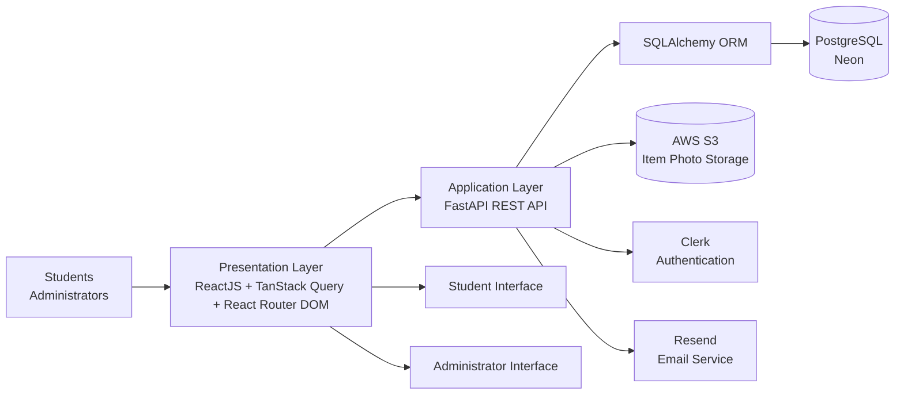
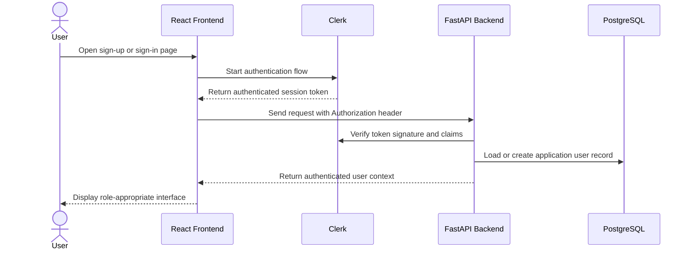
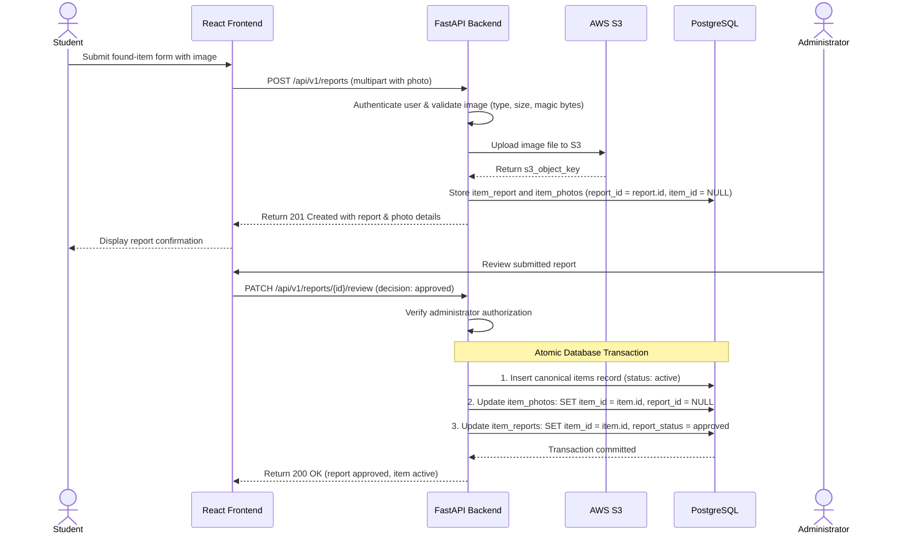
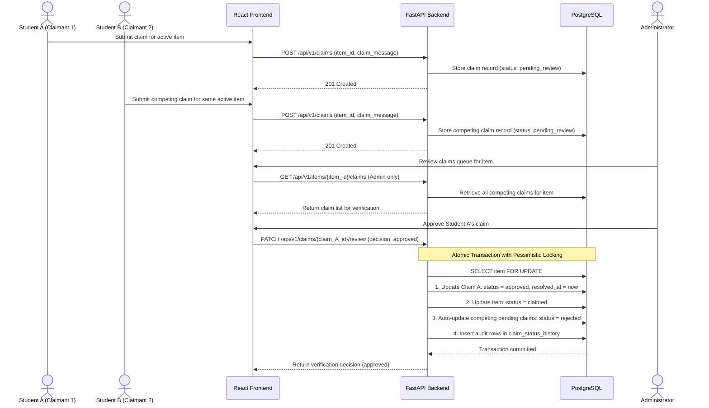
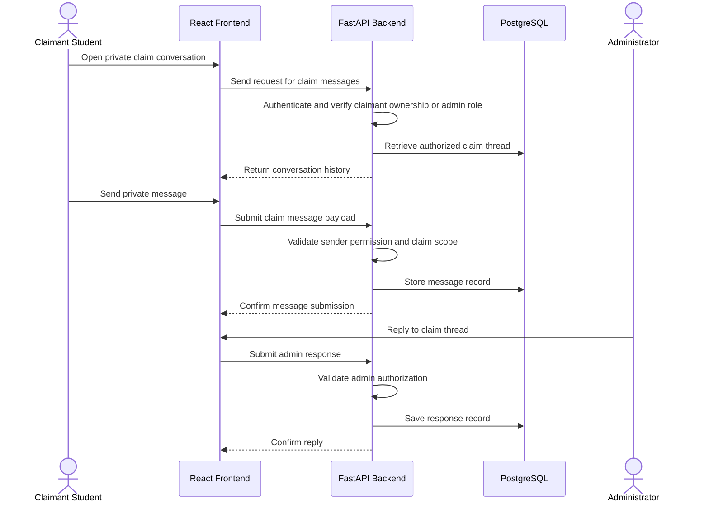
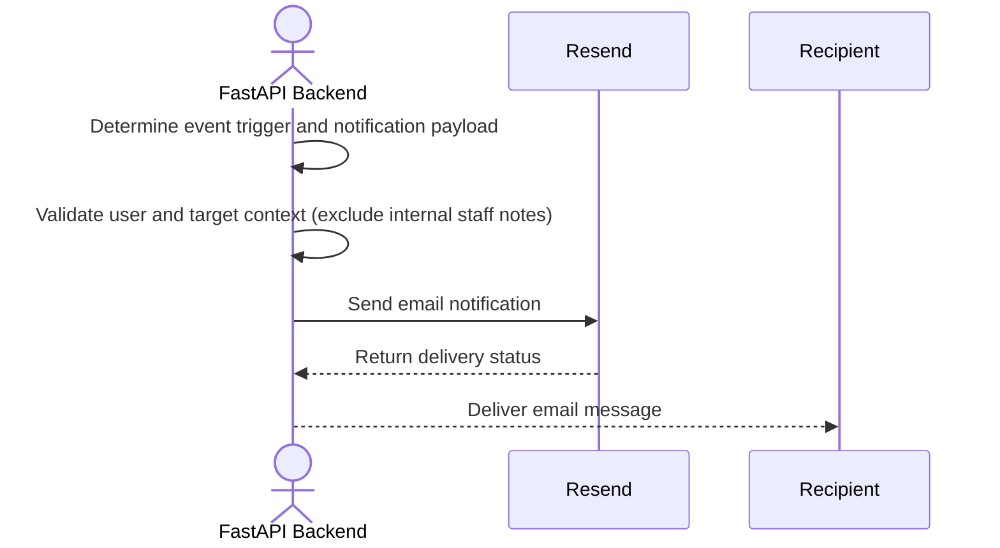
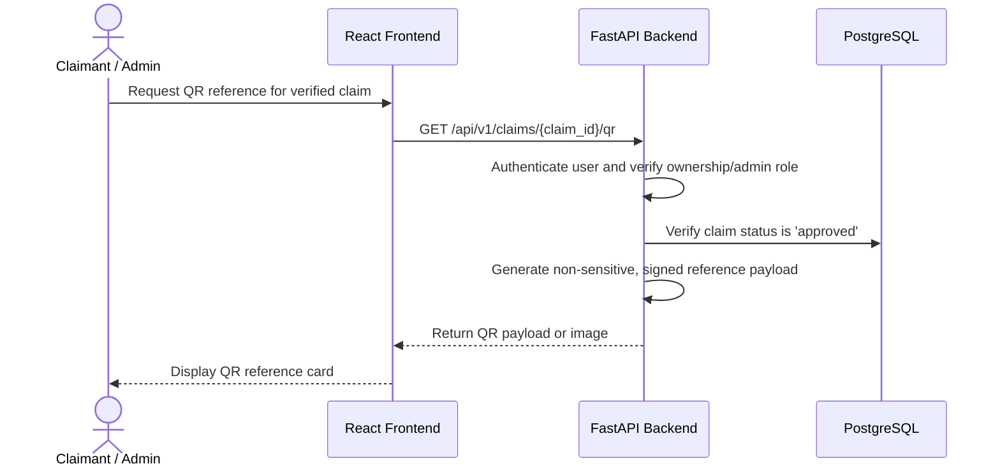

# System Architecture Documentation

Figure 1. System Architecture of the Item Finder System



## 1. Overview and Purpose of the System

The Item Finder / Campus Lost-and-Found Retrieval System is a proposed web-based platform for managing lost and found item records within a campus environment. The system supports the full item recovery workflow, from the initial report of a missing or found item to item matching, claim submission, verification, and communication. Students report missing or found belongings, search the item catalog, submit claims, and receive notifications. Administrators review reports, verify claims, manage item listings, and confirm claim outcomes.

The system is designed as a layered client-server architecture in which the frontend interacts with a centralized backend through HTTP/REST APIs. The backend validates requests, enforces authorization, coordinates business logic, and persists records in PostgreSQL. Item photos are stored in AWS S3, and external services provide identity management and email delivery. This design separates concerns across the user interface, application logic, persistence layer, and external dependencies, which improves maintainability and supports future extension.

This document presents the proposed architecture as a pre-implementation specification. It describes the intended design and clarifies the responsibilities of each component without claiming that the final implementation has already been completed.

---

## 2. Architectural Style and Design Rationale

The system follows a layered client-server architecture. The presentation layer is implemented in ReactJS and provides student and administrator interfaces. The application layer is implemented in FastAPI and contains the business logic, request validation, authentication coordination, authorization checks, and module orchestration. The data layer comprises PostgreSQL for structured application records and AWS S3 for item image files. External services include Clerk for authentication and Resend for email notifications.

This architecture is suitable for the system because it separates responsibilities into clearly defined layers:

- Presentation layer: user interaction, navigation, and interface rendering
- Application layer: business logic, validation, authorization, and API orchestration
- Data layer: relational persistence and object storage
- External services: identity management and communication support

The layered design allows each component to evolve independently without tightly coupling interface concerns to database logic or external service integration. It also centralizes sensitive operations, such as claim verification and item status updates, in the backend, where authorization and integrity checks can be enforced consistently.

> (assumed) The architecture is designed for a single backend service rather than microservices. This remains consistent with the provided system diagram and is not expanded into additional infrastructure.

---

## 3. Layer-by-Layer Description

### 3.1 Users

The system supports two primary user roles:

- Students: Students register and log in, report found items, report missing belongings, search items, submit claims, receive notifications, and participate in private claim communication.
- Administrators: Administrators log in, verify found-item reports, review claims, manage item listings, and verify claim results.

The system distinguishes between these roles in both the user interface and the backend authorization model. Student-facing features are designed for item reporting and claim submission, while administrative features are reserved for moderation and verification workflows.

### 3.2 Presentation Layer

The presentation layer uses:

- ReactJS as the frontend framework
- TanStack Query for server state management
- React Router DOM for navigation and routing

The frontend includes separate student and administrator interfaces. It communicates with the backend through HTTP/REST requests. The frontend does not directly access PostgreSQL or AWS S3. Instead, it sends requests to the FastAPI application, receives structured responses, and renders the relevant user interface state.

This layer is responsible for user navigation, form handling, result display, and user experience. It is intentionally thin with respect to business logic, which remains centralized in the backend layer.

### 3.3 Application Layer

The application layer uses:

- FastAPI as the REST API framework
- Pydantic for request validation and response serialization
- SQLAlchemy ORM for database interaction
- Clerk for identity authentication and token validation
- Backend authorization checks for role enforcement and ownership validation

The backend implements the following modules:

- Item Management
- Found and Missing Item Reporting
- Search and Filtering
- Claim Submission and Verification
- Private Claim Communication
- Email Notification
- QR Code Generation

This layer validates all incoming requests, enforces authentication and authorization rules, coordinates domain logic, and persists or retrieves data through the data layer. It also handles communication with external services for email delivery and identity verification.

### 3.4 Data Layer

The data layer consists of the following components:

- PostgreSQL (hosted on Neon) for structured application records
- AWS S3 for item photo storage

PostgreSQL stores application records such as user profile references, item records, item reports, claim records, claim messages, and status transitions. AWS S3 stores image files uploaded by users and provides a scalable object-storage layer for media content. The database stores references to object locations or object metadata, while the actual media file remains in S3. Photo metadata in PostgreSQL (`item_photos`) associates initially with a user-submitted report (`report_id`) and atomically transfers its association to the canonical item (`item_id`) upon administrator approval without re-uploading the S3 object. To preserve media privacy and avoid public bucket exposure, client-side photo retrieval is served via short-lived AWS S3 Presigned GET URLs generated by the FastAPI backend.

The architecture defines the following core logical entities:

- User profiles (`users`)
- Item records (`items`)
- Item reports (`item_reports`)
- Claims (`claims`)
- Claim messages (`claim_messages`)
- Claim status history (`claim_status_history`)
- Item photo references (`item_photos`)

These entities reflect a normalized relational design where photos can link to either reports or items, and audit trails remain historically preserved.

### 3.5 External Services

The external services in the proposed architecture are:

- Clerk: user authentication and identity management
- Resend: email delivery service
- AWS S3: object storage for uploaded item photos

Clerk provides the identity layer and issues authentication tokens that the frontend includes in each request. Resend sends system notifications such as claim status updates and item-related notices. AWS S3 stores uploaded image files that are referenced by item records stored in PostgreSQL.

---

## 4. Module Descriptions

| Module | Purpose | Inputs | Outputs | Primary Dependencies | Authorized User Roles |
|---|---|---|---|---|---|
| Found and Missing Item Reporting | Creates reports for missing or found belongings | User identity, item description, location, date, optional image | New report and associated photo metadata (and item creation trigger upon approval) | FastAPI validation, authentication, PostgreSQL, S3 | Students, Administrators |
| Item Management | Maintains the canonical item record set and item lifecycle | Item metadata, status updates, photo references, admin actions | Updated item records, item statuses, item history, manual item entry | PostgreSQL, validation rules, authorization checks | Students (read active), Administrators (full management) |
| Search and Filtering | Retrieves matching records using query criteria | Search keywords, filters, item metadata | Matching item list and result set (scoped to authorized visibility) | PostgreSQL, access control checks | Students (active items only), Administrators (all statuses) |
| Claim Submission and Verification | Handles claim submission and administrative review | Claim details, item identifier, user identity | Claim record, claim status, verification result, competing claim resolution | PostgreSQL, authorization checks, item records | Students (submit & view own), Administrators (review all) |
| Private Claim Communication | Supports private claim discussions | Claim ID, message content, sender identity | Claim message records, conversation history | PostgreSQL, claim authorization checks | Students (authorized participants), Administrators |
| Email Notification | Coordinates notification sending through Resend | Event type, recipient information, email content | Email send request and delivery result | Resend, backend event handling | Students, Administrators |
| QR Code Generation | Creates non-sensitive QR references for verified claims (redemption deferred from MVP) | Claim reference, validation context | Non-sensitive QR payload or QR image | Backend validation, claim verification status | Students, Administrators |

### 4.1 Found and Missing Item Reporting

The Found and Missing Item Reporting module is responsible for submitting item reports. It accepts user-submitted descriptions of a found item or a missing item, ingests optional uploaded photographs via AWS S3, and creates a report in `item_reports` with photo metadata linked via `report_id`. This module is distinct from Item Management, which maintains and updates canonical item records (`items`) after an administrator accepts and processes a report.

- Inputs: user identity, report type (`found` or `missing`), item description, item location, item date, and optional images
- Outputs: submitted report, report status, attached photo metadata
- Dependencies: authentication, validation, PostgreSQL, AWS S3
- Authorized user roles: Students and Administrators
- Workflow Rules:
  - An approved `found` item report triggers the creation of a canonical `items` record, updates the report status to `approved`, and atomically transfers photo associations to the newly created item record.
  - A `missing` item report serves as an inquiry/alert record; it remains in `item_reports` (status `approved` or `active_inquiry`) and does not generate a claimable catalog item in `items`, preventing users from submitting claims on missing items.

### 4.2 Item Management

The Item Management module maintains canonical item records and their lifecycle states. It stores canonical item metadata, manages status transitions (`active`, `claimed`, `resolved`, `archived`), coordinates photo associations, and supports direct administrative entry of found items (`POST /api/v1/items`) for belongings logged directly at campus lost-and-found desks.

- Inputs: item metadata, admin actions, status updates, photo references
- Outputs: canonical item records, item state changes, item history, photo associations
- Dependencies: PostgreSQL, S3 metadata references, authorization service
- Authorized user roles: Students (view approved active items), Administrators (full CRUD and status management)

### 4.3 Search and Filtering

The Search and Filtering module enables users to search the item catalog using relevant keywords and filters. It retrieves item records strictly according to the permissions of the authenticated user:
- Students can search and view only approved, eligible items where `item_status = 'active'`. Items with status `pending_review`, `claimed`, `resolved`, `rejected`, or `archived` are excluded from student search results to protect privacy and avoid confusion.
- Missing-item reports in `item_reports` are never exposed in public search results; students view their own missing reports via their user profile.
- Administrators can search and filter across all item statuses.

- Inputs: search terms, category or date filters, item status filters (admin only)
- Outputs: matching item list and item details within authorized scope
- Dependencies: PostgreSQL, authorization rules, Item Management
- Authorized user roles: Students (active items only) and Administrators (all items)

### 4.4 Claim Submission and Verification

The Claim Submission and Verification module handles the lifecycle of ownership claims. Students submit claims for matching active items, and administrators review, approve, or reject the claim.
- Multiple simultaneous pending claims are permitted on a single active item, as multiple students may believe an item is theirs.
- Claim approval is enforced through an atomic database transaction using pessimistic locking (`SELECT ... FOR UPDATE`): approving one claim transitions it to `approved`, updates the canonical item to `claimed`, and automatically marks all other competing pending claims for that item as `rejected` with an audit history note ("Competing claim approved").
- Students may only view their own claims; competing claim lists on an item (`GET /api/v1/items/{item_id}/claims`) are strictly restricted to administrators.

- Inputs: item identifier, claimant identity, claim details, verification decision
- Outputs: claim record, claim status, verification result, item status update, competing claim updates
- Dependencies: Item Management, PostgreSQL, authorization checks, notification triggers
- Authorized user roles: Students submit claims and view own claims; Administrators review and verify all claims

### 4.5 Private Claim Communication

The Private Claim Communication module supports claim-specific communication between the claimant student and administrators. It preserves confidentiality and prevents unrelated users from viewing discussions or evidence.

- Inputs: claim identifier, sender identity, message content
- Outputs: private claim messages, message history, access-controlled conversations
- Dependencies: PostgreSQL, claim authorization checks, user identity context
- Authorized user roles: Students (claimant only) and Administrators with valid claim access

### 4.6 Email Notification

The Email Notification module coordinates outgoing email notifications via Resend. The backend composes notification content triggered by key lifecycle events (e.g., report approval, claim decision, claim message). Internal administrative notes are never included in notification bodies.

- Inputs: event type, recipient information, notification content
- Outputs: email request to Resend, delivery status metadata
- Dependencies: Resend, backend event handling, user email metadata
- Authorized user roles: Students and Administrators

### 4.7 QR Code Generation (Redemption Deferred)

The QR Code Generation module generates non-sensitive QR-based references for verified claim workflows.
- Scope boundary: In the initial MVP, physical item handover is confirmed directly by an administrator through the administrative interface. Full QR-code scanning and automated cryptographic redemption (`POST /api/v1/claims/redeem`) are explicitly **deferred** from the initial MVP release.
- The generated QR code serves as an informational reference card for the student. Possession of a QR code alone does not establish ownership; physical verification of student identity by an administrator remains mandatory.

- Inputs: verified claim reference, validation context
- Outputs: QR code image or non-sensitive QR payload
- Dependencies: backend validation, claim status verification (`approved`), authorization checks
- Authorized user roles: Students (for own verified claim) and Administrators

---

## 5. Technology Stack Table

| Technology | Layer | Purpose | Justification |
|---|---|---|---|
| ReactJS | Presentation | User interface development | Supports a modular and interactive frontend for students and administrators |
| TanStack Query | Presentation | Server-state management and caching | Improves synchronization with REST APIs and reduces redundant client-side state logic |
| React Router DOM | Presentation | Navigation and route handling | Supports separate student and administrator views |
| FastAPI | Application | REST API layer | Provides high-performance Python-based API development and request validation |
| Pydantic | Application | Validation and serialization | Ensures structured request data and consistent response schemas |
| Clerk | External Service | Identity authentication and session management | Centralizes login, identity verification, and secure session handling |
| SQLAlchemy ORM | Application/Data Integration | ORM-based database interaction | Supports cleaner Python object mapping for PostgreSQL access |
| PostgreSQL (Neon) | Data | Structured relational persistence | Provides robust data storage for records and relationships |
| AWS S3 | Data/Storage | Item photo storage | Provides scalable object storage for uploaded image files |
| Resend | External Service | Email delivery | Enables externalized, reliable email notification delivery |

---

## 6. Key Data and Request Flows

### 6.1 User Registration and Login via Clerk



This flow describes the authentication process. The frontend receives a valid Clerk session token, passes it to the backend in the HTTP Authorization header, and the FastAPI backend verifies the token before creating or retrieving the associated application user profile. Authentication confirms identity, but authorization remains a separate backend responsibility.

Administrator role assignment is handled through a secure backend bootstrap or database seeding mechanism using an environment configuration whitelist (e.g., `INITIAL_ADMIN_EMAIL`), never by trusting user-editable frontend payloads or public Clerk metadata.

### 6.2 Found-Item Reporting with Photo Upload and Item Approval Transfer



This flow reflects the two-stage photo ingestion and association model. When a report is initially submitted, the photo is stored in S3 and its metadata is saved in PostgreSQL linked to `item_reports` (`report_id`). When an administrator approves the report, a single atomic database transaction creates the canonical `items` record, updates the `item_photos` foreign key from `report_id` to `item_id`, and backlinks the report. The original S3 object key remains unchanged—no costly or redundant re-upload occurs. Client image rendering uses secure, short-lived AWS S3 Presigned GET URLs generated on-demand by the backend.

### 6.3 Searching and Filtering Items

```mermaid
sequenceDiagram
    actor User
    participant Frontend as React Frontend
    participant Backend as FastAPI Backend
    participant DB as PostgreSQL

    User->>Frontend: Enter keyword and filter values
    Frontend->>Backend: Send search request (GET /api/v1/items?...) with access token
    Backend->>Backend: Authenticate user & enforce role visibility scope
    Backend->>DB: Query records (Students: item_status = 'active'; Admins: all statuses)
    DB-->>Backend: Return matching records
    Backend-->>Frontend: Return filtered result set with pagination
    Frontend-->>User: Display matching items
```

The search flow begins with a user entering a search query and optional filters. The backend enforces strict role-based visibility filters at the database query level:
- For student requests, queries are forced to filter `item_status = 'active'`. Non-active items (`pending_review`, `claimed`, `resolved`, `rejected`, `archived`) and private missing-item reports are completely inaccessible.
- For administrator requests, query filters across all lifecycle statuses are permitted.

### 6.4 Claim Submission and Competing Claim Verification



This workflow enforces concurrency control and competing claim resolution. Multiple pending claims can coexist on an active item. When an administrator approves one claim, the backend executes an atomic database transaction with pessimistic locking (`SELECT ... FOR UPDATE`): the approved claim is set to `approved`, the item status is set to `claimed`, and all remaining pending claims for that item are automatically set to `rejected` with an audit trail note indicating a competing claim was approved. If another administrator attempts to approve a claim concurrently, the database lock and state validation reject the second attempt with a `409 Conflict`.

### 6.5 Private Claim Communication



The private claim communication flow supports direct, claim-scoped messaging without exposing conversation content through public item listings. Access is strictly restricted to the claimant student who owns the claim and authorized administrators.

### 6.6 Email Notification via Resend



The email notification flow shows the backend generating a message from an application event and forwarding it to Resend. Notification payloads contain minimal event descriptions and strictly omit internal administrative review notes or sensitive ownership evidence.

### 6.7 QR Code Generation for Verified Claims (Redemption Deferred)



The QR code feature generates a non-sensitive reference for students whose claims have been approved.
- Scope Clarification: In the initial MVP, physical item pickup is verified in person by an administrator via the administrative portal. Automated QR scanning and cryptographic redemption (`POST /api/v1/claims/redeem`) are explicitly deferred from the initial MVP release.
- Security Constraint: Possession of a QR code alone does not constitute proof of ownership; staff must verify student identity against the claim record.
    Backend->>DB: Retrieve verified claim or item reference
    Backend->>Backend: Validate claim state and generate non-sensitive reference
    Backend-->>Frontend: Return QR payload or image
    Frontend-->>User: Display QR code
```

The QR code feature generates a non-sensitive reference for students whose claims have been approved.
- The backend verifies that the claim state is `approved` and that the requester is the authorized claimant or an administrator before generating the reference.
- The reference does not expose raw database primary keys or sensitive user data.
- Possession of the QR code alone does not establish ownership; physical identity verification by an administrator remains mandatory.
- Full automated QR redemption (`POST /api/v1/claims/redeem`) is deferred from the initial MVP; physical handover is confirmed by administrators directly in the web portal.

---

## 7. Security Considerations

The proposed architecture enforces strong security controls across identity, claims, private messaging, media assets, and audit histories. Authentication and authorization are treated as separate concerns, with primary enforcement centralized in the FastAPI backend.

### 7.1 Authentication and Authorization

Authentication and authorization are distinct layers in the architecture:

- Clerk handles user authentication and identity verification.
- The frontend obtains a Clerk session token and includes it in the HTTP Authorization header for each request.
- FastAPI verifies the token signature and payload claims using the appropriate Clerk verification mechanism.
- FastAPI identifies the authenticated user from the verified token.
- Backend authorization checks enforce user roles and resource ownership before allowing access to protected operations.

The backend must never blindly trust user-provided identifiers from the client. A user ID or item ID supplied by the frontend is treated as untrusted input unless validated against the authenticated session and server-side access rules.

### 7.2 Role-Based Access Control and Administrator Provisioning

Role-based access control is required to distinguish between student and administrator privileges.
- Students may report items, view own reports, search active items, submit claims on active items, view own claims, and participate in private claim threads.
- Administrators review reports, create/manage canonical items, review all claims, manage item statuses, and conduct moderation operations.

**Administrator Provisioning:**
Initial administrator accounts are provisioned exclusively through a controlled backend bootstrap or database seeding process using an environment variable whitelist (e.g., `INITIAL_ADMIN_EMAIL`), or direct database administration in PostgreSQL. The backend never trusts client-supplied role claims, frontend state, or user-editable Clerk public metadata to assign administrative privileges, preventing unauthorized privilege escalation.

### 7.3 Resource Ownership and BOLA / IDOR Prevention

The backend enforces strict resource ownership checks for all operations involving claims, private messages, and item records to prevent Broken Object Level Authorization (BOLA) and Insecure Direct Object Reference (IDOR) vulnerabilities:
- `GET /api/v1/items/{item_id}/claims` is strictly restricted to role `Administrator`. Students are forbidden from enumerating claims on an item to prevent harvesting competing claimant identities and ownership proof.
- Students may only access their own claims via `GET /api/v1/users/me/claims` or `GET /api/v1/claims/{claim_id}` where `claimant_user_id == current_user.id`.
- Private claim conversations (`/api/v1/claims/{claim_id}/messages`) are restricted to the verified claimant student and authorized administrators.
- Status history retrieval (`/api/v1/claims/{claim_id}/status-history`) applies field-level authorization: internal administrative notes are redacted for student callers and visible only to administrators.

### 7.4 Request Validation and Data Integrity

Pydantic validates API request payloads before application logic processes them. Validation includes structural checks, required field checks, value type validation, and supported field constraints. This reduces malformed input, reduces risk of injection through invalid payloads, and improves consistency across API handlers.

The backend also validates request context before writing to the database or external services. This includes verifying that the user is authenticated, has the correct role, and is entitled to operate on the target resource.

### 7.5 Image Upload Validation and Private Media Delivery

The backend-mediated image upload flow validates uploaded files before they are stored in AWS S3:
- Allowed MIME types: `image/jpeg`, `image/png`, `image/webp`.
- Maximum file size: enforced at 5 MB.
- Magic byte content inspection to verify binary file headers match declared MIME types.
- Sanitized, unpredictable S3 object keys (e.g., `reports/{report_id}/{uuid}.jpg`).
- **Private S3 Storage & Delivery:** S3 buckets remain strictly private. Client-side image rendering is handled via short-lived AWS S3 Presigned GET URLs (e.g., 15-minute expiration) generated by the FastAPI backend for authorized callers, avoiding public bucket exposure.

### 7.6 Secure Communications and Secret Management

All requests between the frontend and backend use HTTPS. All API credentials, secret keys, and service tokens are stored using environment variables or a secret-management mechanism rather than hardcoded in source code. This includes Clerk configuration values, Resend keys, AWS credentials, and database connection details.

The backend avoids exposing internal service credentials to the frontend or storing them in client-side code.

### 7.7 Protection of Private Claim Conversations and Internal Notes

Private claim communication is restricted to authorized conversation participants (claimant student and administrators). The backend enforces access checks before returning message history or storing new messages. It avoids exposing message content in public item records, public search results, or notification payloads.

Furthermore, internal staff review notes recorded in `claims.review_note` and `claim_status_history.note` are strictly segmented from student-visible responses. Response serialization schemas ensure internal administrative rationale is never leaked to students.

### 7.8 Sensitive Information in Email Notifications

Email notifications include only the minimum necessary information. They avoid exposing raw item identifiers, internal review rationale, private claim content, or other sensitive details that are not required for the recipient to act on the notification. Resend is treated as a delivery channel rather than a security boundary; the backend remains responsible for maintaining content safety and authorization.

### 7.9 Safe QR Reference Handling (Redemption Deferred)

QR references contain non-sensitive, cryptographically signed identifiers rather than raw database keys. Possession of a QR code alone does not constitute proof of ownership or claim authority; campus staff must physically verify the claimant's identity. Automated redemption endpoints are deferred from the initial MVP release.

### 7.10 Database Transaction Consistency and Concurrency Control

Multi-step lifecycle transitions must be executed within atomic database transactions:
1. **Report Approval Transaction:** When an administrator approves a found-item report, a single atomic transaction inserts the canonical `items` record, updates `item_photos` (setting `item_id = item.id, report_id = NULL`), and sets `item_reports.report_status = 'approved', item_reports.item_id = item.id`.
2. **Claim Approval & Competing Claims Transaction:** When an administrator approves a claim, the backend acquires a pessimistic lock (`SELECT ... FOR UPDATE`) on the canonical item record. The transaction marks the approved claim as `approved`, updates the item status to `claimed`, automatically transitions all other pending claims on that item to `rejected` (with an audit note in `claim_status_history`), and commits all changes together. Concurrent approval attempts on the same item are blocked and resolved with `409 Conflict`.

---

## 8. Scalability, Maintainability, and Performance Considerations

### 8.1 Scalability

The architecture supports scalability through modular responsibilities and separation of concerns. The frontend and backend can evolve independently, relational data is separated from media storage, and external services manage specialized functions such as authentication and email delivery. The system remains adaptable as the number of users, item reports, or claim records grows.

### 8.2 Maintainability

The architecture supports maintainability because each layer has a clear responsibility. FastAPI contains the core application logic, PostgreSQL manages structured records, AWS S3 manages file storage, and external services handle identity and email. This separation reduces duplication and simplifies debugging and future enhancements.

### 8.3 Performance

The proposed system can maintain acceptable performance through several design choices:

- query optimization for search and filtering
- indexing of frequently used database fields
- frontend caching with TanStack Query
- separation of image storage from database storage
- efficient authorization checks on protected endpoints

These practices improve responsiveness while preserving the system’s maintainability and readability.

> (assumed) Search performance and claim review throughput may require optimization later, but the precise indexing strategy and scaling approach remain to be determined.

---

## 9. Limitations and Possible Future Improvements

### 9.1 Limitations and Project Scope Decisions

- QR code redemption and scanning workflows are explicitly deferred from the initial MVP release.
- The system depends on external services for authentication (Clerk) and email delivery (Resend).
- Long-term document/photo retention policies and automated purging schedules are operational decisions scheduled for deployment configuration.

### 9.2 Future Improvements

- Add AI-assisted item matching or image comparison mechanisms
- Improve audit logs and administrative review tracking
- Add broader notification channels such as push notifications or SMS
- Expand administrative dashboards for operational visibility
- Introduce additional role models if campus policy requires broader moderation responsibilities

---

## Conclusion

The Item Finder / Campus Lost-and-Found Retrieval System is designed as a layered client-server application that separates user experience, backend business logic, database persistence, and external service integration. The architecture combines ReactJS, TanStack Query, FastAPI, SQLAlchemy, PostgreSQL, AWS S3, Clerk, and Resend to support the core workflow of item reporting, search, claim submission, verification, and communication.

This specification describes the proposed architecture as a pre-implementation design document. It clarifies the responsibilities of the presentation, application, data, and external service layers while emphasizing the importance of authentication, authorization, validation, and secure data handling. The architecture provides a solid foundation for the later stages of system implementation, but specific schema definitions, endpoint contracts, and detailed operational policies remain to be finalized during development.
